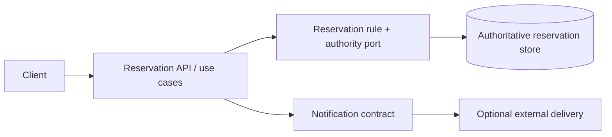
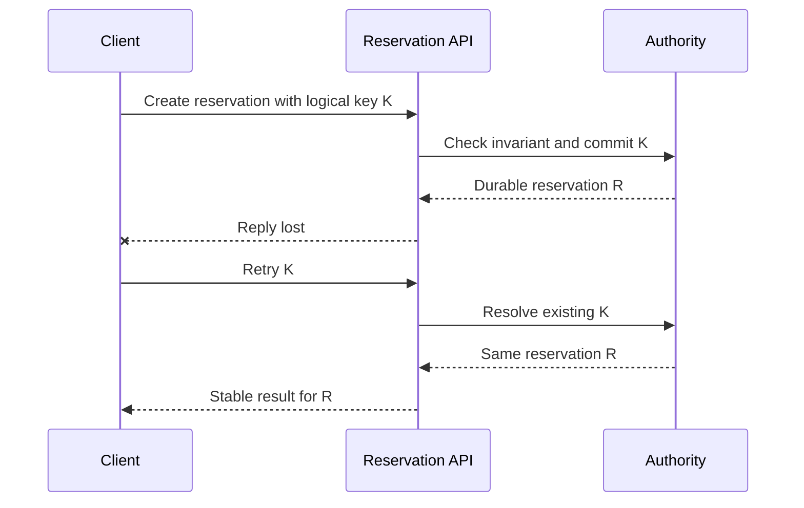

# Concerns and architectural views

**Owning question:** Which concern is answered by a context, building-block, runtime or deployment view?

This page belongs to [V01/C05 — Architecture descriptions and decision records](README.md). Use the integrated walkthrough for the surrounding decision; the sections below own this narrower mechanism and its limits.

<!-- tycho-question-source:tycho.page.b42e3ffc4a924b7089d261d0a3dc33b0:1 -->
## 1. Start with concerns and a coherent vocabulary

Before drawing, define:
- **System boundary:** what the selected software system owns, which people and neighbors interact with it.
- **Responsibility:** what functional result or rule belongs to each logical component.
- **Runtime identity:** process, executor, container or deployed artifact; not interchangeable with a business capability.
- **Data authority:** source of truth for a business object; not interchangeable with a cache.
- **Dependency:** an interface, network connection, transaction, event or runtime deployment relationship with a named meaning.
- **Version:** repository/diagram/contract revision, because an architecture depiction changes over time.
- **Evidence state:** observed source/runtime fact versus hypothesis or proposed target.

A diagram label is an assertion. If only a desired topology is known, call the drawing **proposed**, and never silently present it as the running implementation.

<!-- /tycho-question-source -->
<!-- tycho-question-source:tycho.page.b42e3ffc4a924b7089d261d0a3dc33b0:2 -->
## 2. The main views answer separate questions

| View | Reader's question | What it must contain | What it cannot prove |
|---|---|---|---|
| Context | Who uses and surrounds the system? | Actors, external partners, data/effect contracts, scope | Internal modules or runtime availability |
| Building blocks | Which responsibilities and dependency directions exist? | Modules, interfaces, owned state, black-box boundaries | Per-request causal order |
| Runtime | How does a user journey or fault unfold? | Messages, deadlines, state transitions, error branches | Physical placement and shared-failure zones |
| Deployment | Where do software artifacts execute? | Nodes, processes, zones, networks, quotas, storage | That the actual system passes a user SLO |
| Data/consistency | Who commits or derives each state? | Authority, schema, versions, read models, reconciliation | Availability of any specific deployment |
| Cross-cutting | How are authorization, monitoring and recovery applied? | Consistent policies and enforcement points | Operational effectiveness without testing |
| Decision record | Why this choice, given alternatives and constraints? | Context, criteria, chosen/rejected option, consequences, status | That a proposal was accepted merely by existing |

The [arc42 context/scope guidance](https://docs.arc42.org/section-3/) deliberately distinguishes business context and technical context. Do not place a framework class on a business context chart merely because an engineer knows its name.

<!-- /tycho-question-source -->
<!-- tycho-question-source:tycho.page.b42e3ffc4a924b7089d261d0a3dc33b0:3 -->
## 3. Fictional architecture example: community tool reservations

Imagine a simple equipment booking application. An external client requests a timeslot. A reservation component enforces exclusivity and writes the authoritative record. A notification component later sends optional confirmation. This is an invented design, not observed production software.

### Static responsibility view

Text alternative: client invokes a reservation API; one reservation rule/authority owns the committed state. Notification is a separate optional interaction. The diagram shows logical responsibilities, not the number of JVM processes or separate machines.

### Runtime scenario: acknowledgment loss

Text alternative: after a valid commit, the client may not receive the acknowledgment. If the architecture promises idempotent logical commands, a later retry must resolve the same durable identity, rather than creating an additional booking. This is a **required design and test**, not evidence a specific system behaves that way.

### Deployment view: two possible configurations

The same logical modules could run in one modular executable, or as independently deployed services with a remote communication and consistency boundary. A placement diagram would specify **which deployable executes each box**, the zones/data dependencies and how the authoritative store is reached. This scenario does not contain those facts, so inventing a specific multi-zone production diagram would be misleading. Read [deployment/runtime placement](../../v08/c03/runtime-placement-and-control-plane.md) for alternatives, not presumed infrastructure.

<!-- /tycho-question-source -->

## Navigation, prerequisites and source scope

| Route | Destination |
|---|---|
| Parent and source ledger | [Chapter introduction and exact source rows](README.md#chapter-source-ledger) |
| Previous / prerequisite | [Read preceding context](architecture-views-and-decision-records.md) |
| Next | [Continue the reasoning](identity-adrs.md) |
| Integrated question | [Original scenario and limits](architecture-views-and-decision-records.md) |

The source material keeps its original published/inferred/synthetic/unverified distinctions. Chapter-wide citations are shared reference context, not proof that every cited source supports every sentence on this page. Freshly inspected text is identified explicitly; absent dates and unknowns are retained.
