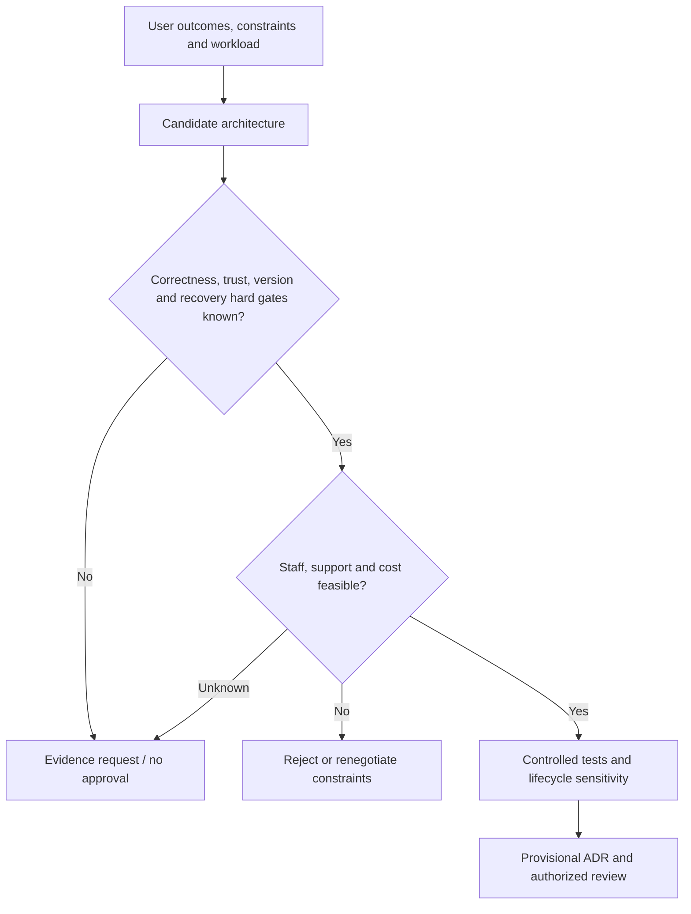

# Operating capability and readiness

**Owning question:** Which capacity, ownership and recovery constraints must be demonstrated before adoption?

This page belongs to [V01/C06 — Capacity, operational constraints and total cost](README.md). Use the integrated walkthrough for the surrounding decision; the sections below own this narrower mechanism and its limits.

<!-- tycho-question-source:tycho.page.76244dbe2bd44035b7154f821191f6f2:5 -->
## 5. Capacity is not just processing throughput

A candidate may deliver enough steady RPS and still violate:
- latency at the busiest minute;
- user-level correctness under retries or same-key contention;
- scale-up startup time during short bursts;
- storage rebuild/backup window as data grows;
- connection ceilings under many replicas;
- per-tenant fairness and authorization;
- available operator response time during partial failure.

**Synthetic counterexample:** a load test shows eight read workers pass the steady-rate target. A fictional peak lasts 20 seconds while a new worker requires 40 seconds to become useful. The steady result does not prove the design can meet its burst objective. [Autoscaling delay](../../v07/c06/autoscaling-lag-and-capacity-limits.md) and [overload policy](../../v07/c05/overload-admission-control-and-graceful-degradation.md) own the mechanics.

<!-- /tycho-question-source -->
<!-- tycho-question-source:tycho.page.76244dbe2bd44035b7154f821191f6f2:6 -->
## 6. Operational readiness belongs in architecture acceptance

Text alternative: an architecture must pass correctness and recovery gates, then staff/support/cost feasibility, before being chosen. Unknown critical evidence blocks unconditional approval. Tests and cost sensitivity inform a provisional record, not an automatic deployment.

An operational acceptance record should name actual owners, runbook/recovery evidence, access restrictions, version support, budget and revisit triggers. If the team has never restored the data under the required time target, the statement “we can restore” is an untested plan.

<!-- /tycho-question-source -->

## Navigation, prerequisites and source scope

| Route | Destination |
|---|---|
| Parent and source ledger | [Chapter introduction and exact source rows](README.md#chapter-source-ledger) |
| Previous / prerequisite | [Read preceding context](lifecycle-cost.md) |
| Next | [Continue the reasoning](README.md) |
| Integrated question | [Original scenario and limits](operational-constraints-and-total-cost-gates.md) |

The source material keeps its original published/inferred/synthetic/unverified distinctions. Chapter-wide citations are shared reference context, not proof that every cited source supports every sentence on this page. Freshly inspected text is identified explicitly; absent dates and unknowns are retained.
