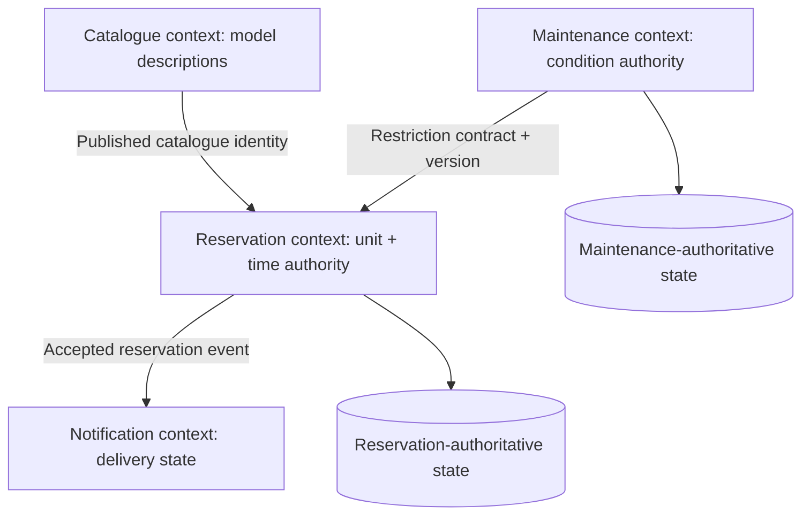

# Domain semantics and authoritative ownership

**Owning question:** When do shared names conceal different invariants and owners?

This page belongs to [V02/C02 — Domain boundaries, data ownership and contracts](README.md). Use the integrated walkthrough for the surrounding decision; the sections below own this narrower mechanism and its limits.

> **Pattern atlas:** [Domain-Driven Design / Bounded Context](../../v11-pattern-atlas/c01-application-boundaries/README.md#domain-driven-design-bounded-context) — decision conditions and contraindications.

<!-- tycho-question-source:tycho.page.4681b3ba9e234c46bdb4b5993634b0e3:1 -->
## 1. Model behaviors and invariants before drawing ownership boxes

**Original fictional example:** a community makerspace lends portable projectors. The catalogue describes a projector type and attributes; the reservation capability promises access to a particular physical unit in a time window; the maintenance capability may block damaged units. A user can read the catalogue even if no device is currently available.

| Context | Meaning of “item” | Authoritative responsibility | Relevant invariant |
|---|---|---|---|
| Catalogue | Published projector model/specification | Descriptions, searchability, display attributes | A public description must reference a valid catalogue identity |
| Reservation | Allocatable physical unit + interval | Exclusivity, acceptance, cancellation and expiry | No two overlapping accepted reservations for the same exclusive unit |
| Maintenance | Physical device condition and availability restriction | Inspection, out-of-service state, restoration | An unsafe device cannot be newly allocated |
| Notification | Message to a user | Delivery status and retries | A notification failure does not rewrite a committed reservation |

These meanings are **deliberate inventions**. A shared word "item" should not force a database schema shared by all four contexts. Nor must four contexts become four microservices: a modular application could implement them with explicit in-process interfaces and one deployable.

A boundary is weak if none of its business rules can be stated separately. It is overextended if unrelated decisions must share transactions simply because they live behind one URL.

<!-- /tycho-question-source -->
<!-- tycho-question-source:tycho.page.4681b3ba9e234c46bdb4b5993634b0e3:2 -->
## 2. Authority and storage are separate concerns

A single physical relational database can house several contexts; it must still define which module owns writes to each logical aggregate or table. Conversely, separate databases do not automatically prove exclusive authority if two services both independently update the same business object.

A state authority contract records:

- **Logical identity:** which key is stable, how versions/aliases map, and which keys may be reassigned.
- **Command ownership:** exactly which operation may create, mutate, cancel or delete authoritative state.
- **Validation boundary:** where consistency, authorization and required preconditions are checked atomically.
- **Concurrency control:** transaction, compare-and-set/version, serialized owner or a proven multi-writer coordination model.
- **Published read models:** who may cache/project state, allowed staleness and reconciliation.
- **Failure/recovery:** how retries identify the same logical operation; how a lost acknowledgment is resolved.
- **Version and retirement:** how new fields and retired contracts coexist with old consumers.

For the fictional makerspace, a maintenance "unsafe" signal may need to prevent *future* reservations immediately. That requires an explicit rule: reservation could synchronously check authoritative maintenance status inside a consistency boundary, or publish restrictions with a modeled freshness gap and a conservative deny-when-unknown rule. If the business requirement is strong, eventually consistent notification cannot be presented as equivalent to atomic exclusion.

**Text alternative:** catalogue identity is referenced by reservations without allowing catalogue to commit allocations. Maintenance owns restrictions, whose consistency with reservations requires an explicit contract. Reservation owns accepted allocations; notification derives message work and does not become an authority for reservation truth. The separate storage symbols depict ownership, not a required number of physical databases.

<!-- /tycho-question-source -->
<!-- tycho-question-source:tycho.page.4681b3ba9e234c46bdb4b5993634b0e3:3 -->
## 3. Context maps are semantic integration maps, not mandatory graphs

Two contexts can cooperate through a published language, a translation layer, or agreed upstream/downstream conventions. An explicit **context map** tells readers whose meaning is authoritative and how mappings are enforced. Such a map is a human-readable architecture artifact: it **does not imply building a curated knowledge graph** as product infrastructure.

For example, catalogue “product ID” and reservation “physical unit ID” cannot be safely substituted because one model can describe many physical units. The mapping may be one-to-many, time-scoped and incomplete. A contract must document these cases and reject impossible conversions.

| Boundary interaction | Mapping required | Failure/ambiguity to test |
|---|---|---|
| Catalogue → Reservation | Public model ID → eligible physical units | A model exists but no unit is eligible |
| Maintenance → Reservation | Restriction ID/version → allocatable unit | Restriction arrives after allocation was accepted |
| Reservation → Notification | Reservation ID + recipient consent + outcome version | Replayed acceptance causes duplicate message |
| Legacy client → New reservation API | Old field names and enum semantics → new command | Old “pending” maps to new “accepted” incorrectly |

A translation that cannot preserve a required semantic fact must reject or degrade **explicitly**. Treat “unknown” and “not found” as different outcomes where the domain requires it.

<!-- /tycho-question-source -->

## Navigation, prerequisites and source scope

| Route | Destination |
|---|---|
| Parent and source ledger | [Chapter introduction and exact source rows](README.md#chapter-source-ledger) |
| Previous / prerequisite | [Read preceding context](domain-boundaries-data-ownership-and-contracts.md) |
| Next | [Continue the reasoning](boundary-evolution.md) |
| Integrated question | [Original scenario and limits](domain-boundaries-data-ownership-and-contracts.md) |

The source material keeps its original published/inferred/synthetic/unverified distinctions. Chapter-wide citations are shared reference context, not proof that every cited source supports every sentence on this page. Freshly inspected text is identified explicitly; absent dates and unknowns are retained.
## Bounded pattern ownership notes

### Domain-Driven Design / Bounded Context

A bounded context is a boundary within which one model and its ubiquitous language stay
consistent. A shared word "item" should not force a database schema shared by all four contexts.
Each context owns its terms, invariants and release cadence.

A boundary is weak if none of its business rules can be stated separately. It is overextended if
unrelated decisions must share transactions simply because they live behind one URL. A boundary can
rot through shared tables, a common entity reused across contexts or a workflow that writes two
owners' state; detect those paths and assign one authority per invariant.

Nor must four contexts become four microservices: a modular application could implement them with
explicit in-process interfaces and one deployable. Choose deployment boundaries from ownership and
failure containment, not from the number of model names.
