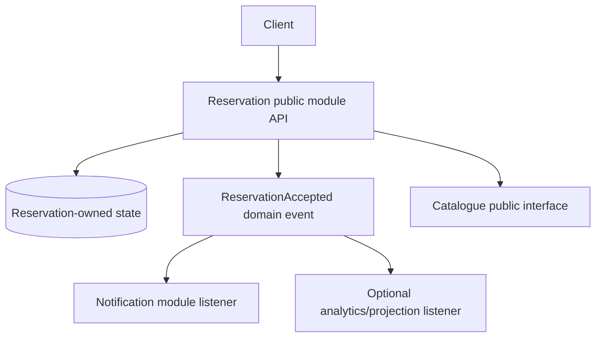

# Internal events and transaction timing

**Owning question:** What can happen between local commit, event handling and process death?

This page belongs to [V02/C03 — Modular monolith and internal events](README.md). Use the integrated walkthrough for the surrounding decision; the sections below own this narrower mechanism and its limits.

<!-- tycho-question-source:tycho.page.a06fd146f96b4b17a754f4d3b608ebdf:2 -->
## 2. Original synthetic example: community workshop reservation

Three modules inside a single application:
- **Catalogue** publishes equipment descriptions and approved configurations.
- **Reservation** owns exclusive allocation, cancellation and durable command identities.
- **Notification** owns opt-in messages; successful delivery must not determine whether a reservation was accepted.

**Text alternative:** the reservation module is the sole authority for accepted reservations. It may synchronously consult the catalogue when eligibility rules require it. After a durable state change it publishes a fact; notification and optional derived views consume the fact without gaining authority over reservation truth. All blocks can remain inside one executable.

The event's name should describe **past successful meaning**, not an intention (e.g. “ReserveSlot” would be a command). Include an event ID, aggregate identity, schema version and relevant source state version if required for replay/deduplication.

<!-- /tycho-question-source -->
<!-- tycho-question-source:tycho.page.a06fd146f96b4b17a754f4d3b608ebdf:3 -->
## 3. Internal events have multiple execution and durability contracts

| Event style | Execution boundary | Failure question | Appropriate use |
|---|---|---|---|
| Direct synchronous module call | Caller stack/transaction if configured | Can callee failure roll back caller? | Required immediate invariant/decision |
| In-process synchronous event | Same process; dispatch semantics framework-specific | Does listener exception fail publishing operation? | Small local observers when explicit coupling is accepted |
| Post-commit event listener | Triggered in relation to a successful transaction boundary | Is listener work durable or retried after a process crash? | Side effects that must not happen before commit, when loss policy is defined |
| Transactional publication registry | Durable record of interested listeners under implementation-specific conditions | Are incomplete/failed events resent; can duplicate handling occur? | Recoverable asynchronous module integration |
| External broker event | Process/network/broker boundaries | Delivery/redelivery, ordering scope and effect idempotency | Independently deployed consumers or real external contracts |

In Spring Framework, [transaction-bound event listeners](https://docs.spring.io/spring-framework/reference/7.1/data-access/transaction/event.html) support phases such as AFTER_COMMIT by default. This means listener timing can depend on commit success; it does **not** by itself prove an event will survive a crash between commit and listener processing.

Spring Modulith's [publication registry](https://docs.spring.io/spring-modulith/reference/events.html) documents listener-specific publication records and retry/resubmission mechanisms; check its actual version and storage implementation before using these guarantees. Event publication durability is **separate** from downstream external side-effect identity. A listener retried after partial external success can duplicate a notification unless the effect has its own deduplication/reconciliation semantics.

### Post-commit listeners are not a fresh durable transaction (Spring-specific caveat)

The [official Spring Framework `@TransactionalEventListener` JavaDoc](https://docs.spring.io/spring-framework/docs/6.0.7/javadoc-api/org/springframework/transaction/event/TransactionalEventListener.html) warns that, for `AFTER_COMMIT` (default), `AFTER_ROLLBACK` and `AFTER_COMPLETION`, the underlying transaction has **already completed** although bound resources can remain accessible. An unguarded database update triggered there may *appear to participate* in the original context but have **no later commit**. Do not design mandatory follow-up state mutation on the assumption that an `AFTER_COMMIT` listener automatically begins a new commit.

For an intentionally separate database write, use an explicitly configured **new transaction boundary** (e.g. a correctly invoked `PROPAGATION_REQUIRES_NEW` operation or transaction template, with the actual transaction manager and framework generation checked), and treat failure of that new transaction as a separate partial outcome. A fresh transaction is not equivalent to a durable event obligation: the process may still crash *before* it is entered or *after* the second commit but before acknowledgment. For mandatory effects, persist an outbox/publication intent atomically with the authoritative reservation and reconcile/redeliver using stable effect IDs.

**No-active-transaction trap:** according to that same JavaDoc, a transactional event listener normally does not process an event if no transaction is active, unless `fallbackExecution` is explicitly enabled. Turning on fallback changes when listeners may execute; it does **not** create a missing transaction or guarantee after-commit behavior for such publications. Reactive transaction context has its own event-source requirements and must not be inferred from a thread-local model.

**Proposed negative test, not executed:** publish an event inside, outside and immediately after a transaction; verify committed primary state, visibility of any follow-up write, an intentional new transaction, process death after commit and duplicate resubmission. The expected result under missing durable publication must be represented as potentially lost, rather than silently accepted.

<!-- /tycho-question-source -->
<!-- tycho-question-source:tycho.page.a06fd146f96b4b17a754f4d3b608ebdf:4 -->
## 4. Transaction boundary determines which outcome is correct

**Synthetic failure:** reservation state commits but the process crashes before an in-memory notification event reaches its listener.

If notification is optional, user booking truth can remain correct; however, the system must disclose whether notification may be lost. If the requirement says delivery must be attempted eventually, an in-memory-only event is insufficient. A transactional event registry or outbox-like persistence with retry handling may be appropriate. [Outbox and idempotency](../../../distributed/transactional-outbox-and-idempotency.md) owns the detailed commit-publication problem.

**Second failure:** a listener performs an external irreversible effect before the reservation transaction commits, but the transaction later aborts. The external effect may now describe a booking that never existed. Delay the effect until commit and use durable recovery when required; mere annotation-driven dispatch without a durable record is not a full recovery contract.

**Third failure:** duplicate delivery of an accepted event causes two messages or redundant projections. Consumers need stable event/effect identities and bounded retry/reconciliation. Deduplication should be scoped to actual business identity, not to one process lifetime.

<!-- /tycho-question-source -->

## Navigation, prerequisites and source scope

| Route | Destination |
|---|---|
| Parent and source ledger | [Chapter introduction and exact source rows](README.md#chapter-source-ledger) |
| Previous / prerequisite | [Read preceding context](module-enforcement.md) |
| Next | [Continue the reasoning](README.md) |
| Integrated question | [Original scenario and limits](modular-monolith-and-internal-events.md) |

The source material keeps its original published/inferred/synthetic/unverified distinctions. Chapter-wide citations are shared reference context, not proof that every cited source supports every sentence on this page. Freshly inspected text is identified explicitly; absent dates and unknowns are retained.
