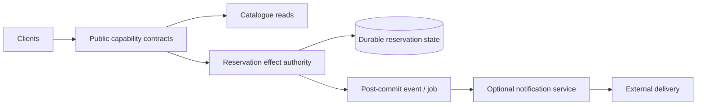

# Service contracts and failure evaluation

**Owning question:** What must be tested when a capability moves into another process?

This page belongs to [V02/C04 — SOA, microservices and distributed boundaries](README.md). Use the integrated walkthrough for the surrounding decision; the sections below own this narrower mechanism and its limits.

<!-- tycho-question-source:tycho.page.acb452608a8b42898aae7482c27f5f04:3 -->
## 3. Original fictional system: reservable equipment

An invented workspace offers a public catalogue, reservable devices, and optional notifications. One current application handles all three capabilities.

Options for a target:
- **A — one modular deployable** with separated interfaces and one transactional allocation authority.
- **B — extract only the notification capability**, whose delivery can fail without changing the committed reservation.
- **C — extract reservation as an independent service** with explicit remote transaction authority.
- **D — several services directly writing the same allocation tables** (usually a dangerous partial separation).

B may support different scaling/failure policies if notification load is a measured independent resource constraint, but a broker and separate process can also increase operating effort without changing user value. C requires moving or mediating writer authority with a validated transition. D does not eliminate shared-state coupling merely because process boundaries changed.

**Text alternative:** capability contracts distinguish catalogue read, reservation's authoritative state effect and optional notification delivery. The drawing is *one proposed allocation*, not a requirement that every box be its own process. Reservation must preserve exactly its admitted business invariants no matter what deployment style is used.

<!-- /tycho-question-source -->
<!-- tycho-question-source:tycho.page.acb452608a8b42898aae7482c27f5f04:5 -->
## 5. Service descriptions are more than interface schemas

The OASIS model characterizes services in terms of *visibility, interaction and effects*. A useful service contract must specify:
- who is eligible to invoke which effect, with trust and tenant context;
- identity and meaning of commands, state and errors;
- protocol and schema versions, supported lifecycle and deprecation;
- operation deadlines, idempotency scope and uncertain outcomes;
- consistency/freshness, published events and replay behavior;
- failure mode when the service is unreachable;
- who owns operation, data protection and consumer compatibility.

An OpenAPI document or protobuf schema can declare message formats. It does not by itself specify all domain semantics or guarantee that consumers tolerate a meaning-changing enum update.

<!-- /tycho-question-source -->
<!-- tycho-question-source:tycho.page.acb452608a8b42898aae7482c27f5f04:6 -->
## 6. Candidate evaluation under realistic requirements

| Evidence / requirement | Keep modular | Extract optional notifications | Extract reservation authority |
|---|---|---|---|
| Strong local allocation invariant | Favorable if transaction remains local | Unchanged if notifications are post-commit | Requires authoritative state transfer and race tests |
| Separate release cadence | Shared rollout | May improve one capability's release autonomy | Only if client/data versions independently supported |
| Fault isolation | One process may have shared failure modes | Optional dependency can be bulkheaded | Remote data owner adds availability dependency |
| Uneven load | Scale one executable or isolate internal worker pools | Independent notification workers may help | Must show reservation is separable bottleneck |
| Team/operational capacity | Fewer deployables | Adds one set of operational assets | Adds availability, auth, data and migration responsibility |
| Recovery | One state authority plus derived work | Replays/dedups notifications | Reconcile writer identity, in-flight effects and cutover |

No cell is a measured recommendation. A proven hard correctness violation disqualifies an option. If actual service autonomy or cost evidence is missing, **retain/measure first** is a defensible output.

### Opposing choices for one workload: why a new service may be the wrong optimization

**Original fictional baseline:** a workshop reservation domain is one module in a deployable application. Its database transaction enforces booking exclusivity. Releases are delayed because a small shared component needs coordinated testing; request throughput itself is within required bounds. A proposed microservice extraction claims to improve both team autonomy and scalability, but those are **two distinct hypotheses**.

| Choice | Candidate benefit | New ownership or failure obligation | Decision-reversing observation |
|---|---|---|---|
| Keep a modular monolith with enforced module APIs | Local transactional correctness and simpler operations | Build dependencies and deployment still shared | Module boundary cannot support independent release needs after targeted remediation |
| Extract stateless edge/API adapter while state stays local | Separate edge scaling or compatibility without relocating authority | Extra RPC and timeout budget, independently managed edge deployment | Increased p99/retries overwhelm modest gains |
| Extract booking state into an independent service | True autonomous booking deployment and capacity possible | Exclusive-writer transfer, cross-service effects, reconciliation, security and on-call | No measured coordination advantage or unsafe transition behavior |

**Failure trace:** the edge times out after the authoritative monolith commits booking R7. Retrying through the edge must preserve K42 and return the same outcome, rather than create another reservation. A service split moves the *transport* of this ambiguity; it does not solve it. If ownership moves to a separate datastore, the transition needs old/new client compatibility, fenced writes and restore gates.

The [OASIS SOA Reference Model](https://docs.oasis-open.org/soa-rm/v1.0/soa-rm.html) supports the description of services, visibility and real-world effects. The [Lewis/Fowler microservices article](https://www.martinfowler.com/articles/microservices.html) discusses independently deployable services and their operational characteristics. Neither is evidence that a particular organization needs microservices or that a split is safe.

**Proposed, not executed:** compare lead time for independently deployable changes, full business-operation p99, retries after faults, incident ownership and lifecycle operating cost. Retain the monolith unless a hard requirement or reproducible measured benefit outweighs the added remote failure/authority boundary. The [data ownership owner](../c02-domain-boundaries-data-ownership-and-contracts/domain-boundaries-data-ownership-and-contracts.md) defines domain integrity; this page owns the choice to cross a deployment boundary.

<!-- /tycho-question-source -->
<!-- tycho-question-source:tycho.page.acb452608a8b42898aae7482c27f5f04:7 -->
## 7. Test a distributed boundary before deciding

A bounded experiment should compare:
1. fixed logical workload, key skew and user-success denominator;
2. baseline versus candidate while including equivalent operating resource budgets;
3. old/new client and schema versions under staggered deployment;
4. kill/restart of optional and mandatory dependencies;
5. request timeout just after a durable commit and safe retry/reconciliation;
6. authorization across the new network boundary;
7. loss of one service zone or process and recovery of correctly accepted effects;
8. operational overhead, release coordination, and restore/reconciliation time.

**None of these tests has been performed.** A team could rationally choose a modular application if independent service benefits remain speculative.

<!-- /tycho-question-source -->

## Navigation, prerequisites and source scope

| Route | Destination |
|---|---|
| Parent and source ledger | [Chapter introduction and exact source rows](README.md#chapter-source-ledger) |
| Previous / prerequisite | [Read preceding context](service-independence.md) |
| Next | [Continue the reasoning](README.md) |
| Integrated question | [Original scenario and limits](service-orientation-microservices-and-distribution.md) |

The source material keeps its original published/inferred/synthetic/unverified distinctions. Chapter-wide citations are shared reference context, not proof that every cited source supports every sentence on this page. Freshly inspected text is identified explicitly; absent dates and unknowns are retained.
