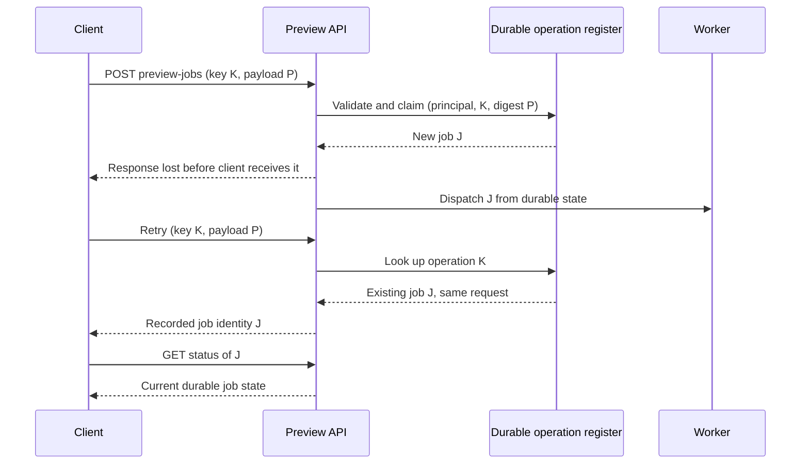

# API contracts and effect identity

**Owning question:** Which promises belong to transport semantics and which require application deduplication?

This page belongs to [V02/C05 — Public APIs, HTTP/RPC and compatibility](README.md). Use the integrated walkthrough for the surrounding decision; the sections below own this narrower mechanism and its limits.

<!-- tycho-question-source:tycho.page.cccbd188936543a2aaf904f4002236d8:1 -->
## 1. The contract has multiple layers

| Contract layer | The caller needs to know | Typical failure if omitted |
|---|---|---|
| Operation and effect | Read/query, command, creation, update, cancellation; what “success” commits | A timed-out creation is retried and duplicated |
| Identity and authorization | Principal, resource identity, object-level permissions, tenant/isolation boundary | Caller sees success for a resource it should not control |
| Schema | Required/optional fields, defaults, absent vs null, unknown fields, enum behavior | An older consumer misreads a new response |
| Transport and scheduling | Deadline, cancellation, retry budget, maximum message size, streaming | Caller times out while provider continues wasting resources |
| Failure envelope | Distinguishable validation, conflict, transient overload, unavailable, unknown outcome | Client retries a permanent violation or gives up on an applied command |
| Compatibility | Client/server versions coexisting, migration window, deprecation and recovery | A routine canary release breaks a still-active old client |

A code generator or OpenAPI document makes an interface machine-readable; neither proves business idempotency, authorization correctness, or successful mixed-version operation. OpenAPI Specification 3.2.1 describes HTTP API operations, parameters, payloads and responses. Its existence is a **contract artifact**, not measured conformance of runtime code.

<!-- /tycho-question-source -->
<!-- tycho-question-source:tycho.page.cccbd188936543a2aaf904f4002236d8:2 -->
## 2. HTTP method semantics are not business-effect deduplication

[RFC 9110, §9.2.1–9.2.2](https://www.rfc-editor.org/rfc/rfc9110.html#section-9.2.2) defines the semantics of safe and idempotent methods. A safe method is intended not to request a state-changing effect. Idempotency describes the intended server-side effect of repeating an identical request; it does not require the responses, timing or logging events to be identical. PUT, DELETE and safe methods are idempotent by their specified semantics. POST has no general automatic-retry guarantee.

Three distinct notions must not be merged:

1. **HTTP method contract:** Is the requested operation safe or idempotent according to its semantics?
2. **Application effect identity:** Does retrying the same logical command create a second resource, charge, export job or side effect?
3. **Outcome discovery:** If an acknowledgment disappears, can the caller obtain a durable record of the original result?

Even when a DELETE request is idempotent, the first response might report an existing resource removed and a later response that it is absent. A POST can be made application-idempotent when a stable operation identity and durable result are owned by the application, but HTTP alone does not supply that property.

The HTTP failure model should distinguish syntactic validation, resource conflicts, missing or stale versions, overload, provider unavailability and unknown command outcome. [RFC 9457, §3–§5](https://www.rfc-editor.org/rfc/rfc9457.html#section-3) specifies a machine-readable problem-detail format, but a producer must define its own problem types, safe information disclosure, and client behaviors. A generic HTTP status alone may not tell the client whether its requested business change committed.

### Original synthetic command: build a preview

A fictional document-preview service accepts `POST /preview-jobs` to create work that may outlive a single HTTP exchange. Clients send a unique operation key scoped to the principal and normalized request arguments. The service validates identity and authorization, atomically claims that key, and records a stable job identity and state before acknowledging. Repeated requests with the **same key and same arguments** return or point to the recorded job outcome; reusing the key with materially different arguments is rejected as a conflict. A status-read operation permits reconciliation after a lost response.

**Text alternative:** a response can be lost after the server records a new operation. A repeat with the same scoped key resolves to that operation rather than creating another job, and a separate status read reveals the durable outcome.

This is a **proposed design**, not behavior guaranteed by HTTP or an experiment that was run. Important implementation decisions remain: retention of operation keys, request canonicalization, concurrent-first-request race protection, transactionally durable dispatch or outbox, and what happens after key expiration. A naive in-memory map fails after restart and can report false deduplication success.

| Synthetic crash window | Possible state | Safe recovery condition |
|---|---|---|
| Before operation key persisted | No accepted durable job | Retry may legitimately create first job |
| After durable record, before response arrives | Job exists; caller uncertain | Retry must resolve same identity, not recreate |
| After record, before work is queued | Job registered but not dispatched | Durable state/outbox enables re-dispatch without losing job |
| During worker effect before completion recorded | External effect may already exist | Worker requires a separate effect idempotency/reconciliation contract |
| After key-retention horizon | Deduplication memory may be gone | Define a bounded retry window and an outcome-lookup/expiry policy |

Read the [transactional outbox chapter](../../../distributed/transactional-outbox-and-idempotency.md) for the commit/publication boundary; a deduplicating ingress does not automatically make all downstream effects exactly-once.

<!-- /tycho-question-source -->

## Navigation, prerequisites and source scope

| Route | Destination |
|---|---|
| Parent and source ledger | [Chapter introduction and exact source rows](README.md#chapter-source-ledger) |
| Previous / prerequisite | [Read preceding context](http-rpc-contracts-and-compatibility.md) |
| Next | [Continue the reasoning](deadlines-retries.md) |
| Integrated question | [Original scenario and limits](http-rpc-contracts-and-compatibility.md) |

The source material keeps its original published/inferred/synthetic/unverified distinctions. Chapter-wide citations are shared reference context, not proof that every cited source supports every sentence on this page. Freshly inspected text is identified explicitly; absent dates and unknowns are retained.
