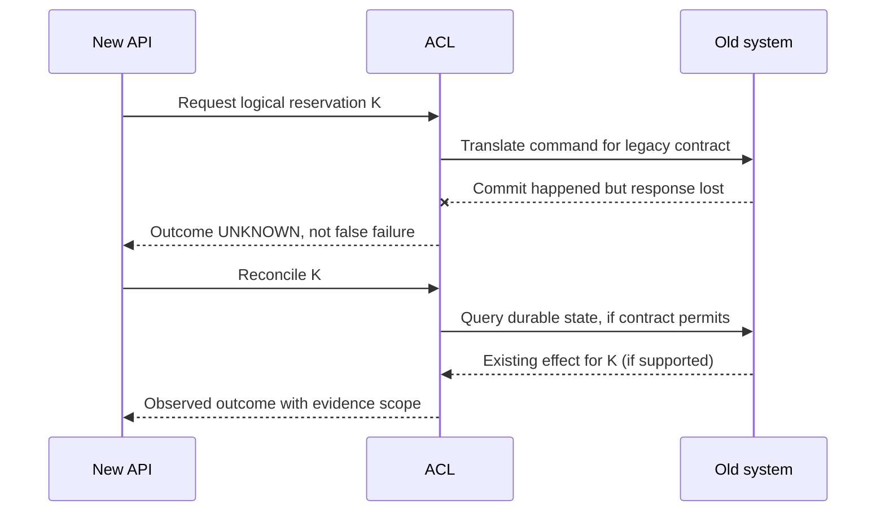

# Coexistence, unknown outcomes and adapter retirement

**Owning question:** How is a lost acknowledgment reconciled before old contracts are retired?

This page belongs to [V02/C06 — Integration adapters and anti-corruption boundaries](README.md). Use the integrated walkthrough for the surrounding decision; the sections below own this narrower mechanism and its limits.

<!-- tycho-question-source:tycho.page.31c8e450f78c451d90cb6090df330c5a:3 -->
## 3. Synchronous and asynchronous mediation are different choices

A synchronous ACL may be an in-process module or an independent proxy. A request traverses the foreign dependency's latency, availability, transport and authorization boundaries. Its failure can directly delay the caller.

An asynchronous ACL may subscribe to events or consume change-data capture and create a local projection. This reduces direct latency coupling but introduces freshness lag, replay/ordering, duplicate processing and divergent model state. It is inappropriate where the user promise requires authoritative immediate consistency that the projection cannot provide.

| Topology | Can help | Requires explicit proof |
|---|---|---|
| In-process synchronous adapter | Few extra deployments, straightforward local instrumentation | Isolation from untrusted payloads, timeout and circuit behavior |
| Standalone synchronous mediator | Shared translation needs and independent lifecycle | Additional hop, deployment failure, consistent auth enforcement |
| Event-driven translation/projector | High read demand and tolerable stale data | Replay, event identity, ordering scope, lag observability |
| One-time batch migration translator | Finite data movement with snapshot | Cutover completeness, referential integrity and no later old writes |
| Temporary bidirectional adapter | Long coexistence of client semantics | Ownership conflict avoidance and no unguarded dual writer |

An ACL does not solve a distributed transaction. If both old and new systems accept independent writes, a translator alone cannot make those writes atomic. The transition may require a single authoritative writer, controlled command routing, reconciliation and explicit no-return gates. [Outbox and idempotency](../../../distributed/transactional-outbox-and-idempotency.md) covers publication and duplicate boundaries; [schema evolution](../../../delivery/progressive-delivery-and-schema-evolution.md) covers staged client/data migration.

<!-- /tycho-question-source -->
<!-- tycho-question-source:tycho.page.31c8e450f78c451d90cb6090df330c5a:4 -->
## 4. The critical lost-acknowledgment problem

**Original proposed failure:** the new booking API asks the legacy inventory to reserve an item. The old system commits, but its response times out. If the adapter converts timeout to “failed, safe to retry,” a second request may allocate again or trigger another notification.

Correct adapter behavior depends on the foreign protocol:
- If a scoped idempotency identity exists, repeat with the same identity and reconcile to the durable original outcome.
- If only a status read exists, query it using a stable business identity and handle uncertain/inconsistent results explicitly.
- If the foreign system provides neither, the adapter cannot honestly guarantee that blind retries are safe. Surface **unknown outcome**, use bounded manual/automated reconciliation subject to business policy, or redesign the contract before accepting effects.

**Text alternative:** after a legacy commit, an acknowledgment can be lost. The translator preserves an unknown outcome and only reconciles through a verifiable legacy contract. This diagram is a proposed design, **not** a guarantee that such a query exists in a real interface.

<!-- /tycho-question-source -->
<!-- tycho-question-source:tycho.page.31c8e450f78c451d90cb6090df330c5a:5 -->
## 5. Change and eventual retirement are part of the pattern

If migration is staged, an ACL can remain for a finite coexistence window, then be removed when old dependencies and clients are gone. Alternatively it may become a stable permanent interface to an uncontrollable partner. The choice affects test ownership, observability, contract deprecation and support costs.

A migration protocol should define:
1. Existing identity/status mappings and semantic invariants at a versioned source snapshot.
2. All callers and consumers requiring old fields, errors or ordering.
3. Positive and negative fixture tests, including absent/invalid/old values.
4. Shadow comparisons where permitted, without treating shadow outcomes as authoritative writes.
5. One-writer authority during each transition step; prohibition or explicit coordination of overlapping writes.
6. Fault-injected timeouts, retried commands and lost acknowledgments.
7. Visibility into translation failures, poison events, backlog and reconciliation.
8. A staged cutover gate and removal criterion for foreign semantics.
9. Revert/forward-repair conditions for persisted data that old code cannot interpret.

The independently public [Strangler Fig pattern](https://learn.microsoft.com/en-us/azure/architecture/patterns/strangler-fig) describes gradual replacement of capabilities, with explicit coexistence cost. It does not prove that every small or inaccessible system can be migrated by request interception.

<!-- /tycho-question-source -->
<!-- tycho-question-source:tycho.page.31c8e450f78c451d90cb6090df330c5a:6 -->
## 6. Security, correctness and performance trade-offs

An ACL crosses different trust levels and may process untrusted or malformed data. Validate IDs, payload sizes, encoding, numeric ranges and authorization at the actual effect boundary. Do not proxy arbitrary paths or credentials to a foreign system. Bound concurrency and caches, distinguish transient from permanent failures, and avoid presenting stale derived state as authoritative.

Extra translation can incur measurable CPU, serialization and network latency; a remote ACL can become a bottleneck or shared failure domain. An asynchronous projection may relieve caller latency at the cost of freshness and replay. There is no universal reason to introduce a separate deployment when an internal adapter can safely preserve the required semantics.

**Negative experiment:** supply a payload whose old status has no new equivalent, lose the old command response after commit, replay the same event twice and simulate conflicting owner changes. The correct result is either a validated translated effect or explicit inability to guarantee it—not silent success. No such tests were run for this chapter.

<!-- /tycho-question-source -->

## Navigation, prerequisites and source scope

| Route | Destination |
|---|---|
| Parent and source ledger | [Chapter introduction and exact source rows](README.md#chapter-source-ledger) |
| Previous / prerequisite | [Read preceding context](semantic-translation.md) |
| Next | [Continue the reasoning](README.md) |
| Integrated question | [Original scenario and limits](anti-corruption-adapters-and-coexistence.md) |

The source material keeps its original published/inferred/synthetic/unverified distinctions. Chapter-wide citations are shared reference context, not proof that every cited source supports every sentence on this page. Freshly inspected text is identified explicitly; absent dates and unknowns are retained.
