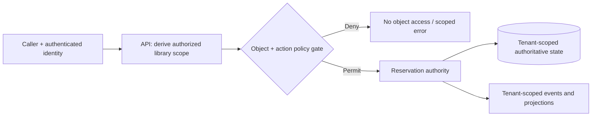

# Isolation dimensions and placement

**Owning question:** How do domain, tenant, authorization and runtime isolation differ?

This page belongs to [V02/C07 — Authorization boundaries and multitenancy](README.md). Use the integrated walkthrough for the surrounding decision; the sections below own this narrower mechanism and its limits.

<!-- tycho-question-source:tycho.page.31cda61d174248eaa326559d256ce352:1 -->
## 1. Separate four isolation dimensions

| Axis | Requirement to establish | A dangerous assumption |
|---|---|---|
| Identity/authorization | Principal, tenant membership, object ownership, permitted effect | Authenticated automatically means entitled to all objects |
| Data isolation | Which records and indexes may be read, written, exported or restored together | Every query remembers a WHERE tenant_id filter |
| Resource isolation | Which compute, connection, queue, cache and quota capacity may be shared | One tenant's workload cannot delay another's |
| Lifecycle/operations | Who upgrades, backs up, deletes, rekeys and restores a tenant's state | A shared restore can safely rewind one tenant alone |

The [OWASP Authorization Cheat Sheet](https://cheatsheetseries.owasp.org/cheatsheets/Authorization_Cheat_Sheet.html) documents least privilege and deny-by-default. The [OWASP Authorization Patterns guide](https://cheatsheetseries.owasp.org/cheatsheets/Authorization_Patterns_Cheat_Sheet.html) explains that a policy enforcement point must protect the actual resource/action. Applying one filter at a gateway is insufficient when direct job consumers, background work or exported projections can reach the same state.

<!-- /tycho-question-source -->
<!-- tycho-question-source:tycho.page.31cda61d174248eaa326559d256ce352:2 -->
## 2. Fictional example: community equipment libraries

Imagine one software platform serving several independent neighborhood equipment libraries. A member belongs to a library and reserves one of its physical items. Each library controls its inventory, operating rules and reservation records.

Synthetic domain identities:
- **LibraryId** denotes the tenant context for the invented example.
- **MemberId** may exist in several libraries, but membership/role differs by library.
- **ItemId** may be unique only *within* a library, not globally.
- **ReservationId** identifies a booking with its library and authorizing principal.

Correctness invariant: a caller may read or change a reservation only with a policy decision for its **actual library and specific object**, and a slot cannot be double-allocated within the authoritative reservation state owner.

**Text alternative:** the authenticated caller is checked for permissions on a named object and library; only allowed operations reach the reservation authority, which maintains tenant-scoped state and emits scoped events. The diagram is conceptual and **not** a proof that the actual policy and storage architecture enforce it.

For example, reading a public item description may be permitted across libraries while cancelling a reservation requires tenant-specific membership and object ownership. Do not infer one permission from the other.

<!-- /tycho-question-source -->
<!-- tycho-question-source:tycho.page.31cda61d174248eaa326559d256ce352:3 -->
## 3. Common storage and placement designs

| Deployment/data model | Potential advantage | Isolation and operational cost |
|---|---|---|
| Shared application + shared tables, tenant key | Efficient resource reuse and simpler global deployment | Every query/join/index/cache/background job needs enforced tenant scope; shared quotas and noisy neighbors |
| Shared application + schema/database per tenant | Easier isolation, restore or migration at data boundary in some engines | Schema/version fan-out, connection pools, orchestration and mapping complexity |
| Dedicated application/runtime and datastore | Stronger physical/resource failure isolation | High per-tenant operating cost, upgrades and observability fragmentation |
| Hybrid by risk/workload | Different tenants receive bounded isolation appropriate to constraints | Routing, placement rules, movement and exceptions become complex |

The [Microsoft multitenancy tenancy-models guide](https://learn.microsoft.com/en-us/azure/architecture/guide/multitenant/considerations/tenancy-models) distinguishes shared versus isolated components as a spectrum, not a universal tier ranking. A model should be chosen against mandatory authorization, data residency, performance, restore and total operating cost requirements rather than aesthetic preference.

<!-- /tycho-question-source -->

## Navigation, prerequisites and source scope

| Route | Destination |
|---|---|
| Parent and source ledger | [Chapter introduction and exact source rows](README.md#chapter-source-ledger) |
| Previous / prerequisite | [Read preceding context](authorization-boundaries-and-multitenancy.md) |
| Next | [Continue the reasoning](tenant-effects.md) |
| Integrated question | [Original scenario and limits](authorization-boundaries-and-multitenancy.md) |

The source material keeps its original published/inferred/synthetic/unverified distinctions. Chapter-wide citations are shared reference context, not proof that every cited source supports every sentence on this page. Freshly inspected text is identified explicitly; absent dates and unknowns are retained.
