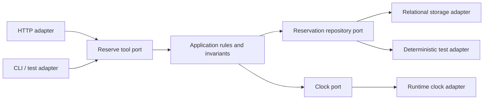

# Dependency direction and application ports

**Owning question:** What does a port isolate and which runtime failure boundary remains?

This page belongs to [V02/C01 — Layered, modular and ports-and-adapters design](README.md). Use the integrated walkthrough for the surrounding decision; the sections below own this narrower mechanism and its limits.

<!-- tycho-question-source:tycho.page.77b512c4e2e946bd92d70b4a714600c8:1 -->
## 1. Layered design states a dependency policy

A conventional layered application might have interface, application orchestration, domain rules and data-access layers. It works if the code controls dependency directions and avoids bypassing required rules. Simply placing files in similarly named directories does not establish architectural layering.

| Concept | What should be stable | Example violation |
|---|---|---|
| User interface boundary | Input/output and interaction details | UI class directly updates an authoritative table |
| Application/use-case layer | Sequencing, authorization hand-off and transaction scope | Business invariant scattered across controller branches |
| Domain model | State transitions, invariants and business language | Rule depends on HTTP request or a specific ORM record shape |
| Technology adapters | Protocol, DB, broker and device details | Domain code imports vendor drivers and creates connections itself |
| Shared cross-cutting policy | Trace, security, lifecycle and failure requirements | One layer silently skips the central authorization rule |

Layers may be strict, or some dependencies may legitimately bypass intermediate layers. That is a design decision requiring explicit documentation, not a universal principle. A system can use a dependency inversion rule so that interfaces required by the domain are *declared inside the application* while adapter implementations live outside it.

<!-- /tycho-question-source -->
<!-- tycho-question-source:tycho.page.77b512c4e2e946bd92d70b4a714600c8:2 -->
## 2. A port is an application contract, not automatically a network port

A **driving port** describes a use case that a client or test invokes. A **driven port** describes a capability the application requires from external resources (storage, clock, delivery gateway). Adapters translate between these stable application contracts and details of HTTP, CLI, SQL, queues or other technologies.

**Text alternative:** distinct clients use one application port. The core defines its required repository and clock contracts. Storage and clock adapters implement the contracts; the application rules do not depend on the SQL or command-line technology. This depicts logical source dependencies, not automatically separate processes.

The geometric term *hexagon* is not a requirement to have exactly six sides or six ports. A port also need not be a REST endpoint: an in-process interface can express the actual invariant boundary more directly.

<!-- /tycho-question-source -->
<!-- tycho-question-source:tycho.page.77b512c4e2e946bd92d70b4a714600c8:4 -->
## 4. Choose the correct core boundary

An application core must still choose between:
- **pure domain rules** (e.g., interval overlap predicate) that can be evaluated deterministically;
- **application orchestration** (identity/authorization, repository lookup, command sequence);
- **transactional authority** (atomic read-check-write or equivalent conditional state change);
- **external interaction** (notification, storage, payments, queues, which can fail independently).

Ports do not make a multi-resource transaction atomic. If a database commit succeeds but an external message is lost, the core needs a durable event/publication strategy where the contract requires it; adding an interface merely hides the transport. The [outbox/workflow chapter](../../v04/c05/outbox-inbox-sagas-and-durable-workflows.md) owns that coordination, and [retry identity](../../v04/c04/retries-idempotency-and-ambiguous-effects.md) owns the lost acknowledgment question.

A useful design explicitly states which operations can occur synchronously in one transaction and which need asynchronous effect reconciliation. When a business rule requires strong consistency, a port may still be backed by one authoritative transactional resource.

<!-- /tycho-question-source -->

## Navigation, prerequisites and source scope

| Route | Destination |
|---|---|
| Parent and source ledger | [Chapter introduction and exact source rows](README.md#chapter-source-ledger) |
| Previous / prerequisite | [Read preceding context](layered-hexagonal-ports-and-adapters.md) |
| Next | [Continue the reasoning](adapter-scenarios.md) |
| Integrated question | [Original scenario and limits](layered-hexagonal-ports-and-adapters.md) |

The source material keeps its original published/inferred/synthetic/unverified distinctions. Chapter-wide citations are shared reference context, not proof that every cited source supports every sentence on this page. Freshly inspected text is identified explicitly; absent dates and unknowns are retained.
