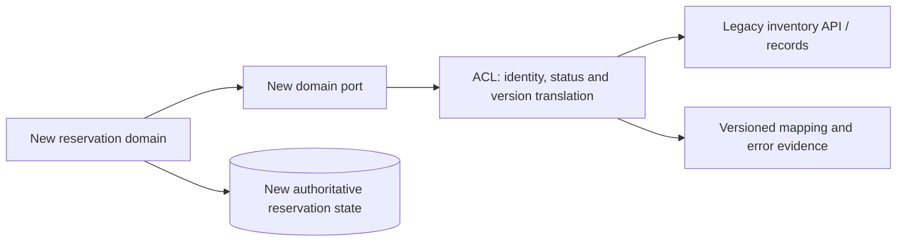

# Semantic translation and rejected values

**Owning question:** Which meaning must an adapter preserve and which input must it refuse?

This page belongs to [V02/C06 — Integration adapters and anti-corruption boundaries](README.md). Use the integrated walkthrough for the surrounding decision; the sections below own this narrower mechanism and its limits.

<!-- tycho-question-source:tycho.page.31c8e450f78c451d90cb6090df330c5a:1 -->
## 1. An adapter has a semantic contract, not just a schema mapping

| Adapter responsibility | Safe question | Unsafe shortcut |
|---|---|---|
| Identity mapping | Is one new entity equal to one old ID, many old IDs, or only a time-scoped mapping? | Copy a numeric ID and assume global uniqueness |
| Status interpretation | Do states imply committed, pending, failed or unknown effect? | Rename old “queued” to new “completed” |
| Validation and access | Which domain rules and authorization checks are authoritative? | Trust a foreign upstream “validated” flag |
| Temporal behavior | Can old state lag, arrive out of order or be overwritten by retries? | Treat message order as transaction order |
| Value semantics | Can amount, timestamp, unit or locale be converted losslessly? | Round or default without a recorded business decision |
| Error translation | Is this a permanent rejection, temporary unavailability or unknown outcome? | Map every timeout to “not found” |
| Version support | Which old/new combinations are required during transition? | Assume release of new code retires all old clients |
| Recovery | What can be replayed, reconciled, rolled back or forward-repaired? | Assume retry is always safe |

An adapter should either preserve a required invariant or explicitly mark a conversion *partial/unsupported*. Unknown is not success. Input validation and service authorization must remain at enforceable business boundaries.

<!-- /tycho-question-source -->
<!-- tycho-question-source:tycho.page.31c8e450f78c451d90cb6090df330c5a:2 -->
## 2. Original synthetic case: an equipment catalogue migration

A fictional community equipment catalogue is being rewritten while clients still query a legacy inventory feed.

In the invented legacy feed, a row can have a product-level identity, display status “open”, a last-refresh timestamp and several inventory locations. The new domain distinguishes a physical item's *allocatable identity*, inspection restrictions and committed reservation. A simplistic one-to-one row mapping confuses product visibility with physical-unit availability.

**Text alternative:** the new domain calls its own port, not a foreign inventory DTO. The adapter queries a legacy interface, translates identity and state, and records unresolved mapping or version errors. New reservation state remains under its own authority. The diagram does not assert the old inventory service is safe, fast or permanently required.

Define one explicit contract: **an item may be allocated only if the authoritative eligibility rule is satisfied**. If the legacy feed cannot distinguish a physical item from a model type, no exact mapping is possible without a new source or additional confirmation. An adapter must not manufacture eligibility from an ambiguous “open” flag.

<!-- /tycho-question-source -->

## Navigation, prerequisites and source scope

| Route | Destination |
|---|---|
| Parent and source ledger | [Chapter introduction and exact source rows](README.md#chapter-source-ledger) |
| Previous / prerequisite | [Read preceding context](anti-corruption-adapters-and-coexistence.md) |
| Next | [Continue the reasoning](coexistence-retirement.md) |
| Integrated question | [Original scenario and limits](anti-corruption-adapters-and-coexistence.md) |

The source material keeps its original published/inferred/synthetic/unverified distinctions. Chapter-wide citations are shared reference context, not proof that every cited source supports every sentence on this page. Freshly inspected text is identified explicitly; absent dates and unknowns are retained.
