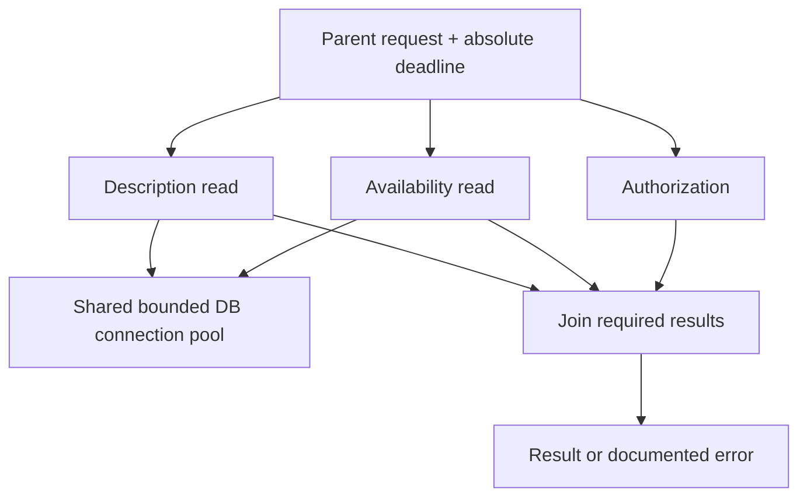

# Task ownership, lifetimes and cancellation

**Owning question:** Who owns concurrent work and what happens when its parent leaves?

This page belongs to [V03/C01 — Threads, tasks and coordination](README.md). Use the integrated walkthrough for the surrounding decision; the sections below own this narrower mechanism and its limits.

<!-- tycho-question-source:tycho.page.4e075e4ebc644f0e9b92c05294f62ca4:1 -->
## 1. Four distinct concurrency boundaries

| Boundary | Question | Typical limitation |
|---|---|---|
| Business operation | What is one durable user intent, across retries? | Duplicate/unknown outcomes |
| Logical task | Which subcomputations belong to one parent? | Cancellation, failure joins and cleanup |
| Execution thread | What runs and blocks on a platform or virtual thread? | CPU and scheduler resources |
| Scarce dependency | Which pool, lock, quota or remote backend is used? | Throughput and correctness regardless of thread count |

An accepted task may still sit in a queue after its user-visible deadline. A task can remain running after the caller disconnects. Durably accepted background work should be represented as an independently tracked job with a stable ID—not hidden in an unbounded in-process queue.

<!-- /tycho-question-source -->
<!-- tycho-question-source:tycho.page.4e075e4ebc644f0e9b92c05294f62ca4:2 -->
## 2. ExecutorService and cooperative cancellation

The [Java SE 25 ExecutorService API](https://docs.oracle.com/en/java/javase/25/docs/api/java.base/java/util/concurrent/ExecutorService.html) defines task submission, futures, shutdown and best-effort cancellation. Its shutdownNow operation attempts to stop active tasks, but code that does not cooperate with interruption may continue to execute. A Future can expose completion and cancellation; neither says that an external effect was reversed.

The intended task contract should name:
- parent logical operation ID and total deadline;
- input validation and authorization state;
- which child results must join before responding;
- response, error and cancellation propagation;
- timeout/abort behavior and connection/lock release;
- whether effects are reversible, committed or require reconciliation;
- maximum queue/concurrency budget per dependency.

Text alternative: a caller owns three bounded child tasks. Two share a scarce DB connection pool. They must meet the parent's result semantics or terminate cooperatively; timing out cannot reverse committed state.

<!-- /tycho-question-source -->
<!-- tycho-question-source:tycho.page.4e075e4ebc644f0e9b92c05294f62ca4:3 -->
## 3. Structured concurrency is a task-lifetime mechanism

The [Java 25 StructuredTaskScope documentation](https://docs.oracle.com/en/java/javase/25/docs/api/java.base/java/util/concurrent/StructuredTaskScope.html) describes lexical scopes, fork/join and cancellation policies. It is a **preview feature** that requires enabling preview support and may change in future releases.

Structured execution can make it clearer that child tasks do not silently outlive their parent. It does not make remote writes atomic or remove database/pool limits. If child A commits an external effect and child B then fails, cancelling A cannot undo the completed effect. That needs a business-level saga or recovery contract.

<!-- /tycho-question-source -->

## Navigation, prerequisites and source scope

| Route | Destination |
|---|---|
| Parent and source ledger | [Chapter introduction and exact source rows](README.md#chapter-source-ledger) |
| Previous / prerequisite | [Read preceding context](threads-tasks-structured-coordination.md) |
| Next | [Continue the reasoning](shared-state-effects.md) |
| Integrated question | [Original scenario and limits](threads-tasks-structured-coordination.md) |

The source material keeps its original published/inferred/synthetic/unverified distinctions. Chapter-wide citations are shared reference context, not proof that every cited source supports every sentence on this page. Freshly inspected text is identified explicitly; absent dates and unknowns are retained.
