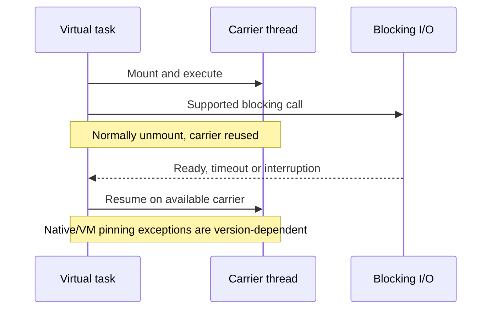

# Virtual threads and release-specific pinning

**Owning question:** What changes with virtual threads and which downstream limits stay finite?

This page belongs to [V03/C02 — Java execution and virtual threads](README.md). Use the integrated walkthrough for the surrounding decision; the sections below own this narrower mechanism and its limits.

<!-- tycho-question-source:tycho.page.02238832b395417bae63939cd96b9134:2 -->
## Virtual threads: tasks are cheap; operations are not

JDK 21 introduced `Thread.ofVirtual()` and `Executors.newVirtualThreadPerTaskExecutor()`. Each accepted request can keep a readable sequential call stack. A virtual thread blocked on supported I/O normally unmounts, but it can still retain heap state, locks and a leased DB connection. The carrier scheduler is not a backpressure mechanism. [E01]

```java
// Illustrative Java 21+ policy fragment, NOT a complete server.
// Gate only the database operation; a separate admission limit bounds pending tasks.
Semaphore dbPermits = new Semaphore(12);
try (var executor = Executors.newVirtualThreadPerTaskExecutor()) {
    for (Request request : admittedRequests) {
        executor.submit(() -> {
            if (!dbPermits.tryAcquire(request.remainingMillis(),
                    TimeUnit.MILLISECONDS)) {
                throw new CapacityRejectedException();
            }
            try {
                return queryWithDeadline(request);
            } finally {
                dbPermits.release();
            }
        });
    }
}
```

This fragment deliberately omits definitions, exception mapping, interruption handling, and partial-commit recovery. **Important:** a semaphore inside unlimited submissions bounds DB calls but not the number of virtual threads waiting for permits. Use admission before task creation when pending work and memory must also be bounded. A virtual-thread executor's lifecycle must be tied to shutdown and deadline policies.

<!-- /tycho-question-source -->
<!-- tycho-question-source:tycho.page.02238832b395417bae63939cd96b9134:3 -->
## Pinning depends on the JDK release

**JDK 21–23:** JEP 444 documents carrier pinning when a virtual thread blocks inside a `synchronized` region or native/foreign method. Long, frequent pinned waits can exhaust carriers. It describes `jdk.VirtualThreadPinned` JFR events and the historical `jdk.tracePinnedThreads` diagnostic. In-memory short monitor sections do not by themselves require replacement. [E01]

**JDK 24+:** JEP 491's OpenJDK implementation review describes monitor changes allowing virtual threads to unmount while holding a monitor, waiting to enter a monitor, and using `Object.wait()`. That specifically supersedes the blanket JDK 21 warning about blocking under `synchronized`. Native/foreign and exceptional VM paths still require diagnosis. The implementation discussion qualifies legacy locking mode; verify the exact JDK build and flags. The canonical [JEP 491](https://openjdk.org/jeps/491) text was not fully accessible in this research environment; the claim is based on the [primary OpenJDK review](https://mail.openjdk.org/pipermail/core-libs-dev/2024-November/134177.html) and [JDK 24 targeting announcement](https://inside.java/2024/11/15/jep491-target-jdk24/), not a purported full read of JEP 491. [E02, E03]


Text alternative: a virtual task temporarily uses a carrier. Supported blocking I/O normally frees the carrier until completion. JDK 21 monitor pinning differs from JDK 24 behavior; the diagram does not promise unmounting for every native library.


### Worked counterexample: fixing monitor pinning cannot fix a DB bottleneck

[JEP 444](https://openjdk.org/jeps/444) describes JDK 21 virtual threads and warns against pooling them like scarce platform workers. [JEP 491](https://openjdk.org/jeps/491) addresses carrier pinning due to synchronized monitors in JDK 24; it does **not** guarantee that native/foreign calls always release carriers, eliminate lock contention or increase downstream capacity. The [Netflix JDK 21 case](../../../cases/netflix-java21-virtual-thread-pinning.md) is an historical failure tied to its instrumentation and JDK vintage.

**Original synthetic scenario:** 1,000 accepted virtual tasks contend for twelve database connections. A driver holds one while an unrelated remote call waits; a monitor protects an in-memory counter. Moving to a JDK with changed monitor-pinning behavior could reduce one scheduler hazard, but cannot expand the twelve-connection resource, undo a previously committed request or make the counter authoritative across replicas.

| Possible observed result | Plausible boundary | Discriminating observation |
|---|---|---|
| Fewer carrier stalls, same DB wait | Monitor pinning improved but connections remain scarce | Pool acquisition time and active leases |
| More accepted requests, heap growth | Unbounded pending task admission | Live task count, heap and rejection rate |
| Saturated CPU with little blocking | Task threads cannot add CPU throughput | CPU profile at equal offered work |
| Lost response after durable write | Cancellation is not rollback | Stable logical key and durable result lookup |

A **proposed, unexecuted comparison** would pin JVM/driver versions and flags, offered demand, downstream quotas and workload skew while comparing platform workers, virtual threads with bounded admission, and nonblocking execution. Report correct completions, p99, connection waits, heap and ambiguous effects. For bounded CPU work a conventional pool may remain preferable; for many independent I/O waits virtual threads can improve programming simplicity; for existing end-to-end reactive protocols nonblocking flow control may suit the contract. See [task lifecycle](../c01-threads-tasks-and-coordination/threads-tasks-structured-coordination.md) and [connection budgets](../c05-thread-connection-and-buffer-pools/connection-pools-hikaricp-pgbouncer.md) for separate ownership.


### Canonical-release cross-check — JDK 24 JEP 491 (editorial update, 2026-10-20)

The original 2026-10-18 research note above says the canonical JEP text was not fully accessible *during that research*. This limitation remains part of the historical provenance; it is **not** evidence that JEP 491 was merely proposed. The [Oracle JDK 24 release notes](https://www.oracle.com/java/technologies/javase/24-relnote-issues.html) and [Oracle's Java 24 release announcement](https://blogs.oracle.com/java/the-arrival-of-java-24) explicitly list **JEP 491, Synchronize Virtual Threads without Pinning**, as a JDK 24 feature. The [OpenJDK implementation-review thread](https://mail.openjdk.org/pipermail/nio-dev/2024-November/018122.html) specifies that the monitor fix addressed default `LM_LIGHTWEIGHT` and `LM_MONITOR` locking modes, **but not legacy `LM_LEGACY` mode** in that review. The [canonical JEP](https://openjdk.org/jeps/491) remains the normative feature reference; its full page could not be independently retrieved in this editorial environment, so this verification explicitly rests on the two linked release announcements and the dated OpenJDK implementation discussion.

**Revised bounded claim:** in normal JDK 24 HotSpot monitor handling, blocking while owning or entering a Java monitor no longer implies the JDK 21 monitor-pinning problem; this does **not** imply that every native/foreign callback unmounts, that a Java monitor ceases to serialize protected logic, or that database/backpressure limits disappear. Before applying this to a deployed JDK build, record exact runtime, locking-mode flags, JFR/observations and a controlled comparison. No JVM experiment or pinning measurement was performed by Tycho.

<!-- /tycho-question-source -->

## Navigation, prerequisites and source scope

| Route | Destination |
|---|---|
| Parent and source ledger | [Chapter introduction and exact source rows](README.md#chapter-source-ledger) |
| Previous / prerequisite | [Read preceding context](platform-pools.md) |
| Next | [Continue the reasoning](context-cancellation.md) |
| Integrated question | [Original scenario and limits](platform-threads-executors-and-virtual-threads.md) |

The source material keeps its original published/inferred/synthetic/unverified distinctions. Chapter-wide citations are shared reference context, not proof that every cited source supports every sentence on this page. Freshly inspected text is identified explicitly; absent dates and unknowns are retained.
