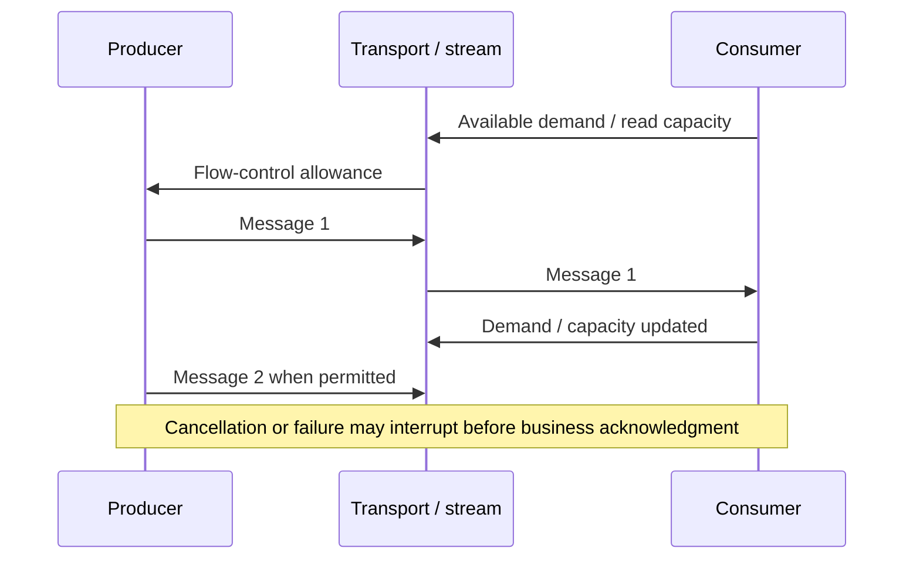

# Stream interaction and buffer ownership

**Owning question:** Who controls demand and owns buffered items in an asynchronous exchange?

This page belongs to [V03/C04 — Asynchronous APIs and streaming](README.md). Use the integrated walkthrough for the surrounding decision; the sections below own this narrower mechanism and its limits.

<!-- tycho-question-source:tycho.page.da7cd1ad59584b8a8ece7aab0f8f35b5:1 -->
## 1. Four interaction contracts

| Interface form | Producer/consumer relationship | Required decision |
|---|---|---|
| Unary request/response | One request, one final result or error | Deadline, retry-safe outcome, response semantics |
| Server streaming | One request produces a sequence over time | Receiver demand, partial completion, order and cancellation |
| Client streaming | A client sends a sequence to one service | Maximum input, validation, final acknowledgment and interruption |
| Bidirectional streaming | Both ends produce messages over a shared stream | Simultaneous flow control, protocol state, ordering and reconnection |
| Durable asynchronous job | Accepted task outlives the request transport | Durable operation ID, status read, retry/recovery and retention |

A durable job is deliberately listed separately: it can use polling, webhooks or a stream for *status updates* without depending on the transport remaining connected to complete the work.

<!-- /tycho-question-source -->
<!-- tycho-question-source:tycho.page.da7cd1ad59584b8a8ece7aab0f8f35b5:2 -->
## 2. Backpressure is a contract between producers and consumers

Reactive Streams define Publisher/Subscriber and Subscription demand semantics; a Subscriber signals how many elements it is prepared to receive. This supports bounded in-memory processing when compliant components coordinate demand. It does not constrain arbitrarily large database queries, transport-level retries or an external producer outside that demand contract.

gRPC streaming flow control operates at a different level: available receiver/transport buffers influence when data may progress, and completion of a framework write call does not necessarily mean the bytes have reached the remote application. gRPC documentation explicitly distinguishes application writes from actual network transmission.

**Text alternative:** the consumer's demand or available buffer capacity constrains how fast messages should flow. Sending into a framework buffer is not the same as downstream consumption or a committed business effect. The drawing is conceptual, not a wire-accurate transcript for every protocol.

<!-- /tycho-question-source -->
<!-- tycho-question-source:tycho.page.da7cd1ad59584b8a8ece7aab0f8f35b5:3 -->
## 3. Buffer ownership and memory safety

A producer can outpace a consumer when:
- framework buffering is unbounded or misconfigured;
- the application converts a bounded stream into an in-memory collection;
- one slow client holds server-side event state indefinitely;
- a downstream sink commits slowly but upstream transport keeps accepting;
- cancellation is dropped at an adapter boundary.

An API contract should specify message size, record count, idle/overall deadline, maximum buffering, demand propagation, queue age and overload behavior. A bounded buffer may cause the producer to wait or fail explicitly; both are visible policies that clients must understand.

**Synthetic failure:** a fictional live weather-history export streams millions of readings to a slow client. An implementation queues all results in RAM before checking flow control and crashes. A compliant bounded stream pages or requests work according to downstream demand, closes upstream resources on cancellation, and exposes a separate durable export task when the job must outlive the HTTP/RPC connection.

<!-- /tycho-question-source -->

## Navigation, prerequisites and source scope

| Route | Destination |
|---|---|
| Parent and source ledger | [Chapter introduction and exact source rows](README.md#chapter-source-ledger) |
| Previous / prerequisite | [Read preceding context](asynchronous-apis-streaming-and-cancellation.md) |
| Next | [Continue the reasoning](resume-cancellation.md) |
| Integrated question | [Original scenario and limits](asynchronous-apis-streaming-and-cancellation.md) |

The source material keeps its original published/inferred/synthetic/unverified distinctions. Chapter-wide citations are shared reference context, not proof that every cited source supports every sentence on this page. Freshly inspected text is identified explicitly; absent dates and unknowns are retained.
