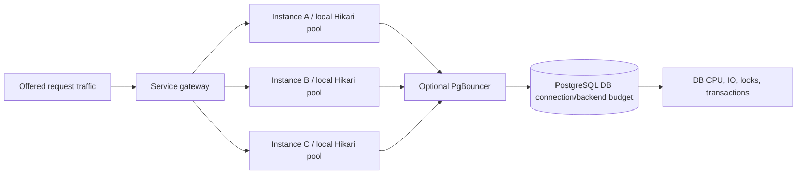

# Fleet resource budgets and queueing

**Owning question:** How do replica count, permits and wait budgets compose across the dependency topology?

This page belongs to [V03/C05 — Thread, connection and buffer pools](README.md). Use the integrated walkthrough for the surrounding decision; the sections below own this narrower mechanism and its limits.

<!-- tycho-question-source:tycho.page.dc2470904e004a4aa733abcdb25517ed:1 -->
## 1. Capacity belongs to the entire dependency topology

Text alternative: three service replicas independently admit requests into local pools and possibly a shared PgBouncer layer. All ultimately compete for a finite server connection/backend budget and downstream CPU/IO/lock resources. The drawing describes a fictional topology.

The number of connections allowed by a pool is a **limit on concurrent access**; it says nothing about how long each transaction holds a connection. If query time or locks increase, each connection is occupied longer and request queues can grow. Pooling should bound overload rather than hide it.

### Synthetic capacity arithmetic, not a deployment recommendation

Suppose an entirely fictional deployment has **4 application instances**, each configured with `maximumPoolSize=25`. The combined nominal pool upper bound is **100** open backend connections **if** each pool directly opens to PostgreSQL and is fully populated. Adding a fifth replica increases that bound to 125 unless orchestration/budgets change.

If the database's operational cap for application sessions is **110**, those numbers leave only 10 for other application instances/maintenance connections under the first topology and would violate the cap under the second. However:

- actual live connections can be fewer than maxima;
- PgBouncer can multiplex client and server connections under appropriate pooling mode;
- other services/users, replicas, migrations and monitoring need independent allowance;
- the database's true concurrent useful work may saturate well **below** maximum_connections;
- connections are not users, threads, transactions per second or operations.

Compute headroom for worst-case auto-scaling and failover, *then* verify measured active/idle/pending and service limits. The figures above merely test arithmetic.

<!-- /tycho-question-source -->
<!-- tycho-question-source:tycho.page.dc2470904e004a4aa733abcdb25517ed:4 -->
## 4. Connection pooling is not queuing-capacity magic

Suppose a stable hypothetical service has a single pool of 20 connections and every operation holds a connection **0.10 seconds on average**. Even under unrealistic perfect utilization and no additional bottleneck, the simple upper-bound arithmetic would be **20 / 0.10 = 200 connection-holding operations/s**. This is *not* a measured throughput SLO and not a queueing-theoretic tail latency prediction; locks, CPU, I/O, variance and overhead can lower achieved throughput dramatically.

If hold time rises to 0.25s due to lock or network contention, the same arithmetic upper bound becomes **80/s**. Adding platform or virtual threads does not alter the 20-connections limit.

The [Little's Law chapter](../../v07-performance-scale-and-resilience/c01-queueing-littles-law-and-measurement-boundaries/queueing-littles-law.md) explains the steady-state occupancy identity and why it cannot be converted into arbitrary thread/connection recommendations. The [Java execution chapter](../c02-java-execution-and-virtual-threads/platform-threads-executors-and-virtual-threads.md) distinguishes virtual-task abundance from scarce downstream resources.

<!-- /tycho-question-source -->

## Navigation, prerequisites and source scope

| Route | Destination |
|---|---|
| Parent and source ledger | [Chapter introduction and exact source rows](README.md#chapter-source-ledger) |
| Previous / prerequisite | [Read preceding context](connection-pools-hikaricp-pgbouncer.md) |
| Next | [Continue the reasoning](pool-modes.md) |
| Integrated question | [Original scenario and limits](connection-pools-hikaricp-pgbouncer.md) |

The source material keeps its original published/inferred/synthetic/unverified distinctions. Chapter-wide citations are shared reference context, not proof that every cited source supports every sentence on this page. Freshly inspected text is identified explicitly; absent dates and unknowns are retained.
