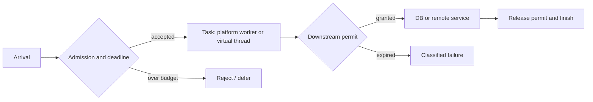

# Context, cancellation and framework integration

**Owning question:** How do execution choices propagate context and handle effects after a caller stops waiting?

This page belongs to [V03/C02 — Java execution and virtual threads](README.md). Use the integrated walkthrough for the surrounding decision; the sections below own this narrower mechanism and its limits.

<!-- tycho-question-source:tycho.page.02238832b395417bae63939cd96b9134:0 -->
## The concurrency question

A thread is an execution resource, not a unit of business capacity. Requests can wait for sockets, database connections, locks, external APIs or CPU. Adding threads helps only while the limiting resource can accept more work. Under stable conditions Little's Law relates mean concurrency, throughput and mean residence time; see [queueing](../../v07/c01/queueing-littles-law.md). It cannot certify capacity under overload.

**Synthetic example (not measured):** at 240 completed requests/s and 250 ms mean residence time, mean in-flight work would be 60. If each request occupies a DB connection for 80 ms, mean occupied connections would be 19.2. Neither number is a safe pool size: bursts, skew, lock contention and tail latency are unknown. If a downstream service supports only 12 simultaneous operations, unlimited task submission does not create capacity.

| Execution choice | Useful property | Resource that remains scarce | Failure risk |
|---|---|---|---|
| Fixed platform-thread executor | Bounds concurrently executing blocking tasks | Worker threads, queue, downstream connections | Worker exhaustion, queue delay, rejection |
| Virtual thread per accepted task | Waiting tasks generally release carrier threads | Heap, external connections, request state, CPU | Unbounded accepted tasks and downstream overload |
| Event-loop/async execution | Multiplexes nonblocking I/O on few threads | CPU per callback, demand buffers, connection pools | A blocking callback stalls unrelated work |

OpenJDK JEP 444 says virtual threads are not faster at CPU work, should **not be pooled**, and are suitable for high-concurrency mostly waiting workloads. They are scheduled onto a smaller number of carrier platform threads. JDK-supported blocking operations can park the virtual thread and release its carrier. [E01]

Text alternative: requests first pass a bounded admission gate. Accepted tasks execute under one of the thread models and separately acquire a permit for each scarce dependency. A failed permit acquisition is visible as a timeout or rejection; the execution model alone does not enforce the dependency limit. This is a proposed architecture, not a traced implementation.

<!-- /tycho-question-source -->
<!-- tycho-question-source:tycho.page.02238832b395417bae63939cd96b9134:4 -->
## Cancellation, context, failures

Interruption is a cancellation request, not a transaction rollback. A client can time out after the server committed an external effect. Retrying requires an idempotency identity and reconciliation, as explained in [outbox/idempotency](../../../distributed/transactional-outbox-and-idempotency.md). Propagate deadline and cancellation through executor queue, permit acquisition, driver operations and remote calls. Record what happens if each layer ignores cancellation.

JDK 21 virtual threads support thread locals, but caching one costly connection per short-lived thread is not a safe resource strategy. Test logging and tracing context propagation across async boundaries; clear sensitive context at task completion. Monitor task counts, JFR pin events, carrier availability, queue time, connection waits, CPU, heap, p95/p99 and rejected work before asserting improvement.

<!-- /tycho-question-source -->
<!-- tycho-question-source:tycho.page.02238832b395417bae63939cd96b9134:5 -->
## Spring Boot 3.3.13 mapping

Spring Boot 3.3.13 documents `spring.threads.virtual.enabled=true` on Java 21+, changing its auto-configured `AsyncTaskExecutor` to a virtual-thread-backed `SimpleAsyncTaskExecutor`; without that property it uses a `ThreadPoolTaskExecutor`. Documented integrations include `@EnableAsync`, MVC asynchronous request processing and WebFlux blocking execution support. Custom executor beans can alter the outcome; this property alone does not prove every request, JDBC operation or scheduled task uses virtual threads. [E04]

For a migration, inspect actual executors and drivers, then compare equivalent arrival distributions and dependency limits. Reverse a virtual-thread decision if CPU saturation, native pinning, memory retention or downstream contention dominate. Prefer the simplest model that meets a measured SLO, not the model with the largest synthetic task count.

<!-- /tycho-question-source -->

## Navigation, prerequisites and source scope

| Route | Destination |
|---|---|
| Parent and source ledger | [Chapter introduction and exact source rows](README.md#chapter-source-ledger) |
| Previous / prerequisite | [Read preceding context](virtual-threads.md) |
| Next | [Continue the reasoning](README.md) |
| Integrated question | [Original scenario and limits](platform-threads-executors-and-virtual-threads.md) |

The source material keeps its original published/inferred/synthetic/unverified distinctions. Chapter-wide citations are shared reference context, not proof that every cited source supports every sentence on this page. Freshly inspected text is identified explicitly; absent dates and unknowns are retained.
