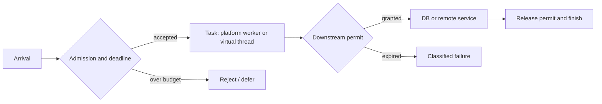
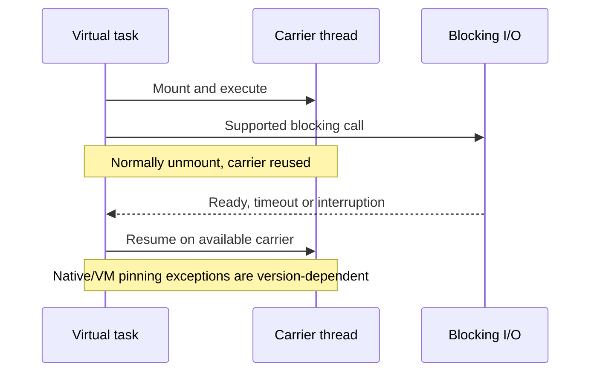

# Platform-thread executors and virtual-thread capacity

> **Tycho #82, public research inspected 2026-10-18.** Scope: OpenJDK JEP 444 (JDK 21), OpenJDK JEP 491 implementation discussion (JDK 24), Spring Boot 3.3.13. Original design reasoning and synthetic examples; no Java code was executed, no load test or independent human review occurred.

## The concurrency question

A thread is an execution resource, not a unit of business capacity. Requests can wait for sockets, database connections, locks, external APIs or CPU. Adding threads helps only while the limiting resource can accept more work. Under stable conditions Little's Law relates mean concurrency, throughput and mean residence time; see [queueing](../../v07/c01/queueing-littles-law.md). It cannot certify capacity under overload.

**Synthetic example (not measured):** at 240 completed requests/s and 250 ms mean residence time, mean in-flight work would be 60. If each request occupies a DB connection for 80 ms, mean occupied connections would be 19.2. Neither number is a safe pool size: bursts, skew, lock contention and tail latency are unknown. If a downstream service supports only 12 simultaneous operations, unlimited task submission does not create capacity.

| Execution choice | Useful property | Resource that remains scarce | Failure risk |
|---|---|---|---|
| Fixed platform-thread executor | Bounds concurrently executing blocking tasks | Worker threads, queue, downstream connections | Worker exhaustion, queue delay, rejection |
| Virtual thread per accepted task | Waiting tasks generally release carrier threads | Heap, external connections, request state, CPU | Unbounded accepted tasks and downstream overload |
| Event-loop/async execution | Multiplexes nonblocking I/O on few threads | CPU per callback, demand buffers, connection pools | A blocking callback stalls unrelated work |

OpenJDK JEP 444 says virtual threads are not faster at CPU work, should **not be pooled**, and are suitable for high-concurrency mostly waiting workloads. They are scheduled onto a smaller number of carrier platform threads. JDK-supported blocking operations can park the virtual thread and release its carrier. [E01]



Text alternative: requests first pass a bounded admission gate. Accepted tasks execute under one of the thread models and separately acquire a permit for each scarce dependency. A failed permit acquisition is visible as a timeout or rejection; the execution model alone does not enforce the dependency limit. This is a proposed architecture, not a traced implementation.

## Platform pools, queues and deadlines

A fixed platform pool bounds active blocking tasks but not waiting submissions unless its queue is also bounded. A queue can make latency worse even while the system reports few immediate errors. The deadline must include admission, executor queue wait, connection acquisition, execution and response transfer. Do not hold a database connection while waiting for unrelated network work. A rejection policy is part of the public service contract: retryable overload must be distinguished from uncertain committed effects.

Platform workers remain a simple choice for moderate concurrency and mature synchronous libraries. Neither fixed thread count nor CPU-core multiplier is universally correct: derive it from observed wait/compute fractions, heap, downstream budgets and load-test behavior.

## Virtual threads: tasks are cheap; operations are not

JDK 21 introduced `Thread.ofVirtual()` and `Executors.newVirtualThreadPerTaskExecutor()`. Each accepted request can keep a readable sequential call stack. A virtual thread blocked on supported I/O normally unmounts, but it can still retain heap state, locks and a leased DB connection. The carrier scheduler is not a backpressure mechanism. [E01]

```java
// Illustrative Java 21+ policy fragment, NOT a complete server.
// Gate accepted request count BEFORE submitting tasks.
Semaphore dbPermits = new Semaphore(12);
try (var executor = Executors.newVirtualThreadPerTaskExecutor()) {
    for (Request request : admittedRequests) {
        executor.submit(() -> {
            if (!dbPermits.tryAcquire(request.remainingMillis(),
                    TimeUnit.MILLISECONDS)) {
                throw new CapacityRejectedException();
            }
            try {
                return queryWithDeadline(request);
            } finally {
                dbPermits.release();
            }
        });
    }
}
```

This fragment deliberately omits definitions, exception mapping, interruption handling, and partial-commit recovery. **Important:** a semaphore inside unlimited submissions bounds DB calls but not the number of virtual threads waiting for permits. Use admission before task creation when pending work and memory must also be bounded. A virtual-thread executor's lifecycle must be tied to shutdown and deadline policies.

## Pinning depends on the JDK release

**JDK 21–23:** JEP 444 documents carrier pinning when a virtual thread blocks inside a `synchronized` region or native/foreign method. Long, frequent pinned waits can exhaust carriers. It describes `jdk.VirtualThreadPinned` JFR events and the historical `jdk.tracePinnedThreads` diagnostic. In-memory short monitor sections do not by themselves require replacement. [E01]

**JDK 24+:** JEP 491's OpenJDK implementation review describes monitor changes allowing virtual threads to unmount while holding a monitor, waiting to enter a monitor, and using `Object.wait()`. That specifically supersedes the blanket JDK 21 warning about blocking under `synchronized`. Native/foreign and exceptional VM paths still require diagnosis. The implementation discussion qualifies legacy locking mode; verify the exact JDK build and flags. The canonical [JEP 491](https://openjdk.org/jeps/491) text was not fully accessible in this research environment; the claim is based on the [primary OpenJDK review](https://mail.openjdk.org/pipermail/core-libs-dev/2024-November/134177.html) and [JDK 24 targeting announcement](https://inside.java/2024/11/15/jep491-target-jdk24/), not a purported full read of JEP 491. [E02, E03]


Text alternative: a virtual task temporarily uses a carrier. Supported blocking I/O normally frees the carrier until completion. JDK 21 monitor pinning differs from JDK 24 behavior; the diagram does not promise unmounting for every native library.


### Worked counterexample: fixing monitor pinning cannot fix a DB bottleneck

[JEP 444](https://openjdk.org/jeps/444) describes JDK 21 virtual threads and warns against pooling them like scarce platform workers. [JEP 491](https://openjdk.org/jeps/491) addresses carrier pinning due to synchronized monitors in JDK 24; it does **not** guarantee that native/foreign calls always release carriers, eliminate lock contention or increase downstream capacity. The [Netflix JDK 21 case](../../../cases/netflix-java21-virtual-thread-pinning.md) is an historical failure tied to its instrumentation and JDK vintage.

**Original synthetic scenario:** 1,000 accepted virtual tasks contend for twelve database connections. A driver holds one while an unrelated remote call waits; a monitor protects an in-memory counter. Moving to a JDK with changed monitor-pinning behavior could reduce one scheduler hazard, but cannot expand the twelve-connection resource, undo a previously committed request or make the counter authoritative across replicas.

| Possible observed result | Plausible boundary | Discriminating observation |
|---|---|---|
| Fewer carrier stalls, same DB wait | Monitor pinning improved but connections remain scarce | Pool acquisition time and active leases |
| More accepted requests, heap growth | Unbounded pending task admission | Live task count, heap and rejection rate |
| Saturated CPU with little blocking | Task threads cannot add CPU throughput | CPU profile at equal offered work |
| Lost response after durable write | Cancellation is not rollback | Stable logical key and durable result lookup |

A **proposed, unexecuted comparison** would pin JVM/driver versions and flags, offered demand, downstream quotas and workload skew while comparing platform workers, virtual threads with bounded admission, and nonblocking execution. Report correct completions, p99, connection waits, heap and ambiguous effects. For bounded CPU work a conventional pool may remain preferable; for many independent I/O waits virtual threads can improve programming simplicity; for existing end-to-end reactive protocols nonblocking flow control may suit the contract. See [task lifecycle](../c01/threads-tasks-structured-coordination.md) and [connection budgets](../c05/connection-pools-hikaricp-pgbouncer.md) for separate ownership.


### Version-bound failure contrast: less pinning is not higher downstream capacity

[JEP 444](https://openjdk.org/jeps/444) documents JDK 21 virtual threads as inexpensive waiting tasks, not faster CPU workers. JDK 24's [JEP 491](https://openjdk.org/jeps/491) changed the monitor-pinning behavior discussed for JDK 21, but cannot eliminate an application lock's mutual exclusion, native/foreign-call constraints, or database connection scarcity. The [Netflix JDK 21 incident](../../../cases/netflix-java21-virtual-thread-pinning.md) is historical and cannot establish what happens on a later JVM.

**Original hypothetical:** 1,000 virtual tasks wait for twelve database leases. A driver holds a lease across an unrelated remote call, while a monitor guards one process-local counter. Changing monitor behavior might remove one carrier stall, but cannot increase the twelve-lease downstream budget, enforce that counter across replicas or undo a committed request whose response was lost.

| Symptom | Owner to inspect | Unsafe inference |
|---|---|---|
| Carrier pinning drops; connection wait stays high | Database lease lifecycle | Virtual threads fixed throughput |
| More live tasks, rising heap and p99 | Admission/queue budget | Cheap thread means cheap request |
| High CPU, few parked tasks | Computation and contention | More virtual threads add cores |
| Cancellation after external commit | Durable operation identity | Interruption reverses the commit |

**Proposed, not run:** compare platform workers, virtual tasks plus admission, and a truly nonblocking implementation under the *same delivered arrival trace*, pinned JDK and driver revisions, pool size, downstream quota and error injection. Measure correct completions, heap, tail latency, blocked carriers, leased connections and unknown effects. Retain a bounded platform pool for CPU-heavy tasks when appropriate; choose virtual threads for suitable blocking I/O, or reactive execution if flow-controlled asynchronous APIs already fit the system. Detailed parent-child cancellation belongs to [task coordination](../c01/threads-tasks-structured-coordination.md), while [pool budgets](../c05/connection-pools-hikaricp-pgbouncer.md) owns connection capacity.

### Canonical-release cross-check — JDK 24 JEP 491 (editorial update, 2026-10-20)

The original 2026-10-18 research note above says the canonical JEP text was not fully accessible *during that research*. This limitation remains part of the historical provenance; it is **not** evidence that JEP 491 was merely proposed. The [Oracle JDK 24 release notes](https://www.oracle.com/java/technologies/javase/24-relnote-issues.html) and [Oracle's Java 24 release announcement](https://blogs.oracle.com/java/the-arrival-of-java-24) explicitly list **JEP 491, Synchronize Virtual Threads without Pinning**, as a JDK 24 feature. The [OpenJDK implementation-review thread](https://mail.openjdk.org/pipermail/nio-dev/2024-November/018122.html) specifies that the monitor fix addressed default `LM_LIGHTWEIGHT` and `LM_MONITOR` locking modes, **but not legacy `LM_LEGACY` mode** in that review. The [canonical JEP](https://openjdk.org/jeps/491) remains the normative feature reference; its full page could not be independently retrieved in this editorial environment, so this verification explicitly rests on the two linked release announcements and the dated OpenJDK implementation discussion.

**Revised bounded claim:** in normal JDK 24 HotSpot monitor handling, blocking while owning or entering a Java monitor no longer implies the JDK 21 monitor-pinning problem; this does **not** imply that every native/foreign callback unmounts, that a Java monitor ceases to serialize protected logic, or that database/backpressure limits disappear. Before applying this to a deployed JDK build, record exact runtime, locking-mode flags, JFR/observations and a controlled comparison. No JVM experiment or pinning measurement was performed by Tycho.

## Cancellation, context, failures

Interruption is a cancellation request, not a transaction rollback. A client can time out after the server committed an external effect. Retrying requires an idempotency identity and reconciliation, as explained in [outbox/idempotency](../../../distributed/transactional-outbox-and-idempotency.md). Propagate deadline and cancellation through executor queue, permit acquisition, driver operations and remote calls. Record what happens if each layer ignores cancellation.

JDK 21 virtual threads support thread locals, but caching one costly connection per short-lived thread is not a safe resource strategy. Test logging and tracing context propagation across async boundaries; clear sensitive context at task completion. Monitor task counts, JFR pin events, carrier availability, queue time, connection waits, CPU, heap, p95/p99 and rejected work before asserting improvement.

## Spring Boot 3.3.13 mapping

Spring Boot 3.3.13 documents `spring.threads.virtual.enabled=true` on Java 21+, changing its auto-configured `AsyncTaskExecutor` to a virtual-thread-backed `SimpleAsyncTaskExecutor`; without that property it uses a `ThreadPoolTaskExecutor`. Documented integrations include `@EnableAsync`, MVC asynchronous request processing and WebFlux blocking execution support. Custom executor beans can alter the outcome; this property alone does not prove every request, JDBC operation or scheduled task uses virtual threads. [E04]

For a migration, inspect actual executors and drivers, then compare equivalent arrival distributions and dependency limits. Reverse a virtual-thread decision if CPU saturation, native pinning, memory retention or downstream contention dominate. Prefer the simplest model that meets a measured SLO, not the model with the largest synthetic task count.

## Evidence and status

- **[E01] Published primary specification, JDK 21:** [OpenJDK JEP 444](https://openjdk.org/jeps/444), *The thread-per-request style*, *Implications of virtual threads*, *Scheduling virtual threads*, *Executing virtual threads*, *JDK Flight Recorder*. Supports execution/pinning contracts, not local throughput.
- **[E02] Primary JDK 24 implementation review:** [OpenJDK core-libs-dev review, 2024-11-06](https://mail.openjdk.org/pipermail/core-libs-dev/2024-November/134177.html), *Summary of changes*, *Unmount virtual thread while holding monitors*. Does not prove application-level freedom from pinning.
- **[E03] Primary JDK 24 release target:** [inside.java notice, 2024-11-15](https://inside.java/2024/11/15/jep491-target-jdk24/). Only confirms the targeted JDK release.
- **[E04] Published Spring Boot 3.3.13 documentation:** [Task Execution and Scheduling](https://docs.spring.io/spring-boot/3.3/reference/features/task-execution-and-scheduling.html), *Task Execution* and *Task Scheduling*. Framework documentation, not a runtime test.

**Research state:** named primary sections inspected; diagrams and workload invented. **Not performed:** compilation, JFR capture, load testing, actual Spring configuration testing, full JEP 491 body inspection or independent human review.

## Applied M9 evidence: what transfers and what does not

These examples connect the chapter's conditional mechanism to published experiences or synthetic decision exercises. A historical company report is **first-party, time-scoped evidence**, not a controlled Tycho benchmark; an M9 decision playbook is **original synthetic analysis**, not a company decision.

**Case lens — [Netflix — Java platform convergence](../../../cases/netflix-java-platform-convergence.md)**. **Relevant mechanism or architectural contrast:** Separate GraphQL composition and Java platform modernization; staged compatibility changes coordination ownership. **Not established by this report/playbook:** The historical talk and later abstract do not establish a universal RxJava-versus-Spring performance ranking or identical fleet versions.

**Case lens — [Netflix — Java 21 virtual-thread pinning](../../../cases/netflix-java21-virtual-thread-pinning.md)**. **Relevant mechanism or architectural contrast:** JDK21 monitor-related carrier starvation makes tracing/instrumentation part of concurrency acceptance. **Not established by this report/playbook:** An observed JVM incident is not a general virtual-thread failure rate and must not be extrapolated unchanged to later JDKs.

**Transfer test:** before applying the lesson to another legacy system, identify the exact workload, source date, relevant runtime/protocol versions, state authority, failure/recovery gate and the new observation that would reverse the choice. Follow the case's public evidence ledger rather than treating its link as independent proof.

<!-- tycho-edition-navigation -->

## Edition navigation and evidence scope

| Route | Destination |
|---|---|
| Parent chapter | [Question, conclusions and reading route](README.md) |
| Parent volume | [Volume synthesis](../README.md) |
| Book | [Authoritative contents](../../../README.md) |
| Source versions and access scope | [Registered sources](../../../../sources/README.md) and the exact page-local citation ledger above |

The original manuscript was accepted under #213 at the recorded baseline. Earlier draft/review labels describe historical authoring events. Source access, versions, unexecuted experiments and nonclaims retain their original scope; assembly does not assert a new source read or benchmark. The chapter landing adds editorial synthesis and navigation.
