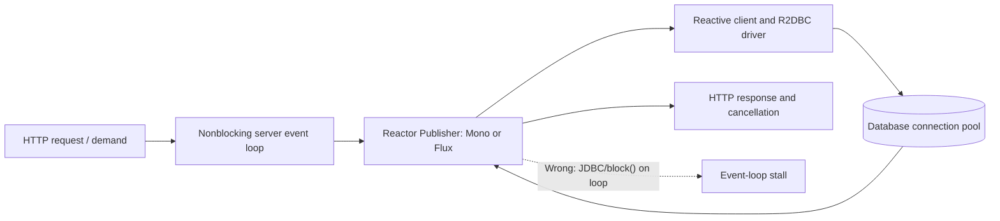
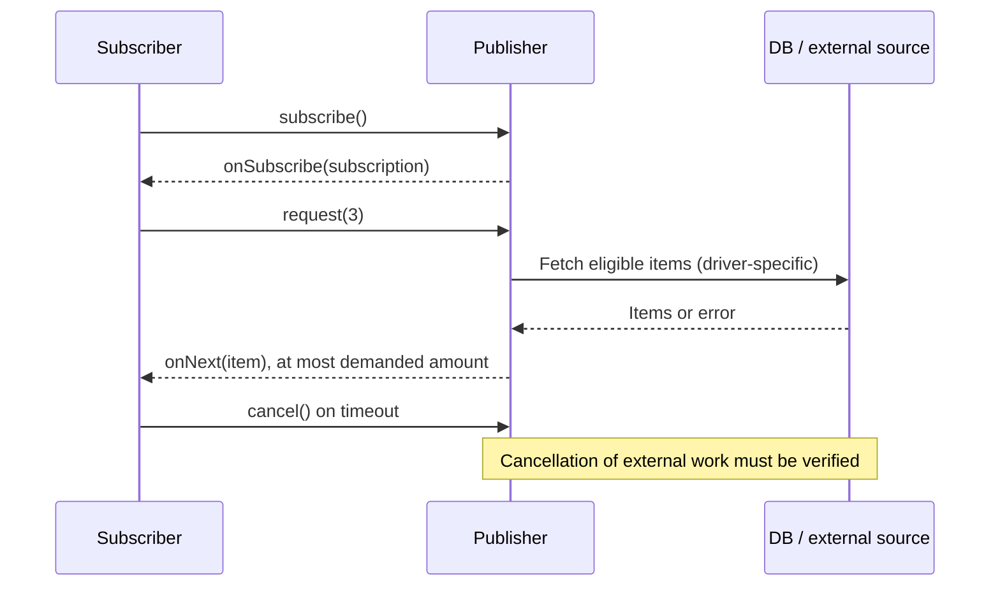

# Nonblocking execution and demand

**Owning question:** Which demand boundary actually controls a producer and where can blocking escape it?

This page belongs to [V03/C03 — Reactive streams, demand and cancellation](README.md). Use the integrated walkthrough for the surrounding decision; the sections below own this narrower mechanism and its limits.

<!-- tycho-question-source:tycho.page.114da51171c2474ebd56ee3bebad3bcb:0 -->
## 1. Nonblocking I/O is an end-to-end contract

An event-loop server multiplexes many I/O operations across a small number of threads by returning promptly when an operation cannot complete. A callback or reactive continuation resumes later. If an application blocks an event loop while waiting for JDBC, a mutex or an HTTP response, it prevents unrelated operations assigned to that loop from progressing. Spring's WebFlux 6.2 documentation distinguishes the small event-loop execution assumption from MVC's larger blocking-worker assumption. [E01]

Reactive programming does **not** automatically mean parallel execution, faster computation, a durable queue, or a stronger transaction. Spring 6.2 says nonblocking's principal potential benefit is resource efficiency under I/O waits; it cautions that a synchronous stack is often adequate when libraries and requirements are blocking. A chain can be written declaratively and still contain a blocking call. [E01]

Text alternative: a nonblocking HTTP handler subscribes to a reactive pipeline, which uses reactive clients and an R2DBC driver to reach a bounded DB pool. Response demand and cancellation flow through the chain when supported. A blocking JDBC call or `block()` on the event loop violates the model. This diagram is conceptual; it does not assert a specific Spring deployment.

<!-- /tycho-question-source -->
<!-- tycho-question-source:tycho.page.114da51171c2474ebd56ee3bebad3bcb:1 -->
## 2. Reactive Streams is demand coordination, not a magic queue

The Reactive Streams protocol links a `Publisher` and `Subscriber` through a `Subscription`. A subscriber signals demand with `request(n)`; signals include item, completion and failure. This is a flow-control boundary **only if the producer and operators respect it**. An uncontrollable upstream producer still needs a documented buffer, drop, backoff or fail policy. Spring's 6.2 *Define “Reactive”* section explicitly warns about sources that cannot slow down. [E01]

A subscriber cancelling a subscription requests that a stream stop delivering work; it does not establish that a database transaction, HTTP request or external effect was rolled back. A hot stream, non-backpressure-aware bridge or eager prefetch can still buffer data. Record where demand is converted to queue capacity and where the protocol ends.

Text alternative: after subscription, the consumer requests a finite number of items and the publisher sends no more than requested under a compliant protocol. Cancellation asks upstream to stop; whether the driver can abort already-issued work remains a separate test.

<!-- /tycho-question-source -->

## Navigation, prerequisites and source scope

| Route | Destination |
|---|---|
| Parent and source ledger | [Chapter introduction and exact source rows](README.md#chapter-source-ledger) |
| Previous / prerequisite | [Read preceding context](reactor-webflux-r2dbc-and-backpressure.md) |
| Next | [Continue the reasoning](scheduler-context.md) |
| Integrated question | [Original scenario and limits](reactor-webflux-r2dbc-and-backpressure.md) |

The source material keeps its original published/inferred/synthetic/unverified distinctions. Chapter-wide citations are shared reference context, not proof that every cited source supports every sentence on this page. Freshly inspected text is identified explicitly; absent dates and unknowns are retained.
