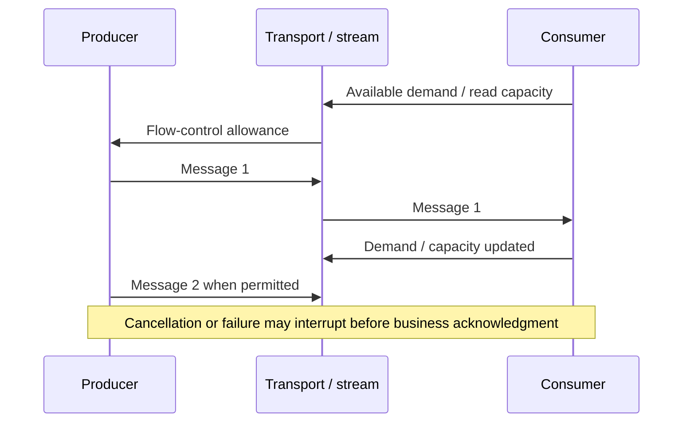

# Asynchronous APIs and streaming: demand, deadlines and cancellation

> **Independent Tycho V03/C04 book draft, 2026-10-19.** This chapter compares contract and flow-control choices. Official Reactive Streams 1.0.4 and gRPC guides supply bounded public facts. The example and acceptance tests are original synthetic material; no streaming client/server, implementation or benchmark was exercised.

## Purpose and mission

An asynchronous interface can separate the sender and receiver in time, but does not make the receiver infinitely fast. A stream introduces questions absent from simple one-response calls: **who controls demand, what happens to in-flight messages on cancellation, how is order defined, and can the conversation resume safely after a disconnection?**

A streaming transport may deliver bytes reliably while an application still loses its *business outcome* after an ambiguous acknowledgment. Backpressure, cancellation, retry identity and durable replay are distinct guarantees.

The [Reactive Streams JVM specification 1.0.4](https://github.com/reactive-streams/reactive-streams-jvm) describes asynchronous stream processing with non-blocking backpressure. The [gRPC flow-control guide](https://grpc.io/docs/guides/flow-control/) describes transport-oriented flow control for streaming RPCs, not unary requests. Neither specification by itself establishes cross-service exactly-once business effects.

## 1. Four interaction contracts

| Interface form | Producer/consumer relationship | Required decision |
|---|---|---|
| Unary request/response | One request, one final result or error | Deadline, retry-safe outcome, response semantics |
| Server streaming | One request produces a sequence over time | Receiver demand, partial completion, order and cancellation |
| Client streaming | A client sends a sequence to one service | Maximum input, validation, final acknowledgment and interruption |
| Bidirectional streaming | Both ends produce messages over a shared stream | Simultaneous flow control, protocol state, ordering and reconnection |
| Durable asynchronous job | Accepted task outlives the request transport | Durable operation ID, status read, retry/recovery and retention |

A durable job is deliberately listed separately: it can use polling, webhooks or a stream for *status updates* without depending on the transport remaining connected to complete the work.

## 2. Backpressure is a contract between producers and consumers

Reactive Streams define Publisher/Subscriber and Subscription demand semantics; a Subscriber signals how many elements it is prepared to receive. This supports bounded in-memory processing when compliant components coordinate demand. It does not constrain arbitrarily large database queries, transport-level retries or an external producer outside that demand contract.

gRPC streaming flow control operates at a different level: available receiver/transport buffers influence when data may progress, and completion of a framework write call does not necessarily mean the bytes have reached the remote application. gRPC documentation explicitly distinguishes application writes from actual network transmission.

**Text alternative:** the consumer's demand or available buffer capacity constrains how fast messages should flow. Sending into a framework buffer is not the same as downstream consumption or a committed business effect. The drawing is conceptual, not a wire-accurate transcript for every protocol.

## 3. Buffer ownership and memory safety

A producer can outpace a consumer when:
- framework buffering is unbounded or misconfigured;
- the application converts a bounded stream into an in-memory collection;
- one slow client holds server-side event state indefinitely;
- a downstream sink commits slowly but upstream transport keeps accepting;
- cancellation is dropped at an adapter boundary.

An API contract should specify message size, record count, idle/overall deadline, maximum buffering, demand propagation, queue age and overload behavior. A bounded buffer may cause the producer to wait or fail explicitly; both are visible policies that clients must understand.

**Synthetic failure:** a fictional live weather-history export streams millions of readings to a slow client. An implementation queues all results in RAM before checking flow control and crashes. A compliant bounded stream pages or requests work according to downstream demand, closes upstream resources on cancellation, and exposes a separate durable export task when the job must outlive the HTTP/RPC connection.

## 4. Cancellation is not rollback, and reconnect is not replay

The [gRPC cancellation guide](https://grpc.io/docs/guides/cancellation/) explains that when clients cancel or deadlines expire, servers should stop work and propagate the signal where possible; application code may need to cooperate. This cannot undo an already committed write or external effect.

A reconnecting stream must define:
- cursor/checkpoint or stable event ID, if replay is supported;
- exact ordering scope (one connection, one partition, one entity or total order);
- delivery mode and gap/duplicate handling;
- expiration and retention after which resume cannot succeed;
- whether a stream acknowledgment means transport received, consumer processed, or committed business effect;
- how protocol/schema versions coexist and unsupported events fail.

An ephemeral live stream with no durable source **cannot promise resumability**. If durable replay is required, store the relevant event/offset outside the connection and make consumer effects idempotent as appropriate. See [Kafka/partition ordering](../../v04/c07/kafka-partitions-replication-and-contracts.md), [outbox](../../../distributed/transactional-outbox-and-idempotency.md) and [stateful streaming](../../v04/c08/stateful-stream-processing-and-cdc.md).

## 5. Which architecture is justified?

| Candidate | Benefit when applicable | Failure condition |
|---|---|---|
| Unary API + pagination | Simple bounded reads and retries | Interactive updates are truly continuous |
| Server-streaming RPC | Progressive responses without waiting for entire data | Slow subscribers retain unbounded state |
| Bidirectional RPC | Concurrent producer/consumer interaction needed | No cancellation, order or backpressure contract |
| Reactor/Reactive Streams | End-to-end nonblocking demand coordination under supported drivers | A blocking adapter defeats bounded demand |
| Durable job + status/stream | Work must survive client disconnect | Job identity/state/cleanup not persisted |

A transport's popularity is not evidence of fit. Prefer a unary bounded API when the user needs one result; choose streaming for genuine incremental value, and durable jobs when completion survives the connection.

## 6. Proposed negative experiments

1. Fast producer with slow consumer: assert bounded memory and known overload behavior.
2. Cancel after the stream has emitted data: assert cleanup and correct partial-result labeling.
3. Timeout immediately after committing a side effect: reconcile by stable operation identity.
4. Disconnect/reconnect at a message boundary: verify duplicates, gaps and cursor expiry under the stated replay contract.
5. Mix old/new event schemas: unsupported/unknown fields must not silently corrupt semantics.
6. Make downstream connection pool saturate while streaming: record wait, admitted work and user-visible outcomes.
7. Keep open and closed load schedules distinct; measure transport bytes and *business completions* separately.

These fixtures are **not executed**, and a published Reactive Streams or gRPC specification does not prove the tested implementation conforms.

## Engineering walkthrough — Reconnect cannot recover unpersisted stream items

**Synthetic scenario:** a device-status server streams numbered updates over gRPC to a remote consumer. The network drops after the server sends sequence 41 but before the consumer can acknowledge it; the server emits 42 while the client is offline. Transport flow-control windows influence buffered bytes **while connected** but do not constitute a durable event log or replay cursor.

| Contract decision | Option A: transient live feed | Option B: resumable durable subscription |
|---|---|---|
| Owner of buffered state | Process/session with bounded bytes | Named storage/log with retention and sequence identity |
| Disconnect after sending 41 | Missing/duplicate 41 may be acceptable, explicitly labeled | Client resumes from last *durably processed* sequence; dedup and replay required |
| Slow consumer | Backpressure, drop/coalesce or explicit disconnect | Lag budget, quotas and replay horizon must be declared |
| Publisher restart | Session resumes from current state only | Rebuild cursor from durable authority; cannot replay what was never persisted |

If updates mean *current temperature*, dropping interim samples may be an acceptable product policy. If updates mean *irrevocable financial postings*, an ephemeral stream is not sufficient. Cancellation of a receive loop does not roll back a posting that another system already committed. This trade-off is separate from choosing gRPC vs WebSocket vs SSE.

**Proposed protocol (not implemented):** include `stream_id`, monotonically interpreted position within a declared partition, schema version, snapshot ID and retention boundary. Client checkpoints a position only after its required local effect is durable. Inject disconnect before/after acknowledgment, server restart, slow consumer and position expiry; return an explicit "resnapshot required" response when replay is impossible. The chapter's gRPC flow-control and Reactive Streams sources support bounded transport/demand semantics, not a durable replay guarantee.

## 7. Public source ledger and limits

| Published source | Narrow support | Unknown |
|---|---|---|
| [Reactive Streams JVM 1.0.4](https://github.com/reactive-streams/reactive-streams-jvm) | Nonblocking demand/backpressure semantics and specification/TCK | Correctness of a fictional streaming API |
| [gRPC Flow Control](https://grpc.io/docs/guides/flow-control/) | Transport streaming buffers/read capacity and non-unary scope | Application-level durable replay |
| [gRPC Cancellation](https://grpc.io/docs/guides/cancellation/) | Caller/worker cancellation propagation | Reversal of committed external effects |
| [Tycho reactive execution](../c03/reactor-webflux-r2dbc-and-backpressure.md) | Version-scoped framework scheduling and demand mechanics | Executed end-to-end client/server validation |

The streaming protocol, failure cases and diagrams are original synthetic educational material. No real integration tests, resource measurements, vendor conformance audit or editorial acceptance occurred.

**Navigation:** proposed **V03/C04** in [book outline](../../../PROPOSED-STRUCTURE.md), current [execution landing](../../../execution/README.md). Before: [Threads/tasks](../c01/threads-tasks-structured-coordination.md), [Reactive execution](../c03/reactor-webflux-r2dbc-and-backpressure.md). After: [API/RPC compatibility](../../v02/c05/http-rpc-contracts-and-compatibility.md), [Tail latency](../../v07/c04/tail-latency-fanout-and-deadline-budgets.md).

<!-- tycho-edition-navigation -->

## Edition navigation and evidence scope

| Route | Destination |
|---|---|
| Parent chapter | [Question, conclusions and reading route](README.md) |
| Parent volume | [Volume synthesis](../README.md) |
| Book | [Authoritative contents](../../../README.md) |
| Source versions and access scope | [Registered sources](../../../../sources/README.md) and the exact page-local citation ledger above |

The original manuscript was accepted under #213 at the recorded baseline. Earlier draft/review labels describe historical authoring events. Source access, versions, unexecuted experiments and nonclaims retain their original scope; assembly does not assert a new source read or benchmark. The chapter landing adds editorial synthesis and navigation.
