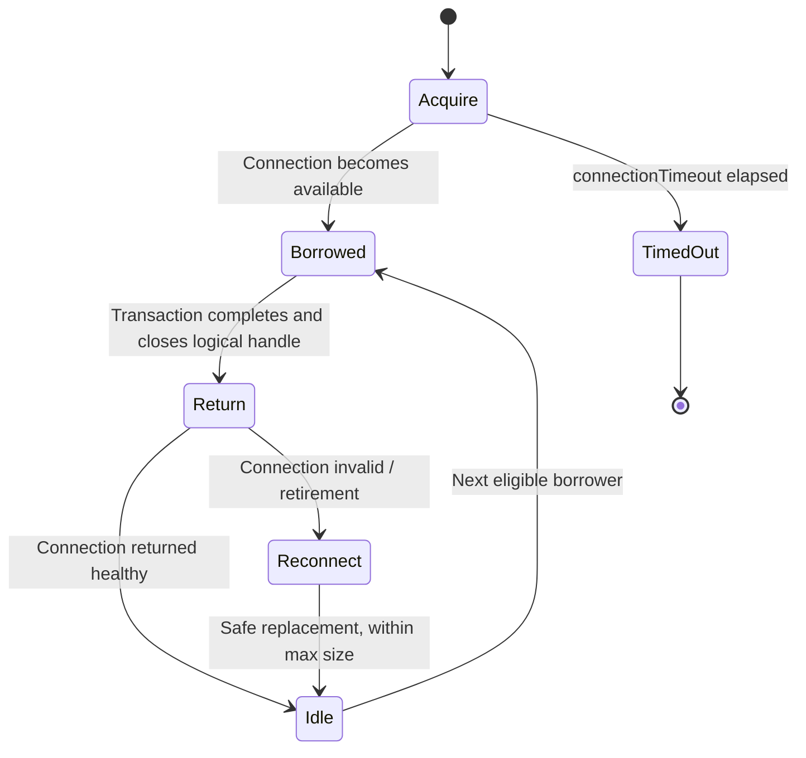
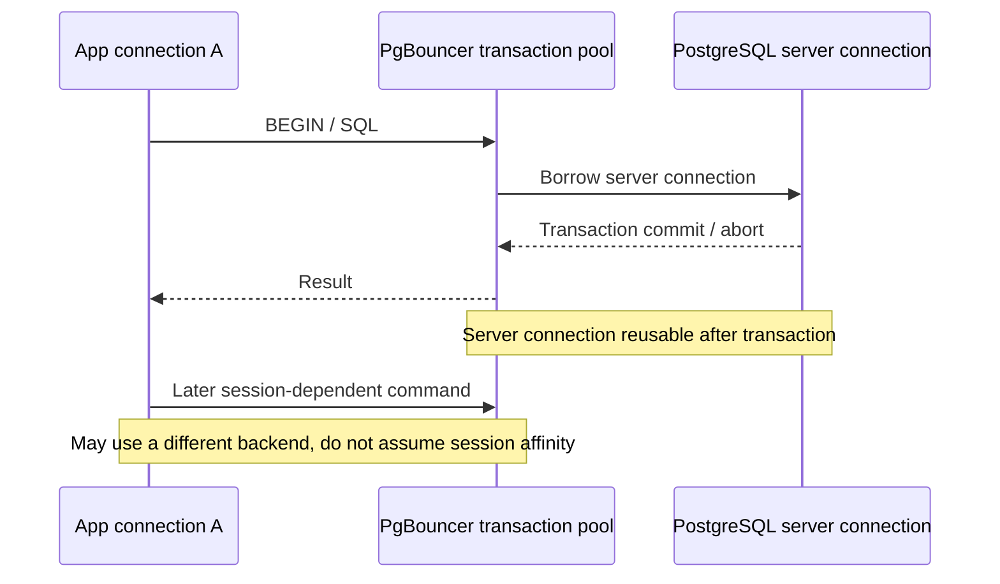

# HikariCP and PgBouncer contracts

**Owning question:** Which session and transaction assumptions distinguish the pool modes?

This page belongs to [V03/C05 — Thread, connection and buffer pools](README.md). Use the integrated walkthrough for the surrounding decision; the sections below own this narrower mechanism and its limits.

<!-- tycho-question-source:tycho.page.dc2470904e004a4aa733abcdb25517ed:2 -->
## 2. HikariCP bounds per-process JDBC connection use

The official HikariCP README configuration explains:

- `maximumPoolSize` caps actual pool connections, including busy and idle connections.
- `connectionTimeout` limits how long a request waits for an available connection before failing.
- `minimumIdle` controls efforts to keep a minimum of idle connections; the README recommends considering a fixed-sized pool by leaving it unset for some spike scenarios.
- `maxLifetime`, `idleTimeout`, validation and connection-health settings have independent operational constraints.
- The library recommends proper pool sizing through measured DB capacity rather than simply increasing threads. [E01]

Text alternative: a request borrows a connection when available or times out waiting. A returned healthy connection can serve another request; invalid ones require replacement. This simplified state machine does not model every HikariCP implementation detail or thread scheduling.

### The critical mistake: connection held across unrelated work

A request can obtain a DB connection and then call a slow remote API or sleep while still inside a transaction. That prevents other requests from borrowing the connection. Increasing pool size shifts the queue into the database, often increasing lock contention and memory instead of improving useful throughput.

Measure **connection hold time** by operation, query execution time, waiting for locks and transactions left idle. Use transaction scopes aligned with genuine database atomicity, not entire user interaction lifetimes. When concurrency grows, choose admission/deadline behavior that preserves database health.

<!-- /tycho-question-source -->
<!-- tycho-question-source:tycho.page.dc2470904e004a4aa733abcdb25517ed:3 -->
## 3. PgBouncer's pool modes change semantics

The official PgBouncer configuration reference defines distinct reuse boundaries:

| PgBouncer `pool_mode` | When server connection can be reassigned | Typical compatibility concern |
|---|---|---|
| **session** | Client disconnect/session ends | Clients can retain session state; fewer multiplexing gains for many long-lived clients |
| **transaction** | Each transaction completes | Session-specific state across transactions can break; review prepared statements, temporary objects, LISTEN/NOTIFY, session settings and driver behavior |
| **statement** | Each statement finishes | Multi-statement transactions are not permitted in this mode |

These are **exactly the official configuration definitions**, not a statement that all applications can switch modes without adaptation. PgBouncer's feature matrix and prepared-statement settings must be matched to its version and the actual driver. [E02]

Text alternative: in transaction mode, one client uses a server connection for its transaction. After commit it can be returned for another client; later statements need not reach the same backend. Session state cannot be presumed to persist across transactions.

PgBouncer `max_client_conn` limits accepted client sessions; `default_pool_size` is a default maximum **server connections per user/database pool**. The actual total server connections can exceed one pool size when multiple database/user pairs exist, and file descriptors/memory limits must be considered. [E02]

### Version-scoped prepared statement compatibility: PgBouncer is not a binary yes/no

A blanket statement that transaction pooling **never supports prepared statements** is outdated. The [PgBouncer FAQ — prepared statements in transaction pooling](https://www.pgbouncer.org/faq.html) states that since **PgBouncer 1.21.0**, protocol-level prepared statements can be tracked and prepared on the selected backend when `max_prepared_statements` is nonzero. The [configuration reference — max_prepared_statements](https://www.pgbouncer.org/config#max_prepared_statements) explains this tracked *protocol-level named-statement* behavior; it does **not** turn a client session into a permanently attached backend.

The relevant compatibility matrix is more specific:

| Client dependency | Transaction pooling disposition | Verification gate |
|---|---|---|
| Plain SQL with no session state | Plausible fit | Measure backend reuse, transaction scope and pool wait |
| Extended-protocol **named prepared** statement | Conditional support in PgBouncer 1.21.0+ with the feature enabled | Pin PgBouncer/libpq/JDBC driver versions and `max_prepared_statements`; execute prepare/execute across different backend leases |
| SQL-level `PREPARE` / `EXECUTE` or other session-affine state | **Do not assume** protocol rewrite makes it safe | Identify server-side statement/session semantics and test; otherwise use session pooling or remove the dependence |
| Session-only `SET`, temporary object, advisory/session lock, `LISTEN` | Not made transaction-independent by prepared-statement support | Identify lifecycle and use an appropriate session/transaction model |

**Synthetic negative test (not run):** client A prepares one named statement, finishes a transaction, then executes in another transaction assigned to a different backend. Repeat with `max_prepared_statements=0` and with nonzero tracking. Then issue SQL `PREPARE` and a session setting in separate transactions to demonstrate why those are **different** contracts. A passing prepared-statement test does not certify every PostgreSQL driver feature or prove pool capacity.

This nuance updates the general compatibility warning above, rather than claiming a configured PgBouncer service or recommending transaction pooling universally.

<!-- /tycho-question-source -->

## Navigation, prerequisites and source scope

| Route | Destination |
|---|---|
| Parent and source ledger | [Chapter introduction and exact source rows](README.md#chapter-source-ledger) |
| Previous / prerequisite | [Read preceding context](fleet-budgets.md) |
| Next | [Continue the reasoning](pool-recovery.md) |
| Integrated question | [Original scenario and limits](connection-pools-hikaricp-pgbouncer.md) |

The source material keeps its original published/inferred/synthetic/unverified distinctions. Chapter-wide citations are shared reference context, not proof that every cited source supports every sentence on this page. Freshly inspected text is identified explicitly; absent dates and unknowns are retained.
