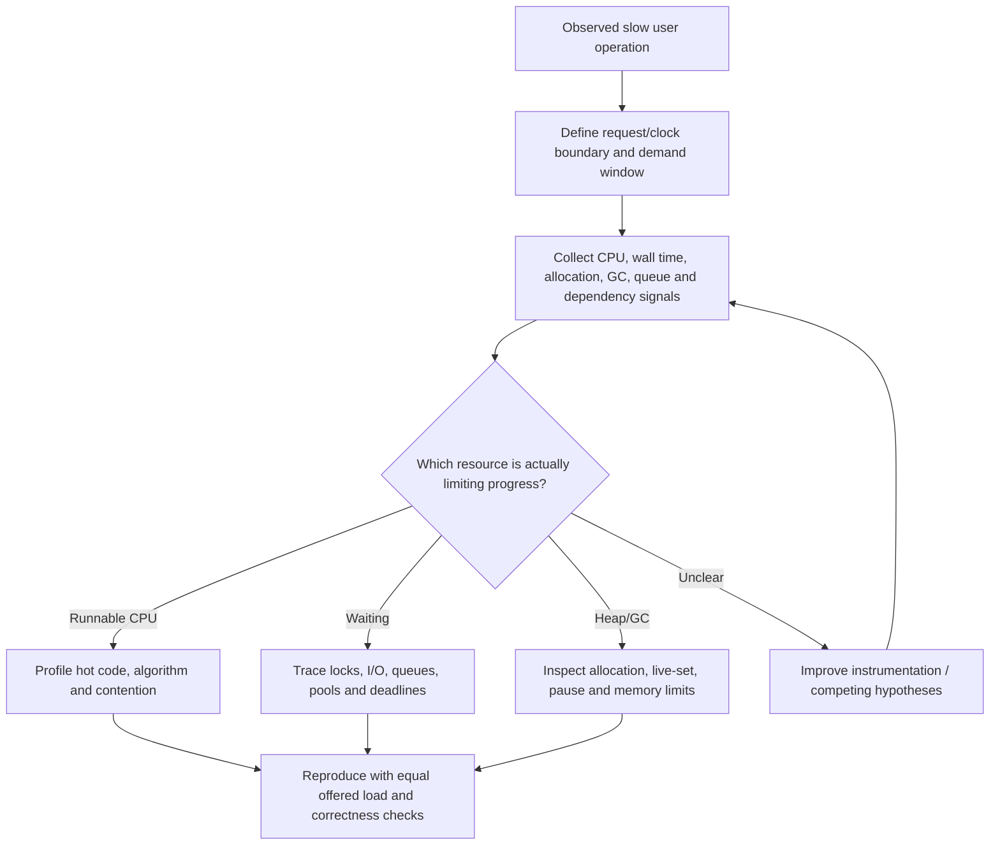

# Latency decomposition and symptom hypotheses

**Owning question:** Which competing bottleneck explanations fit the same slow request?

This page belongs to [V03/C06 — Memory, GC, CPU and blocking diagnostics](README.md). Use the integrated walkthrough for the surrounding decision; the sections below own this narrower mechanism and its limits.

<!-- tycho-question-source:tycho.page.b6cecfd7301b408db611228b4cec59c5:1 -->
## 1. Divide wall-clock latency before selecting a remedy

A request's elapsed time may include:
- waiting to be admitted to a queue/executor and waiting to borrow a connection;
- actually running application instructions on a CPU;
- waiting for locks, network, disk or an external API;
- pauses or scheduling delays from JVM/runtime/OS behavior;
- response serialization and delivery.

A CPU profile mainly attributes **CPU-running sampled time**; it does not by itself show all waiting. Wall-clock samples can show blocked and sleeping stacks, with their own measurement biases. A distributed trace provides time bounds for instrumented spans, but does not automatically distinguish CPU use from a blocked socket or missing spans. Avoid inferring the location of a resource bottleneck from an end-to-end p99 alone.

**Text alternative:** define the user-visible slow operation, correlate resource signals in the same workload window, distinguish running versus waiting and memory behavior, then perform a controlled comparison without losing correctness guarantees.

<!-- /tycho-question-source -->
<!-- tycho-question-source:tycho.page.b6cecfd7301b408db611228b4cec59c5:2 -->
## 2. Working symptom matrix

| Measured symptom | Possible cause (hypothesis) | Discriminating evidence | Unsafe shortcut |
|---|---|---|---|
| One CPU core saturated; large wall wait elsewhere | Serialized hot function or lock owner | Per-thread CPU stacks, lock owner, thread scheduling and request correlation | Add dozens of threads and assume useful parallelism |
| Low CPU, rising request queues and pool waits | Remote I/O or connection capacity | Connection acquisition time, downstream saturation, timeout/retry events | Switch execution model without fixing dependency ceiling |
| Sudden synchronous pauses | GC stop-the-world phase or safepoint delay | JFR/GC pause times aligned to latency spikes | Change garbage collector based only on a p99 graph |
| Heap increases throughout the run | Allocation growth, retained live objects or changed workload | Allocation profile, live-set after comparable collections, input/state cardinality | Increase Xmx indefinitely without leak hypothesis |
| Resident process memory grows while Java heap seems flat | Native allocations, thread stacks, direct buffers, memory-mapped resources | Native memory accounting/container limits, allocation sources | Assume heap GC controls all process RSS |
| Bursty tail under peak arrivals | Waiting/backlog and retry amplification | Offered/admitted/completed rates, queue age and retries per logical operation | Blame garbage collection without temporal evidence |
| Virtual-thread count is high | Many lightweight tasks, possibly waiting | Carrier scheduling, blocking/pinning diagnostics under the specific JDK | Treat task count as equivalent to OS thread count |

This table is a list of **hypotheses to test**, not a decision procedure that guarantees a diagnosis from one metric.

<!-- /tycho-question-source -->

## Navigation, prerequisites and source scope

| Route | Destination |
|---|---|
| Parent and source ledger | [Chapter introduction and exact source rows](README.md#chapter-source-ledger) |
| Previous / prerequisite | [Read preceding context](cpu-memory-gc-and-blocking-diagnostics.md) |
| Next | [Continue the reasoning](memory-tools.md) |
| Integrated question | [Original scenario and limits](cpu-memory-gc-and-blocking-diagnostics.md) |

The source material keeps its original published/inferred/synthetic/unverified distinctions. Chapter-wide citations are shared reference context, not proof that every cited source supports every sentence on this page. Freshly inspected text is identified explicitly; absent dates and unknowns are retained.
