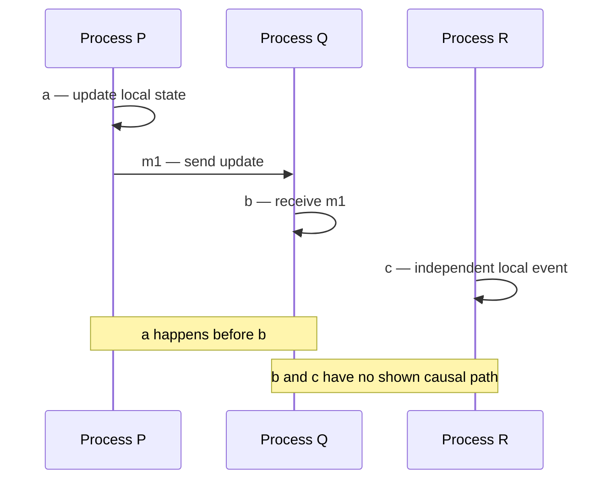
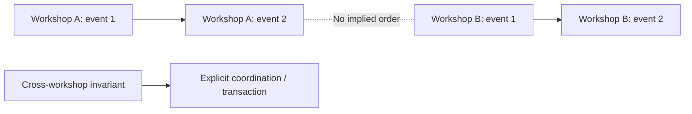

# Causal knowledge and ordering scope

**Owning question:** What can happens-before, timestamps and per-key order each establish?

This page belongs to [V04/C01 — Time, causality and ordering](README.md). Use the integrated walkthrough for the surrounding decision; the sections below own this narrower mechanism and its limits.

<!-- tycho-question-source:tycho.page.d4822cc1e71c4f73896b7f6509f6daae:1 -->
## 1. The happens-before relation describes causal knowledge

Leslie Lamport's 1978 paper *Time, Clocks, and the Ordering of Events in a Distributed System* introduces an ordering relation on events that can represent a partial order; its published abstract specifically contrasts this causal relation with the total-order extensions possible through logical-clock schemes. The paper is listed in Lamport's publication bibliography and Microsoft Research's original-paper record. This page uses that *abstract and bibliographic scope*, rather than claiming a line-by-line review of its PDF. [E01]

For two events `a` and `b`, the commonly used happens-before definition has three generating rules:

- Events on a single sequential process are ordered by their process execution.
- Sending a specific message causally precedes its receiving event.
- The relation is transitive: if `a` precedes `b` and `b` precedes `c`, then `a` precedes `c`.

Events for which neither direction follows may be **concurrent** even if each machine records a clock time. Concurrency here denotes insufficient causal ordering, not necessarily simultaneous physical execution.

Text alternative: process P acts and sends a message to Q, so its event precedes Q's reception. R acts independently; the diagram contains no evidence that Q's event precedes or follows R's.

An integer **Lamport logical clock** can be incremented for a local event, attached to messages, and advanced on reception so that causal predecessors have smaller timestamps. However, the converse does **not** follow: two events with ordered clock numbers may still be causally unrelated. Adding a deterministic process-ID tie-breaker produces one reproducible total ordering; it does not create a real causal dependency. A vector-clock mechanism can represent additional causal distinctions at the cost of metadata associated with participating processes; a full algorithm comparison is outside this page's bounded evidence.

**Decision impact:** if the business only needs every item to preserve its own update order, requiring global total order can introduce unnecessary coordination. If conflicting updates of a shared invariant must be serialized, merely generating timestamps does not create atomic or correct resolution.

<!-- /tycho-question-source -->

> **Pattern atlas:**
> [Causal Ordering](../../v11-pattern-atlas/c08-coordination/README.md#causal-ordering) — decision conditions and contraindications.

<!-- tycho-question-source:tycho.page.d4822cc1e71c4f73896b7f6509f6daae:3 -->
## 3. Ordering scopes: per-key versus global

In a **fictional** registration service, events for workshop A could need a consistent order independent of workshop B. If both operate under separate authoritative owners, a single global sequence may add coordination without improving correctness. But if one operation atomically transfers a limited shared resource between A and B, the owners must specify a coordination protocol for that invariant.

Text alternative: A's changes are ordered within A, and B's changes within B. The drawing does not establish an order between unrelated streams. A cross-stream invariant may still require a separate coordination mechanism.

Ordering must be defined by **where it is enforced**: a transaction log's commit order, a message partition's append order, one actor's sequential mailbox, or an API's linearizable key-value access are different contracts. The next integration research issue (#81) owns broker-specific partition ordering and consumer replay.

<!-- /tycho-question-source -->

## Clock domains, deadlines and expiry

**Enrichment contract:** distinguish a human timestamp, local duration, distributed ordering and durable schedule. These are different inputs to a correctness argument.

A wall clock helps label an event and interpret a civil schedule. A local elapsed-time clock can measure a timeout without relying on agreement with another machine. Neither clock turns an arrival timestamp into proof of causal order. The selected AWS leader-election discussion explains why duration-based reasoning avoids some synchronized-wall-clock assumptions while still requiring careful handling of pauses.

### Original deadline example

A fictional request has an 800 ms total budget measured at ingress. It spends 120 ms validating and 180 ms waiting for admission. Its remaining local budget is 500 ms, not a fresh 800 ms for each of two downstream calls. Reserve response/cleanup time as part of the same budget.

Do not send a raw monotonic-clock reading to another host: its origin is local to that clock domain. A remaining-duration protocol needs defined transmission/queue deductions; an absolute wall-clock deadline needs an explicit skew tolerance. If either protocol cannot establish a positive safe remaining budget, reject or reconcile rather than granting a full new timeout.

| Quantity | Suitable use | Incorrect substitution |
|---|---|---|
| Wall-clock instant | Human chronology, expiry with defined skew rules | Exact elapsed duration across an adjustment |
| Local elapsed duration | Budget and service-time measurement | Globally comparable event order |
| Logical version/sequence | State progression inside its declared scope | UTC time or duration |
| Civil time plus zone | Recurring local appointment/schedule | Fixed-duration repetition through every timezone transition |

### Expiry is an authorization/state transition

In an original cache example, one process writes a 30-second TTL after spending 20 seconds computing an old result. The entry can remain present for 30 seconds after insertion while its underlying information is already older. Define freshness from the authoritative observation/version and processing delay, not merely cache residency.

A token's expiry also needs a threat contract. Clock tolerance increases the acceptance interval; it is not free correctness. Long-lived offline validation and immediate revocation are competing requirements. Read [key and access lifecycle](../../v09-observability-security-and-operations/c05-identity-authorization-and-threat-modeling/object-credentials.md#key-rotation-revocation-and-unavailable-authorities).

### Recovery and proposed tests

Record event time and ingestion/observation time separately. After a pause or restart, re-establish local budgets and durable timer state rather than subtracting incompatible readings. For a process deadline that survives restart, persist an appropriate durable time contract and reconstruct the local timer under stated clock assumptions.

Proposed tests: backward/forward wall-clock adjustment, a process pause beyond its lease, delayed delivery of a remote deadline, replay of an expired command and a restarted durable timer. Observe accepted effects and cutoff semantics, not only timer callbacks. No clock perturbation experiment was performed.

Selected evidence inspected 2026-10-20: [Leader election in distributed systems](https://aws.amazon.com/builders-library/leader-election-in-distributed-systems/) for elapsed-time lease pitfalls; [Distributed Periodic Scheduling with Cron](https://sre.google/sre-book/distributed-periodic-scheduling/) for distributed scheduling failure questions. Numeric examples and the clock-domain comparison are original design reasoning. Calendar/timezone representation is owned by [data semantics](../../v05-data-models-engines-and-lifecycle/c01-relational-modeling-and-transaction-isolation/relational-invariants.md#time-numbers-and-text-are-data-contracts).

## Navigation, prerequisites and source scope

| Route | Destination |
|---|---|
| Parent and source ledger | [Chapter introduction and exact source rows](README.md#chapter-source-ledger) |
| Previous / prerequisite | [Read preceding context](causality-ordering-and-consensus.md) |
| Next | [Continue the reasoning](agreement-failure.md) |
| Integrated question | [Original scenario and limits](causality-ordering-and-consensus.md) |

The source material keeps its original published/inferred/synthetic/unverified distinctions. Chapter-wide citations are shared reference context, not proof that every cited source supports every sentence on this page. Freshly inspected text is identified explicitly; absent dates and unknowns are retained.
