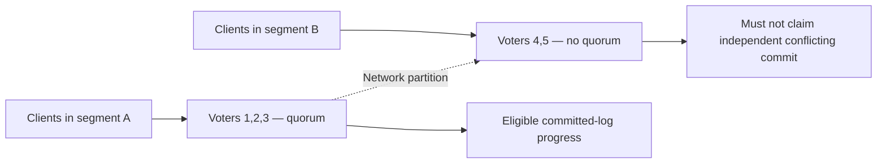

# Replica properties and quorum failure envelopes

**Owning question:** Which partitions can make progress without allowing divergent authority?

This page belongs to [V04/C02 — Replication, consensus and leader changes](README.md). Use the integrated walkthrough for the surrounding decision; the sections below own this narrower mechanism and its limits.

<!-- tycho-question-source:tycho.page.1b2657011d454460856103419095031b:1 -->
## 1. Separate replica types and required properties

| Mechanism | Can provide | What it does not automatically give |
|---|---|---|
| Independent read replica | More read capacity and recovery options | Strong current reads or no lag |
| Asynchronous replication | Durable-copy pipeline with bounded/observed lag under policy | Zero loss at primary failure |
| Leader-based consensus replication | Shared committed-log decisions while quorum and assumptions hold | Client progress without sufficient voters |
| Multi-writer replication | Concurrent writes in different locations | Globally serializable conflict-free outcomes |
| Historical backup and PITR | Recovery to a supported prior state if chain intact | Immediate failover or no acknowledged data loss |

For each architecture specify write acknowledgment, eligible reader, membership configuration, failure domain, consistency, reconfiguration and restore model. “Replicated” alone is not an acceptance criterion.

<!-- /tycho-question-source -->

> **Pattern atlas:**
> [Quorum Coordination](../../v11-pattern-atlas/c08-coordination/README.md#quorum-coordination) — decision conditions and contraindications.

> **Pattern atlas:**
> [Quorum-Based Reads/Writes](../../v11-pattern-atlas/c06-database-storage/README.md#quorum-based-reads-writes) — decision conditions and contraindications.

<!-- tycho-question-source:tycho.page.1b2657011d454460856103419095031b:2 -->
## 2. Majority quorum arithmetic and the failure envelope

In a simplified majority-voting cluster of N eligible voters, a quorum is floor(N/2)+1. A **3-voter** cluster requires 2 votes, and can normally make progress with one unavailable voter if remaining voters can communicate and have necessary log state. A **5-voter** cluster requires 3. Adding an extra voting member can actually increase the quorum without increasing tolerated failures—for example 3 voters → 4 voters raises required votes from 2 to 3.

This arithmetic assumes the quorum protocol and membership-change rules are correct. It is **not a proof that any arbitrary implementation guarantees safety**.

**Alternative.** A leader-based protocol can simplify reads and writes but still needs a
quorum for election and commit. Static assignment or single-writer partitioning avoids
quorum latency but loses automatic failover. Reverse the quorum choice when availability
and latency cost exceed the safety benefit.

The [etcd v3.6 FAQ](https://etcd.io/docs/v3.6/faq/) discusses why a dangerous membership addition can remove progress when the new member cannot join. A non-voting learner can receive state before safe promotion under implementation-specific rules. Changes to membership are themselves state-machine decisions that need supported joint/overlapping quorum safeguards, not a simple count update in a config file.

<!-- /tycho-question-source -->
<!-- tycho-question-source:tycho.page.1b2657011d454460856103419095031b:3 -->
## 3. Original synthetic network-partition scenario

A fictional five-voter metadata service is divided by a network failure into groups of three and two. The majority side can retain quorum; the minority side cannot legitimately independently commit a conflicting entry under the assumed Raft-style safety rules. Users attached only to the minority may experience unavailable writes even though local processes remain healthy.

**Text alternative:** a five-voter group splits 3/2; the connected three-voter majority can potentially elect a valid leader and commit, while the two-voter minority cannot independently make quorum. No actual network test or guarantee for a different replication protocol is implied.

Safety can mean refusing an operation rather than answering from potentially stale state. The business-facing API must distinguish a successful authoritative write, a rejection/unavailable result, and an **unknown outcome** after client timeout. A timed-out write may have committed before the reply disappeared, so blind retry of an external effect is unsafe without stable idempotency and readback.

### Quorum placement and failure domains

Quorum arithmetic assumes the voters are reachable within the required
latency and that their failure domains are not secretly shared. Placement
changes both survival and progress.

- **More replicas are not automatically safer.** A 3-voter group tolerates
  one failure; a 4-voter group requires three votes and still tolerates one;
  a 6-voter group requires four and tolerates two, but a single domain loss
  can remove a larger share of voters. Adding a replica in an existing
  domain can raise the quorum without adding a new failure domain.
- **Distance buys failure-domain span and costs latency.** Spreading voters
  across regions increases the faults the group can survive but adds
  round-trip time to every quorum decision. A leaderless read may avoid the
  worst of it; a strongly consistent write cannot.
- **Overlapping quorums have a link.** A five-replica layout with two
  central, one east-coast and two European voters can make an
  intra-continental quorum fast, but losing the link voter can force a
  transatlantic round trip. Hierarchical quorums trade more replicas for
  more predictable latency.
- **Leader placement concentrates traffic.** Leaders send proposal payloads
  and receive acknowledgements; colocating leaders can bottleneck one
  region's outbound network and shift a large traffic pattern when that
  region fails. Balance leaders across failure domains, not only voters.
- **Placement is not a substitute for backup.** Consensus protects a
  replicated log under its assumptions; it does not protect against
  software defects, operator error or a correlated loss of every voter.
  Keep an independent historical recovery path.

Verify the intended failure domain, quorum latency under normal and
degraded placement, and the traffic shift when a leader or link voter is
lost. The general placement model is owned by `V08/C06`
(`tycho.page.6b3725950fad4c0db82417b3d0225d32`).

<!-- /tycho-question-source -->

## Navigation, prerequisites and source scope

| Route | Destination |
|---|---|
| Parent and source ledger | [Chapter introduction and exact source rows](README.md#chapter-source-ledger) |
| Previous / prerequisite | [Read preceding context](replication-consensus-and-leader-change.md) |
| Next | [Continue the reasoning](leader-recovery.md) |
| Integrated question | [Original scenario and limits](replication-consensus-and-leader-change.md) |

The source material keeps its original published/inferred/synthetic/unverified distinctions. Chapter-wide citations are shared reference context, not proof that every cited source supports every sentence on this page. Freshly inspected text is identified explicitly; absent dates and unknowns are retained.
