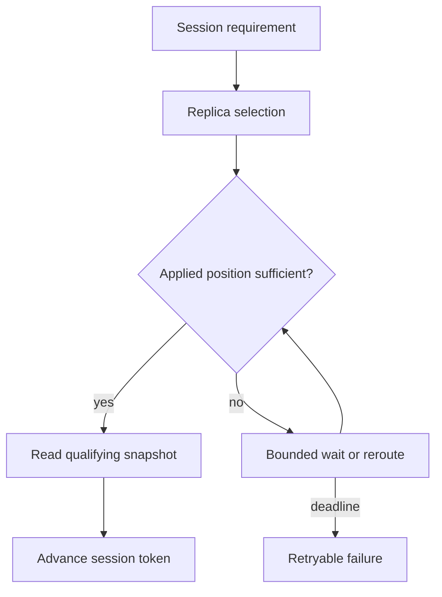

---
{
  "metadata_version": 1,
  "id": "tycho.page.67b469deedc503bc41ca1478e2ce737f",
  "kind": "page",
  "parent_id": "tycho.chapter.6eba0cf391184a709f2e23e5ecc1c3d2",
  "canonical_path": "book/volumes/v04-distributed-coordination-and-events/c02-replication-consensus-and-leader-changes/session-consistency.md",
  "title": "Session-visible consistency",
  "topic_ids": [
    "distributed-systems"
  ],
  "perspectives": [
    "architecture",
    "evaluation",
    "operations"
  ],
  "summary": "Which observations must a user session retain when requests move between replicas?",
  "route_hints": {
    "questions": [
      "Which observations must a user session retain when requests move between replicas?"
    ],
    "prerequisites": [],
    "related_ids": [
      "tycho.chapter.6eba0cf391184a709f2e23e5ecc1c3d2"
    ],
    "excludes": [
      "Original synthetic designs and proposed checks; no executed product experiment or independent acceptance."
    ],
    "keywords": [
      "session-visible",
      "consistency",
      "which",
      "observations",
      "must",
      "user",
      "session",
      "retain",
      "when",
      "requests",
      "move",
      "between",
      "replicas"
    ]
  },
  "evidence_scope": {
    "source_ids": [
      "src.azure-cosmos-consistency",
      "src.mongodb-causal-consistency",
      "src.jepsen-session-models",
      "src.jepsen-monotonic-reads",
      "src.jepsen-read-your-writes"
    ],
    "claim_ids": [],
    "status": "source-linked",
    "notes": "Five public units inspected 2026-10-31; quotes and limits are in the B56 lane note."
  },
  "content_review": {
    "status": "self-checked",
    "reviewed_at": "2026-10-31",
    "reviewer": "Automated authoring agent; independent acceptance pending",
    "proof_uri": null
  },
  "authored_at": "2026-10-20",
  "updated_at": "2026-10-31",
  "source_inspection_date": "2026-10-31",
  "content_verified_at": null
}
---

# Session-visible consistency

**Owning question:** Which observations must a user session retain when requests move between replicas?

> **Pattern atlas:**
> [Session Consistency](../../v11-pattern-atlas/c08-coordination/README.md#session-consistency) — decision conditions and contraindications.

## Name the observation that must survive routing

A session is an application-defined sequence of operations, not automatically a browser, connection or human identity. Define how tabs, devices, workers and anonymous requests acquire and transfer session context. Requests without that context cannot inherit its guarantees by accident.

Read-your-writes requires a later read in the same session to include that session's completed write, or a suitable later state under the data type's semantics. Monotonic reads require subsequent observations not to retreat behind a previously observed state. Neither implies that all users see the latest global state, nor that two concurrent writes have a single agreed order. A numeric value decreasing is not by itself a monotonic-read violation: a legitimate later update can reduce it. Compare versions or causal positions, not the displayed number.

## An explicit session token

Consider an original design with one ordered commit log per partition. A successful write returns partition and commit position. A read returns the position of the snapshot it actually read. The client retains the maximum required position for each partition it has observed or written.

A request sends that requirement. The router chooses a replica whose applied position is sufficient, waits within a bounded deadline, or routes to an authoritative replica that can satisfy it. If none can, return a retryable failure that preserves the token. Do not silently serve an older snapshot to keep a latency target.

Text alternative: select a replica using the session requirement; read only a qualifying snapshot, otherwise wait or reroute until the deadline, then fail explicitly. Successful reads advance the requirement.

This token algorithm assumes positions remain meaningful across leadership changes. A bare counter that resets on a new leader is insufficient. A stable log lineage or epoch-aware comparison must distinguish an established commit from a divergent suffix. In a genuinely multiwriter system, one scalar may not represent causal dependencies; use an appropriate frontier or narrow the guarantee.

**Alternatives.** Linearizable reads require quorum or read-index and accept higher
latency. Sticky sessions can preserve a weaker guarantee but fail on replica loss. Causal
consistency with a frontier handles multiwriter dependencies when one scalar is
insufficient. Reverse the session choice when the stronger contract's cost exceeds the
user-visible requirement.

Do not let an untrusted client request arbitrarily large positions and force unbounded waits. Authenticate or validate token scope, bound token size and waiting, and bind it to the relevant dataset. A token proves an observation requirement, not permission to read its contents.

## Worked history and counterexample

In a fictional workspace, a write of title B commits at position 81. The same session next reads from a replica at position 77 and receives title A. If the write was acknowledged and no later operation reversed it, this violates read-your-writes. A sticky route to one replica might conceal the problem until that replica fails.

Instead, the acknowledgement supplies requirement 81. A replica at 77 cannot satisfy the read; it catches up, the router uses another replica, or the operation fails by its deadline. After a read at position 86, the session requirement becomes 86 even if its own last write remains 81. This second update is what prevents later routing to position 83 from breaking monotonic reads.

Another session can still observe 77 under this contract. Requiring every session to observe the latest completed write is a stronger global obligation. Choosing that stronger contract changes quorum, routing and failure behavior; a session token does not manufacture it.

## Where the dependency must travel

A catalogue page that reads metadata from a qualifying database snapshot but search results from an older index can still appear to lose the user's update. Either propagate a publication watermark into the search read, overlay the session's pending changes, or explicitly label search as a separately delayed view. A database token cannot assert that an external index has applied an event.

For a workflow that reads object X and then writes object Y, read-your-writes alone does not require another reader of Y to observe the X version on which it depended. That is a causal dependency across operations and potentially partitions. State the dependency explicitly or avoid claiming causal consistency.

Delete and recreate require object identity as well as a position. Retaining an old numeric version for a new incarnation can make a token appear satisfied while the application refers to a different object.

## Failure, cost and alternatives

A replica failure removes an eligible serving location; it must not erase the session requirement. A lost client token can weaken the guarantee unless the service retains it elsewhere. A timed-out write may have committed: reconcile by its operation identifier before presenting it as definitely absent. Pinning to a leader can simplify routing but still needs correct failover and acknowledgement semantics.

The costs are metadata propagation, possible frontier growth, extra routing decisions and tail latency during lag. Sticky sessions reduce movement but are not a failover proof. Authoritative reads are simpler when the load and geography allow them. Explicitly stale reads are useful for independent browsing if the interface explains the visibility boundary.

Revisit the token design when partition fan-out makes the token large, clients routinely omit it, or waiting violates the product's useful response budget. A smaller session scope or a stronger authoritative read path may then be preferable.

## Proposed oracle and evidence

Record invocation and completion, session identifier, operation identifier, object incarnation, result and observed position. Check that every completed session read satisfies all preceding session requirements. Retain pending and uncertain operations in the history rather than rewriting them as failures. Test replica lag, rerouting, leadership change, lost tokens, concurrent tabs and an external index independently. No such history check was executed for this chapter.

[Consistency models](https://jepsen.io/consistency/models) distinguishes consistency models and their history scope. [Monotonic reads](https://jepsen.io/consistency/models/monotonic-reads) and [Read your writes](https://jepsen.io/consistency/models/read-your-writes) define the two session properties used here. The proposed log-position token is an original implementation sketch under stated assumptions, not a universal implementation of those models.

## Navigation and prerequisites

- Parent: [V04/C02 — replication, consensus and leader changes](README.md).
- Integrated page: [replication, consensus and leader change][integrated].
- Adjacent pages: [quorum-envelope.md](quorum-envelope.md) and
  [leader-recovery.md](leader-recovery.md).
- Volume: [V04 — distributed coordination and events](../README.md).

[integrated]: replication-consensus-and-leader-change.md

## Bounded pattern ownership notes

### Session Consistency

**Mechanism.** Azure Cosmos DB scopes session consistency "within a single client session",
where "reads are guaranteed to honor the read-your-writes, and write-follows-reads
guarantees." Its mechanism is a token: "After every write operation, the client receives an
updated Session Token from the server." The token "is used as a minimum version barrier but
not as a specific (possibly historical) version of the data to be retrieved from the
database", and "Session Tokens in Azure Cosmos DB are partition-bound". Jepsen scopes its
session guarantees to a process, "a logically single-threaded program which performs
computation and runs operations."
**Tycho reading:** The product owner defines what counts as one session and which
observations its users must retain. A browser tab, device, worker or anonymous request is not
a session until the application defines how context is acquired, transferred and expired. The
service owner publishes the token format, maximum size, lifetime and the failure callers
receive when no replica can satisfy it. A token is evidence of an observation requirement, not
identity or permission.

**Invariant.** Jepsen defines read-your-writes as a per-process property: it "does not apply
to operations performed by different processes." Monotonic reads likewise "does not apply to
operations performed by different processes, only reads by the same process", and
"intuitively, reads cannot go backwards." Cosmos promises read-your-writes and
write-follows-reads inside one client session; it does not make those observations global.
Jepsen places the session properties below causal consistency: "Causal implies writes follow
reads and PRAM" and "PRAM implies monotonic reads".
**Tycho rule:** That choice sets the guarantee; no infrastructure default should supply it
implicitly. Name the required guarantee set per session (read-your-writes, monotonic reads,
monotonic writes, writes-follow-reads) and test each independently. None implies a global
total order, and another user may still observe an older state. Compare versions or causal
positions; a displayed number that a later legitimate update reduces is not by itself a
monotonic-read violation.

**Failure and recovery.** MongoDB's causal-consistency page shows that a mode name does not
fix the guarantee: "different combinations of read and write concerns provide different causal
consistency guarantees." With durability, MongoDB requires majority reads and majority writes
to "guarantee all four causal consistency guarantees." Those concerns keep the guarantees
"even in circumstances (such as with a network partition) where two members in a replica set
transiently believe that they are the primary." Cosmos describes token repair: "if the client
is re-created, its cache of session tokens is also re-created", and if a replica lacks the
session's data, "the client retries the request against another replica in the region." An old
token does not pin history: "If the client uses an old session token, but newer data is
available in the database, the system returns the latest version."
**Tycho runbook:** Persist and validate the token, bound waits and retries, and return a
retryable failure rather than serving an older snapshot. After client recreation or failover,
rebuild the requirement from durable state or narrow the guarantee. An epoch or lineage field
stops a token from crossing a leadership change as though positions remained comparable. A
multiwriter frontier can expose two writes with no total order; the reader must not collapse a
concurrent frontier into one scalar; reject only when the required causal relation or state
cannot be established. External indexes and caches need their own watermark before claiming
the same session view. Record the chosen scope and why a weaker guarantee is acceptable;
narrow any route that cannot honor it before release, and document the token lifetime and the
repair path for a divergent epoch.

**Alternative.** **Tycho comparison:** causal consistency is the stronger adjacent contract.
MongoDB's page shows that with majority reads and writes a causally consistent session
provides "Read own writes", "Monotonic reads", "Monotonic writes" and "Writes follow reads".
Without durability, `{ w: 1 }` writes can still "provide causal consistency", but "writes
may be rolled back"; that is a weaker durability position, not a free upgrade. Jepsen's
hierarchy explains the cost: causal consistency implies writes-follow-reads and PRAM;
session guarantees sit below it, and "All models at or stronger than read your writes can be
at most sticky available." A linearizable read path is the other alternative when the product
needs one latest state.
**Tycho choice rule:** The routing layer owns the wait, reroute and rejection policy. Use
session consistency when per-client continuity is the requirement and token-aware routing is
cheaper than global coordination; use causal consistency when cross-client causal dependencies
must travel; use linearizable reads when a single latest state is the contract. Reverse when
routing, token propagation or failover cost exceeds the user-visible benefit, or when the
weaker view cannot be explained.

**Bound source limits.** Five public units were read on 2026-10-31: Microsoft Learn
"Consistency levels in Azure Cosmos DB" (Session consistency); MongoDB Manual "Causal
Consistency and Read and Write Concerns"; and Jepsen "Consistency Models", "Read Your Writes"
and "Monotonic Reads". They are living documentation pages, not benchmarks, specifications or
production observations. Headers, digests and section lists are in the B56 lane note. No
database, replica set, partition or client session was created or run; no latency, staleness
or recovery measurement was made. The token lifetime, epoch/frontier comparison, validation
and rejection rules are Tycho guidance, not source claims. Quotes are short
whitespace-normalized excerpts, not full-page reproductions.
