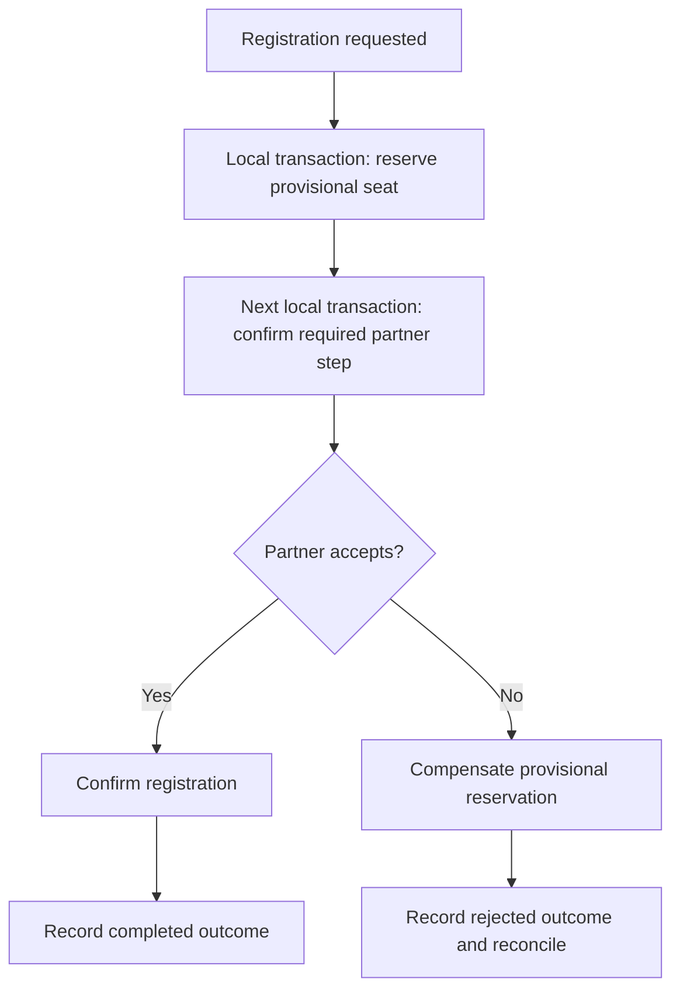

# Distributed transactions and business protocols

**Owning question:** Which obligations remain when local transactions cannot atomically coordinate owners?

This page belongs to [V04/C03 — Consistency and distributed transactions](README.md). Use the integrated walkthrough for the surrounding decision; the sections below own this narrower mechanism and its limits.

<!-- tycho-question-source:tycho.page.3c78e2b17ac74973b2ae658977843c2a:3 -->
## 3. Distributed transactions are a protocol choice, not an automatic extension

A global two-phase commit protocol coordinates prepare/commit decisions across participants capable of supporting that exact protocol. It may simplify some cross-resource atomicity requirements, but participants and the coordinator need documented recovery behavior; coordinator/participant failure and locks may affect progress. Do not assume an arbitrary SaaS API, queue and database support a shared atomic transaction merely because an application uses the word "transaction".

When independent services own separate stores and cross-service 2PC is unavailable or unsuitable, a **saga** can model a business process as an explicit sequence of local transactions with recovery/compensation. Chris Richardson's [Saga pattern](https://microservices.io/patterns/data/saga.html) distinguishes choreography (participants react to events) and orchestration (one coordinator issues commands). It also explicitly notes missing automatic rollback and isolation, and warns about anomalous concurrent saga interactions. [E03]

Text alternative: a workflow reserves provisional capacity, seeks confirmation from a partner and either finalizes or invokes a domain-specific compensating action. Both paths must be recorded and recoverable after process or network failure. This **fictional** story is not a reproduction of the cited author's commerce examples.

A compensating transaction is **not time travel**. If a notification was already delivered to a human, a later "cancel" event cannot erase knowledge; if a payment settled externally, refund may require a new separately audited transaction and can fail independently. Make compensation idempotent where needed and specify which effects are fundamentally irreversible.

<!-- /tycho-question-source -->
<!-- tycho-question-source:tycho.page.3c78e2b17ac74973b2ae658977843c2a:4 -->
## 4. Choreography, orchestration and the concurrency trap

| Dimension | Choreography | Orchestration |
|---|---|---|
| Coordination | Distributed reaction to published business events | Central workflow state issues commands to participants |
| Simplicity benefit | Fewer explicit central coordinator concepts for short flows | Easier to inspect one explicit end-to-end state machine |
| Primary cost | Harder to infer complete flow, loops and recovery from many handlers | Coordinator persistence, availability, versioning and lifecycle ownership |
| Failure recovery | Participants must retain enough state to resume/reconcile | Orchestrator must retain decisions, retries, timeouts and compensations |
| Concurrency | Event reordering and overlapping saga steps may violate invariants | Orchestration still **does not** automatically provide global isolation |
| Applicability | Stable, bounded, independently owned event reactions | Complex business steps with explicit timeouts and compensation policy |

The correct design may keep a single local transaction for the strongest invariant while using a saga **only** for legitimately distributed secondary effects. Do not fragment the registration allocation merely to demonstrate a sophisticated pattern.

### Anomaly: cancel overlaps a pending registration

```mermaid
stateDiagram-v2
    [*] --> Pending
    Pending --> Confirmed: All required steps complete
    Pending --> Rejected: Business check fails; compensate
    Pending --> NeedsRepair: Timeout or unknown step outcome
    NeedsRepair --> Confirmed: Reconciled successful result
    NeedsRepair --> Rejected: Verified compensation
    Confirmed --> Cancelled: Explicit later cancellation workflow
    Rejected --> [*]
    Cancelled --> [*]
```

Text alternative: provisional registration can be confirmed, rejected or require reconciliation after an uncertain remote outcome. A later cancellation of a confirmed registration is a new business transition, not an implicit way to erase an earlier committed step.

In Richardson's separate [saga design discussion](https://microservices.io/post/microservices/2019/07/09/developing-sagas-part-1.html), the semantic-lock technique illustrates why states such as `PENDING` can guard against overlapping commands. Its example is guidance, not a universal guarantee; the invented registration machine above requires explicit storage, concurrency and valid-transition enforcement. [E04]

<!-- /tycho-question-source -->

## Navigation, prerequisites and source scope

| Route | Destination |
|---|---|
| Parent and source ledger | [Chapter introduction and exact source rows](README.md#chapter-source-ledger) |
| Previous / prerequisite | [Read preceding context](invariants-isolation.md) |
| Next | [Continue the reasoning](coordination-failure.md) |
| Integrated question | [Original scenario and limits](transaction-isolation-and-sagas.md) |

The source material keeps its original published/inferred/synthetic/unverified distinctions. Chapter-wide citations are shared reference context, not proof that every cited source supports every sentence on this page. Freshly inspected text is identified explicitly; absent dates and unknowns are retained.
