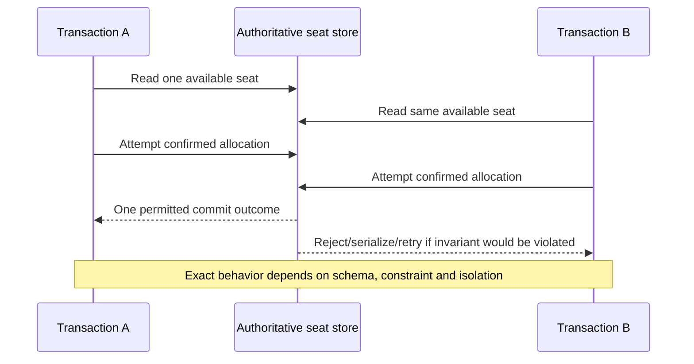
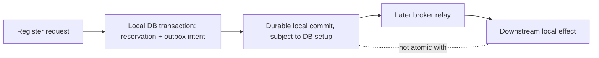

# Invariants and local transaction isolation

**Owning question:** Which state owner and anomaly define the required coordination boundary?

This page belongs to [V04/C03 — Consistency and distributed transactions](README.md). Use the integrated walkthrough for the surrounding decision; the sections below own this narrower mechanism and its limits.

<!-- tycho-question-source:tycho.page.3c78e2b17ac74973b2ae658977843c2a:1 -->
## 1. Define the invariant before naming consistency

Imagine a wholly synthetic booking system with one workshop of ten seats. The invariant is not "use ACID"; it is **number of confirmed allocations must not exceed configured capacity**, under concurrency, retry and failure. Other requirements may permit an availability projection to lag or a confirmation notification to arrive later. The critical question is who can commit the authoritative allocation and what happens after ambiguous client outcomes.

| Concern | Required definition | Common category error |
|---|---|---|
| Local transaction isolation | Which concurrent reads/writes can affect the invariant? | "No dirty reads" means full serializability |
| Durability | What acknowledged state survives which failure and storage setup? | COMMIT response implies every backup or region has latest data |
| Data consistency | What stale/incomplete state can clients observe, and for how long? | Replication delay has no user or business effect |
| Cross-service workflow | Can committed steps be undone or compensated after another service fails? | Saga compensation is an automatic ACID rollback |
| Idempotence | Which repeated request represents the same logical intent? | Two identical HTTP requests cannot cause duplicates |
| Atomic publication | Which state changes must commit together? | Publishing to a broker within an application callback creates a global transaction |

<!-- /tycho-question-source -->

> **Pattern atlas:**
> [Two-Phase Commit (2PC)](../../v11-pattern-atlas/c04-consistency-events/README.md#two-phase-commit-2pc) — decision conditions and contraindications.

<!-- tycho-question-source:tycho.page.3c78e2b17ac74973b2ae658977843c2a:2 -->
## 2. PostgreSQL transaction isolation as a concrete bounded example

PostgreSQL **17** documentation §13.2 describes its implemented isolation levels, including **READ COMMITTED**, **REPEATABLE READ** and **SERIALIZABLE**, their visibility and anomalies; PostgreSQL treats the SQL `READ UNCOMMITTED` request as `READ COMMITTED`. Under `SERIALIZABLE`, transactions can be aborted with a serialization failure rather than allowing a history that could not occur under some serial ordering. PostgreSQL §13.5 requires complete transaction retry handling for some serialization errors. [E01, E02]

**Serializable does not mean wait forever until all transactions succeed.** A transaction's business decision must be safe when reexecuted from the beginning, and external irreversible side effects must not leak out during a transaction that may abort or retry.

Text alternative: two concurrent transactions may see the same apparent capacity. A correct schema/transaction protocol must enforce the seat invariant, potentially rejecting/retrying a transaction. This illustrative timeline **does not claim PostgreSQL automatically detects overbooking in arbitrary application schemas**.

An explicit uniqueness or capacity condition can make a conflict observable. For example, a well-defined seat identifier with an appropriate database uniqueness constraint may prevent **two bookings of the same seat**, but it does not automatically prove all business-level capacity rules across changing allocations. Match the invariant to the actual enforcement.

### Local atomic commit does not include the outside world

Text alternative: a local database transaction can group registration and outbox records, but downstream event transport and the consumer's state have their own failure/atomicity boundaries. The canonical [outbox and idempotency chapter](../../../distributed/transactional-outbox-and-idempotency.md) owns the detailed retry and deduplication protocol.

The outbox does not prevent an invalid business allocation if **the source transaction itself** is incorrectly specified. An idempotency key does not replace isolation. Both concerns may be required.

<!-- /tycho-question-source -->

## Navigation, prerequisites and source scope

| Route | Destination |
|---|---|
| Parent and source ledger | [Chapter introduction and exact source rows](README.md#chapter-source-ledger) |
| Previous / prerequisite | [Read preceding context](transaction-isolation-and-sagas.md) |
| Next | [Continue the reasoning](distributed-protocols.md) |
| Integrated question | [Original scenario and limits](transaction-isolation-and-sagas.md) |

The source material keeps its original published/inferred/synthetic/unverified distinctions. Chapter-wide citations are shared reference context, not proof that every cited source supports every sentence on this page. Freshly inspected text is identified explicitly; absent dates and unknowns are retained.

## Bounded pattern ownership notes

These notes define the decision boundary for atlas cards whose mechanism is not the main subject of
this page. They are synthetic design guidance, not measured evidence, and they do not create a new
source claim.

### Two-Phase Commit (2PC)

A coordinator asks every participant to prepare, collects the votes, then records one commit or
abort decision that the participants apply while holding prepared state. No participant may commit
before the coordinator's durable decision, and the decision must survive coordinator failure for
prepared participants to recover.

A coordinator crash after prepare leaves participants holding locks with an unknown outcome;
recovery depends on a durable decision log and an explicit resolution procedure. A saga with
compensating actions avoids prepared locks at the cost of visible intermediate states and non-atomic
business outcomes; prefer 2PC when participants can hold locks and atomic durability is required.

**Limits.** Prepared locks block resources, coordinator recovery is a single point and
participant heterogeneity is costly; a saga avoids locks but not compensation complexity.
