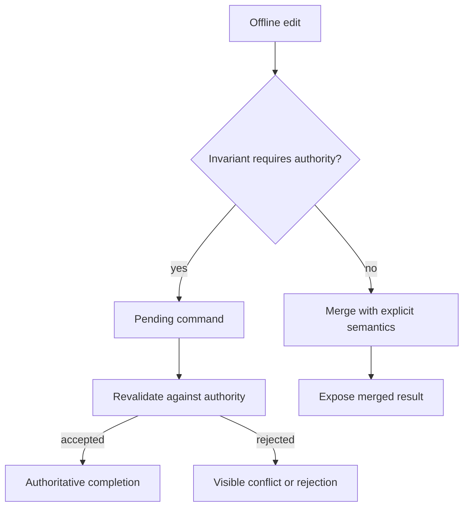

---
{
  "metadata_version": 1,
  "id": "tycho.page.16e98b13fd4c3bf6f652a1d4693a016b",
  "kind": "page",
  "parent_id": "tycho.chapter.4a3cbf0617e44be5b1e8d72568109dad",
  "canonical_path": "book/volumes/v04-distributed-coordination-and-events/c03-consistency-and-distributed-transactions/multiwriter-conflicts.md",
  "title": "Multiple writers and offline conflicts",
  "topic_ids": [
    "distributed-systems"
  ],
  "perspectives": [
    "architecture",
    "evaluation",
    "operations"
  ],
  "summary": "Which concurrent updates can be merged without violating the application's invariant?",
  "route_hints": {
    "questions": [
      "Which concurrent updates can be merged without violating the application's invariant?"
    ],
    "prerequisites": [],
    "related_ids": [
      "tycho.chapter.4a3cbf0617e44be5b1e8d72568109dad"
    ],
    "excludes": [
      "Original synthetic designs and proposed checks; no executed product experiment or independent acceptance."
    ],
    "keywords": [
      "multiple",
      "writers",
      "offline",
      "conflicts",
      "which",
      "concurrent",
      "updates",
      "merged",
      "without",
      "violating",
      "application",
      "invariant"
    ]
  },
  "evidence_scope": {
    "source_ids": [
      "src.replicated-types-semantics"
    ],
    "claim_ids": [],
    "status": "source-linked",
    "notes": "Selected public evidence and limits are in the page ledger and dated inspection record. Scenarios, workloads and architecture decisions are original synthetic reasoning, not production observations."
  },
  "content_review": {
    "status": "self-checked",
    "reviewed_at": "2026-10-20",
    "reviewer": "Codex author; integration execution and independent acceptance pending",
    "proof_uri": null
  },
  "authored_at": "2026-10-20",
  "updated_at": "2026-10-21",
  "source_inspection_date": "2026-10-20",
  "content_verified_at": null
}
---

# Multiple writers and offline conflicts

**Owning question:** Which concurrent updates can be merged without violating the application's invariant?

## Start with the invariant, then choose the merge

Offline availability means accepting some work without consulting a common authority. That does not make every accepted action safely mergeable. Separate an edit's local acceptance, eventual incorporation and authoritative business completion. The interface should expose all three when they differ.

Assume replicas exchange changes after arbitrary delay and may receive duplicates or changes out of order. A replicated data type needs a precise update and merge contract. State-based designs commonly use a join that is associative, commutative and idempotent over valid states; operation-based designs instead need explicit delivery, deduplication and ordering assumptions. A label such as CRDT does not remove those transport obligations or prove the application's invariant.

## Three original workload decisions

| State | Candidate merge | What remains outside the guarantee |
| --- | --- | --- |
| Per-device diagnostic contribution count | Merge each stable device component by maximum, then sum | Deduplicating a real-world action performed on two devices |
| Set of descriptive labels | Track unique add tags; remove only observed tags | A concurrent unseen add can remain present |
| Limited set of approved seats | Authoritative reservation or preallocated rights | Unrestricted offline approvals cannot preserve the global limit |

For the counter, device P advances its component from 3 to 4 and device Q from 5 to 7. Merging components gives 4 + 7 = 11 regardless of duplicate state delivery. Reusing a retired device identifier or decrementing its component breaks this construction. A device reset therefore needs a new identity and an explicit retention policy. This is an arithmetic illustration, not a production measurement.

For labels, replica P removes the add tags for “draft” that it has seen. Replica Q concurrently adds “draft” using a fresh tag. Their merge retains Q's addition under an observed-remove design. That is deterministic, but a user expecting removal to override every concurrent addition will find it incorrect. Choose the product meaning first.

For seats, imagine a limit of two and one existing approval. P and Q each approve a different person while disconnected. Each local state appears valid; the combined state contains three. Taking the union converges and still violates the capacity invariant. Last-writer selection can conceal one approval after the fact, but cannot undo an external action already performed on it.

## Conflict is sometimes the correct result

A multivalue register can retain concurrent titles until a person resolves them. A last-writer register chooses one according to a deterministic total order; clock order is not evidence of user intent. A timestamp tie needs a documented deterministic tie-breaker, and a clock adjustment must not accidentally make a future update permanently dominant.

A useful offline document separates mergeable text or annotations from authoritative transitions such as publication, permissions and finite-resource assignment. The server can accept an edit into a pending branch while refusing to claim that a revoked client still has publication rights.

Text alternative: merge only edits whose declared semantics permit it; hold authority-dependent commands pending, then validate them when connected and expose either completion or rejection.

## Normal operation, failure and recovery

Each edit carries a stable operation identifier, replica identity and the causal context required by its merge rule. A reconnect protocol exchanges missing changes or a compact state. It acknowledges durable receipt separately from approval. A retry with the same identifier cannot become a second application-level action.

If a replica disappears, its metadata may still be needed to distinguish old from new operations. Tombstone and causal-context compaction require an argument that excluded old replicas cannot reintroduce removed data. Options include an explicit membership epoch and full resynchronization after expiry. “Keep tombstones for a while” is not sufficient when offline duration is unbounded.

A revoked offline client may continue writing locally. On reconnect, the authority validates the current permission and a declared policy for edits created before revocation. A client-controlled wall-clock timestamp cannot establish that an edit predates revocation. Preserve rejected work for appropriate local export or review without silently making it authoritative.

Recovery must also handle corrupted or missing local state. Restore from a known snapshot, re-establish replica identity, and replay only operations whose identifiers and permissions remain valid. If compaction removed the required history, require a fresh synchronization instead of guessing a merge.

## Alternatives and reversal conditions

An authoritative command log is simpler for actions that can wait for connectivity. Preallocated rights can permit bounded offline consumption if rights are conserved and cannot be duplicated during transfer; this adds a separate ownership protocol. A visible branch-and-resolve workflow is suitable when automatic field merging would hide consequential disagreement.

Reconsider automatic merging when conflict resolution needs information absent from the data type, metadata growth dominates payload, membership churn invalidates compaction assumptions, or users routinely reject the deterministic outcome. Convergence is one property of a design, not its product acceptance criterion.

## Proposed checks and scoped evidence

Enumerate small update histories with duplicates, reordered delivery, concurrent removal/addition, replica reset and membership expiry. Require convergence for equivalent delivered change sets and check application invariants separately. For the seat counterexample, the expected result is a rejected or pending second approval, unless a conserved-rights model explicitly permits it. These are proposed checks; no merge implementation or model checker was run.

[Replicated Data Types: Specification, Verification, Optimality](https://www.microsoft.com/en-us/research/publication/replicated-data-types-specification-verification-optimality/) supplies public definitions and examples of replicated update semantics. Inspection covered the publication abstract and the paper's introductory sections on specifications, counters and registers; later proofs were not checked. The diagnostic, label and approval scenarios, their boundaries and their recovery policies are original synthetic reasoning.

## Navigation and prerequisites

- Parent: [V04/C03 — consistency and distributed transactions](README.md).
- Integrated page: [transaction isolation and sagas](transaction-isolation-and-sagas.md).
- Adjacent pages: [invariants-isolation.md](invariants-isolation.md),
  [distributed-protocols.md](distributed-protocols.md) and
  [coordination-failure.md](coordination-failure.md).
- Volume: [V04 — distributed coordination and events](../README.md).
