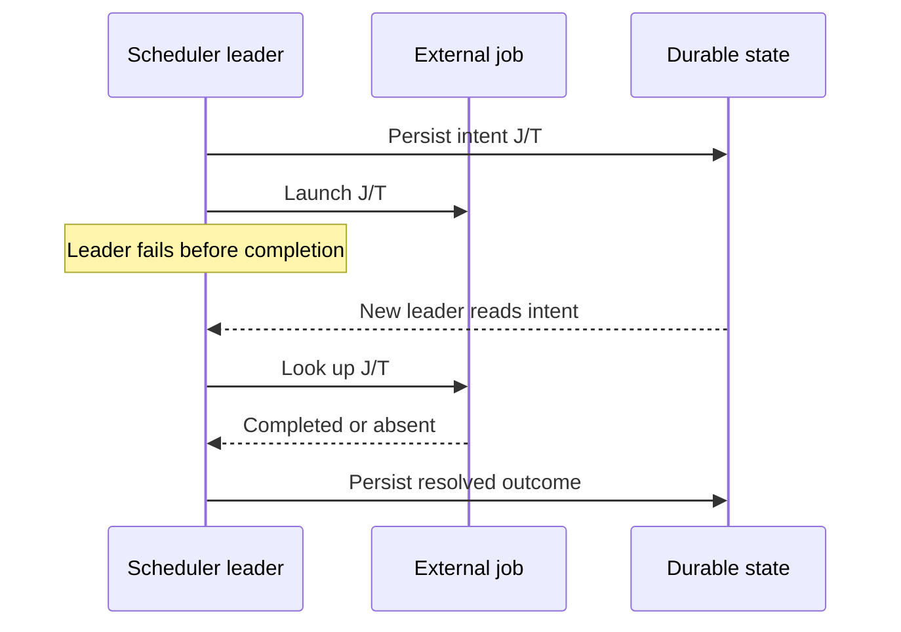
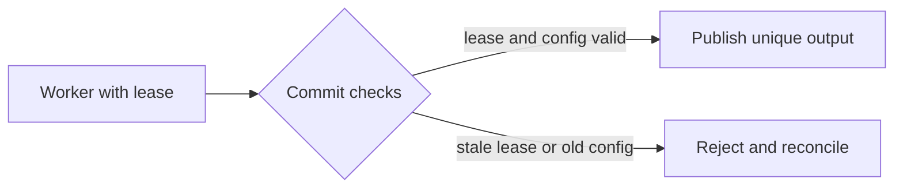

# Periodic work, leases and exactly-once publication

**Owning question:** How do periodic jobs and pipelines recover when a launch
is ambiguous or a lease is stale?

This page belongs to [V04/C05 — Outbox, inbox, sagas and durable workflows](README.md).
It owns periodic scheduling and pipeline publication, not the generic retry and
effect-identity contract in `V04/C04`
(`tycho.page.8d28a6e14a1c49d6b67bf9cb5bfb242f`), the overload policy in
`V07/C05` (`tycho.page.d9abd43bb7394c04a6bf77d4014f870d`), or the release
mechanics in `V08/C04` (`tycho.page.3d13e39bb42a4458999803e40d7137cc`).

## 1. A periodic job is a sequence of launches

A cron-like scheduler launches jobs; it does not necessarily track their
effects. Fire-and-forget is simple, but it makes an ambiguous launch
indistinguishable from a missed one. A tracked scheduler can retry, but it
must also decide whether a retry duplicates work.

The first design question is therefore not "how do we retry?" but "which
outcome can we afford: a skipped launch or a duplicate launch?"

- An idempotent garbage-collection job may tolerate a duplicate launch.
- A payroll or newsletter job may not. A duplicate can be irreversible, while
  a skipped launch can be detected and repaired.
- The source's general preference is to fail closed when the two outcomes are
  not equally recoverable; this is a policy choice, not a universal rule.

A timeout is not evidence that the external job did not start. The scheduler
must either make the external operation idempotent or be able to look up its
authoritative state.

## 2. Stable launch identity and outcome lookup

Give every scheduled launch an identity that survives leader changes:

- the job or workflow identity;
- the scheduled time or logical window;
- the owner/tenant and configuration revision where relevant.

The identity must be usable outside the scheduler. A precomputed external job
name can be distributed to all scheduler replicas before any launch. After a
leader failure, the new leader looks up that name and launches only the
missing work.

Two synchronization points make the ambiguity manageable:

1. **Intent:** persist that launch J at time T is about to be attempted.
2. **Completion:** persist the observed outcome, including an authoritative
   lookup result.

If the leader dies between them, the next leader resolves the intent rather
than creating a new one. The external job name must include the scheduled time
or window; otherwise a later run can be mistaken for the earlier one.

When the external system supports neither a stable effect key nor an outcome
lookup, a blind retry remains a duplicate risk. The scheduler should expose an
explicit unknown state and a manual reconciliation path, not invent certainty.

## 3. Scheduler state is not the external effect

A replicated scheduler can agree on which launch it intended, while the
external job has a different state. Consensus on the scheduler log does not
prove that an RPC was sent, a container started or a side effect committed.

- Persist scheduler state with its own durability and recovery contract.
- A snapshot plus a bounded log suffix may reconstruct scheduler state; it
  does not reconstruct an external effect.
- A new leader must reconcile in-flight launches before opening new work.
- Membership changes and failover are scheduler decisions; they do not fence
  an external worker that is still running.

This is why the launch identity and the external outcome lookup are part of
the scheduler contract, not an implementation detail.

## 4. Periodic pipelines and overlapping runs

A periodic pipeline is a chain of jobs on a schedule. It is fragile when its
interval approaches its runtime:

- A new run can stack behind the previous one, consuming cluster capacity.
- A scheduler can kill a nearly finished run to start the next one, reducing
  progress even though it increases the launch count.
- Many workers starting together can create a thundering herd on shared
  storage, metadata or network.
- Two pipelines can overlap occasionally and create a Moiré load pattern on a
  shared dependency even when each looks stable alone.

Shortening the interval is not a capacity plan. Measure the runtime
distribution, keep the interval above the expected runtime with headroom, and
test the overlap case. Jitter and randomization help synchronized starts;
they do not create capacity.

## 5. Publication correctness: lease, task identity and unique outputs

A pipeline worker should publish only when it can prove that it still owns the
work and is using the intended configuration. Four boundaries are useful:

- **Valid lease.** The worker may commit this work unit now. Without it, an
  orphaned worker can overwrite a newer result.
- **Immutable task/config identity.** The result matches the configuration
  that produced it. Without it, a stale configuration can publish after a
  change.
- **Unique output name.** Workers cannot overwrite each other's files. Without
  it, a delayed worker can destroy valid output.
- **Validated coordinator identity.** The client and server belong to the same
  task master. Without it, a rogue or misconfigured coordinator can corrupt
  state.

The combination supports exactly-once **publication** of the intended output
under those assumptions. It does not make every external side effect exactly
once. A notification, payment or third-party API call still needs its own
effect identity and reconciliation; see `V04/C04`
(`tycho.page.8d28a6e14a1c49d6b67bf9cb5bfb242f`) and the outbox owner in
[this chapter](README.md).

A lease is not a lock on the worker process. A paused worker may continue
writing to its own unique output after its lease expires; it must fail at the
commit boundary. The lease holder, the task/configuration identity and the
output namespace are separate checks.

Text alternative: the leader records the intended launch before sending it.
After a leader failure, the new leader reads the intent, queries the external
job by its stable name, and records the observed outcome. No step proves that
an arbitrary external effect happened exactly once.

Text alternative: a worker can write only to its own output while it holds a
valid lease and the matching task/configuration identity. A stale worker is
rejected at commit and its output is reconciled, not silently accepted.

## 6. Worked synthetic failure

A fictional catalogue publishes a search index from a periodic reconciliation
pipeline. The pipeline runs every 15 minutes, usually finishes in 8, and
occasionally takes 20 minutes. Its workers write immutable output files and
commit an index generation under a lease.

1. Run 41 starts at 10:00 and is still working at 10:15. Run 42 starts and
   finds the previous lease still valid; it waits or exits explicitly instead
   of launching a duplicate writer.
2. Worker A pauses after reading generation 17. Its lease expires. Worker B
   acquires the lease and publishes generation 18 to a new output name.
3. A resumes and tries to commit generation 17. The commit checks the lease,
   task identity and output name; A is rejected. Its output remains isolated
   and can be discarded.
4. A configuration change lands while A is paused. Even if A still held a
   lease, the task/configuration identity would not match; the commit fails.
5. The scheduler leader dies after sending a launch for run 43. The new leader
   reads the persisted intent, looks up the precomputed job name for run 43,
   and records completion instead of launching a second run.

The scenario is invented. No scheduler, pipeline, lease or external job was
executed.

## 7. Failure and test matrix

Proposed checks, not executed results:

- **Ambiguous launch:** kill the scheduler leader between intent and
  completion. The new leader must look up the external job and must not
  double-launch.
- **Skipped launch:** make the lookup return absent after a crash. The
  scheduler must either launch once or record a deliberate skip with an alert;
  it must not report success.
- **Stale worker:** pause a worker past lease expiry, let another worker take
  over, then resume the first. The stale commit must fail; the new output must
  remain intact.
- **Configuration change:** change the pipeline configuration while a work
  unit is in flight. The old worker must not publish under the new
  configuration identity.
- **Overlapping runs:** drive the runtime above the interval. The scheduler
  must bound overlap, preserve progress and avoid killing a nearly finished
  run without an explicit policy.
- **Synchronized start:** start many workers or pipelines together. Measure
  the shared-resource peak with and without jitter.

## 8. Evidence and limits

The SRE book's chapter 24, *Distributed Periodic Scheduling with Cron*,
sections *Cron Jobs and Idempotency*, *Tracking the State of Cron Jobs*,
*Resolving partial failures* and *Storing the State*, and chapter 25,
*Data Processing Pipelines*, sections *Challenges with the Periodic Pipeline
Pattern*, *Drawbacks of Periodic Pipelines in Distributed Environments*,
*Workflow Correctness Guarantees*, *Thundering Herd Problems* and *Moiré Load
Pattern*, were inspected 2026-10-21.

Those chapters are a 2016 operational account, not a protocol specification.
They describe one production design and its trade-offs; they do not prove that
another scheduler or pipeline is correct. The lease/configuration/output/
coordinator boundaries are a synthesis of the source's correctness discussion
with Tycho's own failure reasoning. No source code, scheduler, pipeline, load
test or independent review was exercised.

## Navigation

Parent: [V04/C05 — Outbox, inbox, sagas and durable workflows](README.md).
Previous: [Sagas, workflow recovery and compensation](saga-workflows.md).
Related: `V04/C04` (`tycho.page.33399db8d1574330951d9954801d6e71`) for retry
budgets; `V07/C05` (`tycho.page.d9abd43bb7394c04a6bf77d4014f870d`) for
overload admission; `V08/C04`
(`tycho.page.3d13e39bb42a4458999803e40d7137cc`) for release exposure.
