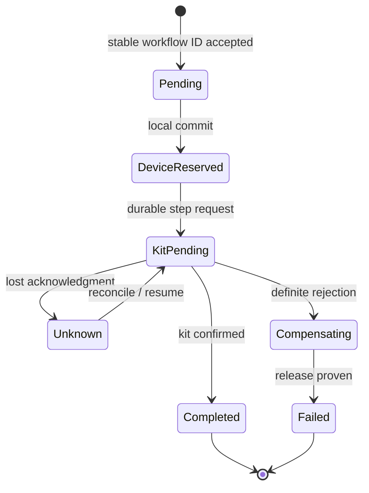

# Sagas, workflow recovery and compensation

**Owning question:** What business recovery contract replaces a nonexistent global rollback?

This page belongs to [V04/C05 — Outbox, inbox, sagas and durable workflows](README.md). Use the integrated walkthrough for the surrounding decision; the sections below own this narrower mechanism and its limits.

<!-- tycho-question-source:tycho.page.aa810dd152884b35a84f0f4cbe4369e9:4 -->
## 4. A saga is a business protocol, not an automatic rollback

[Richardson's Saga pattern](https://microservices.io/patterns/data/saga.html) coordinates a sequence of **local transactions**, with compensating actions when a business step cannot complete. Choreography propagates progress through events; orchestration explicitly coordinates steps.

Original invented workflow: reserve a device, allocate a supporting kit, confirm a booking, then optionally notify its requester. The business might allow the device reservation to be released if kit allocation definitively fails. But a release itself can fail; a delivered message cannot be un-delivered; the kit may already have been handed to a participant. The domain must determine which actions are reversible and which require manual reconciliation.

**Choreography.** Each owner subscribes to events and emits the next business step;
progress lives in the event contracts rather than a central coordinator. It needs
correlation identity, deduplication, dead-letter handling and an observable workflow
state. Unbounded chains, hidden coupling and conflicting compensations are common; a
trace can show correlation without proving durable business truth.

**Compensation.** A compensating transaction is a new business action that creates an
acceptable counter-effect; it is not rollback and it can fail. It needs idempotent effect
identity, retry/repair ownership and a user-visible unknown state when the counter-effect
cannot be proven. Orchestration or a single local transaction may be preferable when steps
need central visibility or when compensations cannot be made safe.

**Saga alternative.** Use one local transaction or a two-phase commit when the steps do not genuinely cross
independent owners, or when compensation is unsafe. Reverse the saga choice when coordination and compensation cost exceed the
availability or ownership benefit.

| Step | Durable state needed | False assumption |
|---|---|---|
| Admit command | Stable workflow/operation identity | In-memory queue acceptance is durable |
| Reserve device | Identity, commit result and cancellation contract | Every accepted step is instantly reversible |
| Request kit | Request identity and uncertain outcome policy | Timeout means rejected |
| Compensate device | Confirmed release or repair state | A compensation call always succeeds |
| Confirm final booking | Evidence required by user contract | Earlier partial success means final completion |
| Notify requester | Separate optional delivery effect identity | Exactly-once notification follows from a broker |

**Text alternative:** the workflow progresses through recorded states. Losing an acknowledgment creates an explicit unknown state requiring reconciliation; compensations can themselves remain incomplete. The diagram is a conceptual state machine, **not** an executed durable workflow.

<!-- /tycho-question-source -->

> **Pattern atlas:**
> [Saga](../../v11-pattern-atlas/c04-consistency-events/README.md#saga) — decision conditions and contraindications.
> [Saga Choreography](../../v11-pattern-atlas/c04-consistency-events/README.md#saga-choreography) — decision conditions and contraindications.
> [Saga Orchestration](../../v11-pattern-atlas/c04-consistency-events/README.md#saga-orchestration) — decision conditions and contraindications.
> [Compensating Transaction](../../v11-pattern-atlas/c04-consistency-events/README.md#compensating-transaction) — decision conditions and contraindications.

> **Pattern atlas:**
> [Process Manager / Routing Slip](../../v11-pattern-atlas/c03-messaging-integration/README.md#process-manager-routing-slip) — decision conditions and contraindications.

<!-- tycho-question-source:tycho.page.aa810dd152884b35a84f0f4cbe4369e9:5 -->
## 5. Durable workflow selection is conditional

One service and one database transaction are often simpler than a saga. Move to orchestration only when a business operation genuinely spans multiple independently owned effects with different failure and recovery boundaries. A durable coordinator may help with long waits, retries and auditability, but its actual guarantees depend on versioned workflow state persistence, activity semantics, timer reliability and recovery configuration.

**Choreography risks:** difficult-to-discover implicit coupling, unbounded event chains, conflicting compensations, and tracing that describes correlation but not durable business truth.

**Orchestration risks:** central coordinator as an added operational dependency; poor command/event boundaries; storing critical progress only in a volatile scheduler; failed compensation hidden behind an automatically “completed” state.

**Orchestration mechanism.** A coordinator persists the workflow state machine and issues
commands to participants, waiting for replies and timers. Its guarantees depend on durable
history, idempotent activities, versioned workflow code and reliable timer/retry handling.
A central coordinator is another operational dependency, but it gives one place to inspect
progress, compensation and unknown outcomes.

**Failure and recovery.** Coordinator loss, stuck histories, duplicate activities and
incompatible workflow upgrades are common. Recover from the durable history, keep
activities idempotent and hold or repair an ambiguous external effect rather than marking
the workflow complete.

Neither is universally superior. Measure the number of participating owners, duration, idempotency requirements, recoverability, operations burden and business acceptance conditions.

### Worked recovery: an outbox relay that dies after delivery

**Original fictional transaction:** a workshop service commits booking R7 and an `outbox_event` row E9 in *one local database transaction*. A relay publishes E9 to a broker, but crashes before marking its local publication checkpoint. After restarting, it publishes E9 again. The source business fact remains one booking; deliveries are two attempts.

| Boundary | Persisted state | Correct failure response |
|---|---|---|
| Booking + E9 commit | R7 and E9 durable together | Relay can recover from the outbox; no atomicity is claimed with the broker |
| First broker publish accepted | Broker may contain E9; relay checkpoint unknown | Retrying publication is possible; duplicate E9 expected |
| Consumer receives E9 twice | Event ID repeats; two network deliveries | One consumer-local effect using durable inbox/dedup + business update |
| Compensation requested after downstream shipment | Local cancellation cannot unsend physical shipment | Explicit business compensation and an unresolved/manual state if reversal is impossible |

The [Transactional Outbox pattern](https://microservices.io/patterns/data/transactional-outbox) supports persisting publication intent with the business change and recognizes relay duplication. The [Idempotent Consumer pattern](https://microservices.io/patterns/communication-style/idempotent-consumer.html) addresses duplicate effect handling at the consumer's *own* durability boundary. A [Saga](https://microservices.io/patterns/data/saga.html) coordinates independent local transactions and compensations; compensation is not an automatic global rollback.

**Alternative and limit:** if an operation needs one atomic local invariant, keep it in the same transaction when feasible. Introduce a durable workflow only when independent long-lived participants require it, and describe irreversible steps, retry limits, authorization and operator repair. An external email or payment service may not expose the exact dedup/reconciliation contract this design needs.

**Proposed, not executed:** kill the relay after broker acknowledgment and before its checkpoint; replay E9 twice; crash the consumer after its effect but before broker acknowledgment; interrupt compensation after an irreversible step. Assert one intended local business effect, traceable progress and an explicit manual recovery state where exact undo is impossible. This chapter owns durable choreography; logical operation identity belongs to [V04/C04](../c04-retries-idempotency-and-duplicate-effects/retries-idempotency-and-ambiguous-effects.md).

<!-- /tycho-question-source -->
<!-- tycho-question-source:tycho.page.aa810dd152884b35a84f0f4cbe4369e9:6 -->
## 6. Test failures rather than just the happy path

A bounded design verification should inject: crash just before/after local state+outbox commit; relay crash after broker acknowledgment; duplicate deliveries processed concurrently; out-of-order events; restart of an orchestration instance mid-step; definitive failure and compensation failure; old/new event schema coexistence; lost external acknowledgment after irreversible effect.

Acceptance requires the same **correct authoritative business result** under permitted failures, plus bounded unknown/repair states and observable lag. Checking that all generated messages reached a topic is insufficient. **No executable fixture was run** for this manuscript.

<!-- /tycho-question-source -->

## Navigation, prerequisites and source scope

| Route | Destination |
|---|---|
| Parent and source ledger | [Chapter introduction and exact source rows](README.md#chapter-source-ledger) |
| Previous / prerequisite | [Read preceding context](inbox-atomicity.md) |
| Next | [Continue the reasoning](README.md) |
| Integrated question | [Original scenario and limits](outbox-inbox-sagas-and-durable-workflows.md) |

The source material keeps its original published/inferred/synthetic/unverified distinctions. Chapter-wide citations are shared reference context, not proof that every cited source supports every sentence on this page. Freshly inspected text is identified explicitly; absent dates and unknowns are retained.

## Bounded pattern ownership notes

These notes define the decision boundary for atlas cards whose mechanism is not the main subject of
this page. They are synthetic design guidance, not measured evidence, and they do not create a new
source claim.

### Process Manager-Routing Slip

A process manager keeps a central workflow state machine and decides the next step; a routing slip
carries the remaining itinerary with the message, so each participant advances a local cursor. The
two variants place the progress record differently and must not be conflated.

The invariant is a recorded dispatch intent, not merely a progress row: update state and enqueue the
next command in one local transaction, or the same outbox. A crash between the two can otherwise
skip a step. A lost dispatch or duplicate step leaves the workflow stuck or duplicated; idempotent
steps, a recorded state and a reconciliation query are required.

Event choreography removes the central coordinator but hides the overall protocol. A routing slip
is simpler when the itinerary is fixed and each hop can forward it; a process manager is preferable
when steps need explicit compensation, timers or visibility.

### Saga

A saga is a long-running business protocol across independent owners. Each step is a local commit;
there is no global lock and no hidden intermediate state, so other readers can observe a partially
completed business outcome.

Before dispatching a step, record the workflow identity, step identity and expected outcome; after
it, record committed, failed or unknown. A compensation is a new business action with its own
authorization, evidence and failure mode, and its ordering is declared rather than assumed to be the
reverse of the forward path.

Tycho synthesis: the invariant is one authority and one effect identity per step; the saga never
claims atomicity or rollback.

**Failure and recovery.** The Azure Saga page states: "If a step fails, a series of compensating
transactions undoes the changes that the completed steps made." It also states: "Compensating
transactions might not always succeed, which can leave the system in an inconsistent state." The
page requires explicit failure handling: "The system must handle transient failures effectively and
ensure idempotence, when repeating the same operation doesn't alter the outcome." It also requires
operational oversight: "Monitoring and tracking the workflow of a saga are essential tasks to
maintain operational oversight." Tycho guidance, not a source claim: treat a lost acknowledgment as
an unknown outcome, not a failure, and hold a failed compensation as a repair item rather than
retrying it blindly.

**Source boundary.** The failure/recovery quotes are from "Saga distributed transactions pattern"
(Azure Architecture Center), read record `read.microsoft-saga-azure.2026-10-30`, revision
`84fba1653e842f2af72959d9ac6c3d88821c179804049849e09431b5132069ca`. The page is living
documentation, not a benchmark, and does not prescribe an acknowledgment-loss policy, retry
limits, a compensation-ordering algorithm or a specific repair procedure; those remain Tycho
guidance.

Use one local transaction when all effects fit one owner; the bound Context supports that a single
local ACID transaction is unavailable when the databases have different owners. Tycho synthesis:
two-phase commit may be preferable when participants can hold prepared state and atomic visibility
is mandatory; compensation is unsafe when a step cannot be undone or its intermediate state cannot
be exposed.

### Saga Choreography

Participants react to one another's events; the protocol is distributed across those reactions,
not held in a central state machine. It needs correlation identity, deduplication,
dead-letter handling, versioned event contracts and a per-step timeout policy; a timeout must
advance, retry or flag the chain, not wait forever. The overall protocol needs an observable
terminal-state query.

Long chains, hidden coupling and conflicting compensations are the failure modes; a trace shows
correlation, not durable business truth. Each participant needs an idempotent effect
identity, a terminal-state query and an owner for a stuck chain. The event contract must carry the
workflow identity and a compatibility window, not only a local message identity.

Orchestration or a single local transaction may be preferable when steps need central visibility,
when compensation ordering must be centrally enforced, or when compensations cannot be made safe. Choreography is a fit when owners can evolve independently
and the emitted events are the real business protocol.

### Saga Orchestration

An orchestrator persists a state machine and sends commands to participants. Its guarantees are
only as strong as versioned state persistence, activity semantics, timer reliability and recovery
configuration.

Operational failure appears as a lost coordinator, a history that cannot advance, or an activity
applied twice. Temporal's guidance names the partial-effect case: "A credit card may be charged
but the Activity fails before returning success." It requires that "Compensations must be
idempotent and tolerate a forward Activity that never executed." Replay durable history, keep
activities idempotent and park an uncertain external effect for repair. Central compensation
ordering improves visibility but adds a bottleneck and a single point of failure; choreography
wins when participant autonomy dominates. The coordinator itself needs an owner, backup,
upgrade path and drills.

Microservices.io states that "There are two ways of coordination sagas": choreography publishes
domain events that trigger other services, while orchestration uses an orchestrator that tells
participants what to execute. Temporal's comparison rates choreography as "Very loose" coupling
with "Event-driven compensations". Tycho guidance: prefer one transaction when every effect
shares an owner and a database. Orchestration earns its cost only when the operation spans
independently owned effects whose failures and repairs differ.

### Compensating Transaction

A compensating transaction is a new business action that creates an acceptable counter-effect; it
is not rollback and it can fail. It needs idempotent effect identity, retry/repair ownership and a
user-visible unknown state when the counter-effect cannot be proven.

The domain must determine which actions are reversible and which require manual reconciliation. A
release itself can fail; a delivered message cannot be un-delivered; the kit may already have been
handed to a participant. Compensation therefore needs its own authorization, evidence and
terminal-state check.

Compensation ordering follows the reverse dependency order, and the cost/risk test is explicit:
compensate only when the counter-effect cost is lower than the risk of leaving the failed step
unresolved. Orchestration or a single local transaction may be preferable when steps need central
visibility, when compensation ordering must be centrally enforced, or when compensations cannot be
made safe. Do not model compensation as an undo button; model it as a second business decision with
its own failure semantics.
