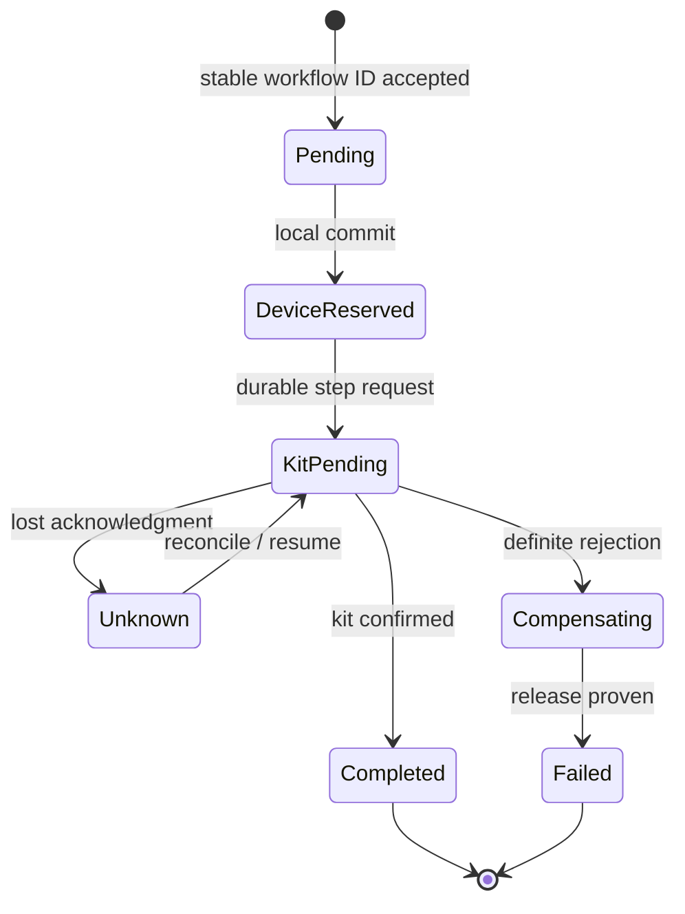

# Sagas, workflow recovery and compensation

**Owning question:** What business recovery contract replaces a nonexistent global rollback?

This page belongs to [V04/C05 — Outbox, inbox, sagas and durable workflows](README.md). Use the integrated walkthrough for the surrounding decision; the sections below own this narrower mechanism and its limits.

<!-- tycho-question-source:tycho.page.aa810dd152884b35a84f0f4cbe4369e9:4 -->
## 4. A saga is a business protocol, not an automatic rollback

[Richardson's Saga pattern](https://microservices.io/patterns/data/saga.html) coordinates a sequence of **local transactions**, with compensating actions when a business step cannot complete. Choreography propagates progress through events; orchestration explicitly coordinates steps.

Original invented workflow: reserve a device, allocate a supporting kit, confirm a booking, then optionally notify its requester. The business might allow the device reservation to be released if kit allocation definitively fails. But a release itself can fail; a delivered message cannot be un-delivered; the kit may already have been handed to a participant. The domain must determine which actions are reversible and which require manual reconciliation.

| Step | Durable state needed | False assumption |
|---|---|---|
| Admit command | Stable workflow/operation identity | In-memory queue acceptance is durable |
| Reserve device | Identity, commit result and cancellation contract | Every accepted step is instantly reversible |
| Request kit | Request identity and uncertain outcome policy | Timeout means rejected |
| Compensate device | Confirmed release or repair state | A compensation call always succeeds |
| Confirm final booking | Evidence required by user contract | Earlier partial success means final completion |
| Notify requester | Separate optional delivery effect identity | Exactly-once notification follows from a broker |

**Text alternative:** the workflow progresses through recorded states. Losing an acknowledgment creates an explicit unknown state requiring reconciliation; compensations can themselves remain incomplete. The diagram is a conceptual state machine, **not** an executed durable workflow.

<!-- /tycho-question-source -->

> **Pattern atlas:**
> [Saga](../../v11-pattern-atlas/c04-consistency-events/README.md#saga) — decision conditions and contraindications.
> [Saga Choreography](../../v11-pattern-atlas/c04-consistency-events/README.md#saga-choreography) — decision conditions and contraindications.
> [Saga Orchestration](../../v11-pattern-atlas/c04-consistency-events/README.md#saga-orchestration) — decision conditions and contraindications.
> [Compensating Transaction](../../v11-pattern-atlas/c04-consistency-events/README.md#compensating-transaction) — decision conditions and contraindications.

> **Pattern atlas:**
> [Process Manager / Routing Slip](../../v11-pattern-atlas/c03-messaging-integration/README.md#process-manager-routing-slip) — decision conditions and contraindications.

<!-- tycho-question-source:tycho.page.aa810dd152884b35a84f0f4cbe4369e9:5 -->
## 5. Durable workflow selection is conditional

One service and one database transaction are often simpler than a saga. Move to orchestration only when a business operation genuinely spans multiple independently owned effects with different failure and recovery boundaries. A durable coordinator may help with long waits, retries and auditability, but its actual guarantees depend on versioned workflow state persistence, activity semantics, timer reliability and recovery configuration.

**Choreography risks:** difficult-to-discover implicit coupling, unbounded event chains, conflicting compensations, and tracing that describes correlation but not durable business truth.

**Orchestration risks:** central coordinator as an added operational dependency; poor command/event boundaries; storing critical progress only in a volatile scheduler; failed compensation hidden behind an automatically “completed” state.

Neither is universally superior. Measure the number of participating owners, duration, idempotency requirements, recoverability, operations burden and business acceptance conditions.

### Worked recovery: an outbox relay that dies after delivery

**Original fictional transaction:** a workshop service commits booking R7 and an `outbox_event` row E9 in *one local database transaction*. A relay publishes E9 to a broker, but crashes before marking its local publication checkpoint. After restarting, it publishes E9 again. The source business fact remains one booking; deliveries are two attempts.

| Boundary | Persisted state | Correct failure response |
|---|---|---|
| Booking + E9 commit | R7 and E9 durable together | Relay can recover from the outbox; no atomicity is claimed with the broker |
| First broker publish accepted | Broker may contain E9; relay checkpoint unknown | Retrying publication is possible; duplicate E9 expected |
| Consumer receives E9 twice | Event ID repeats; two network deliveries | One consumer-local effect using durable inbox/dedup + business update |
| Compensation requested after downstream shipment | Local cancellation cannot unsend physical shipment | Explicit business compensation and an unresolved/manual state if reversal is impossible |

The [Transactional Outbox pattern](https://microservices.io/patterns/data/transactional-outbox) supports persisting publication intent with the business change and recognizes relay duplication. The [Idempotent Consumer pattern](https://microservices.io/patterns/communication-style/idempotent-consumer.html) addresses duplicate effect handling at the consumer's *own* durability boundary. A [Saga](https://microservices.io/patterns/data/saga.html) coordinates independent local transactions and compensations; compensation is not an automatic global rollback.

**Alternative and limit:** if an operation needs one atomic local invariant, keep it in the same transaction when feasible. Introduce a durable workflow only when independent long-lived participants require it, and describe irreversible steps, retry limits, authorization and operator repair. An external email or payment service may not expose the exact dedup/reconciliation contract this design needs.

**Proposed, not executed:** kill the relay after broker acknowledgment and before its checkpoint; replay E9 twice; crash the consumer after its effect but before broker acknowledgment; interrupt compensation after an irreversible step. Assert one intended local business effect, traceable progress and an explicit manual recovery state where exact undo is impossible. This chapter owns durable choreography; logical operation identity belongs to [V04/C04](../c04-retries-idempotency-and-duplicate-effects/retries-idempotency-and-ambiguous-effects.md).

<!-- /tycho-question-source -->
<!-- tycho-question-source:tycho.page.aa810dd152884b35a84f0f4cbe4369e9:6 -->
## 6. Test failures rather than just the happy path

A bounded design verification should inject: crash just before/after local state+outbox commit; relay crash after broker acknowledgment; duplicate deliveries processed concurrently; out-of-order events; restart of an orchestration instance mid-step; definitive failure and compensation failure; old/new event schema coexistence; lost external acknowledgment after irreversible effect.

Acceptance requires the same **correct authoritative business result** under permitted failures, plus bounded unknown/repair states and observable lag. Checking that all generated messages reached a topic is insufficient. **No executable fixture was run** for this manuscript.

<!-- /tycho-question-source -->

## Navigation, prerequisites and source scope

| Route | Destination |
|---|---|
| Parent and source ledger | [Chapter introduction and exact source rows](README.md#chapter-source-ledger) |
| Previous / prerequisite | [Read preceding context](inbox-atomicity.md) |
| Next | [Continue the reasoning](README.md) |
| Integrated question | [Original scenario and limits](outbox-inbox-sagas-and-durable-workflows.md) |

The source material keeps its original published/inferred/synthetic/unverified distinctions. Chapter-wide citations are shared reference context, not proof that every cited source supports every sentence on this page. Freshly inspected text is identified explicitly; absent dates and unknowns are retained.
