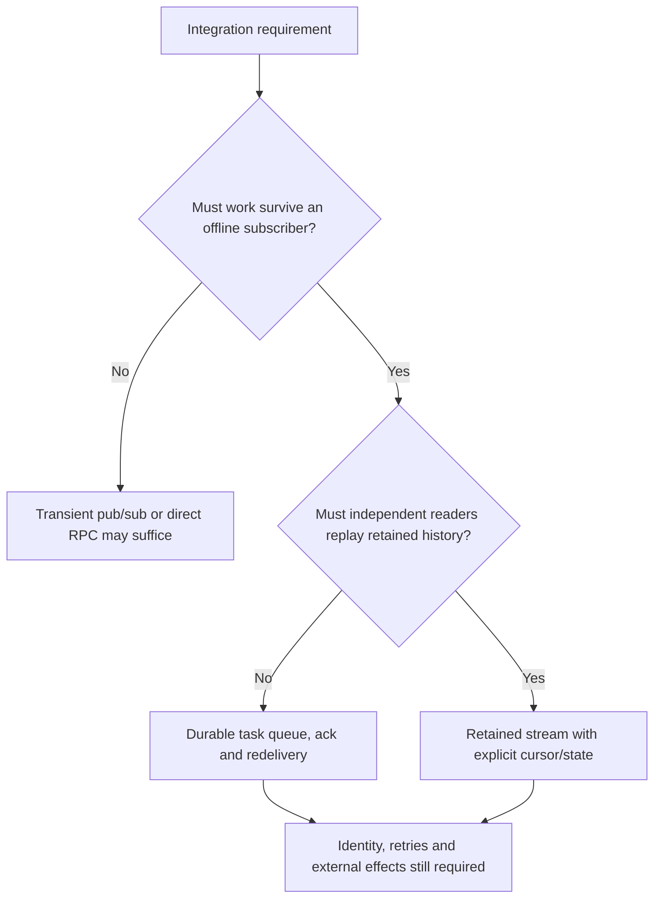
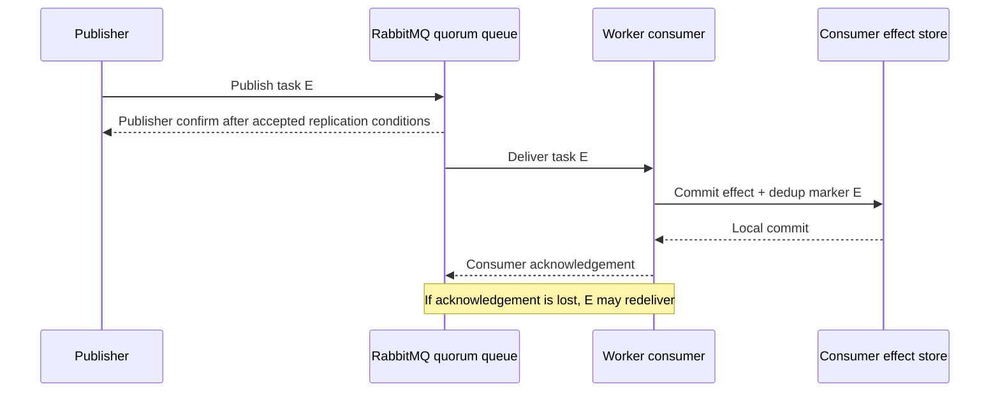
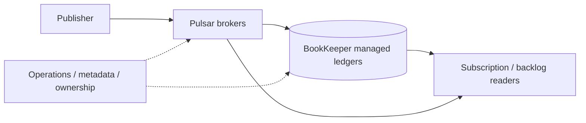

# Consumer requirements and messaging families

**Owning question:** Which ownership, retention and replay contract selects a messaging family?

This page belongs to [V04/C06 — Messaging families and delivery contracts](README.md). Use the integrated walkthrough for the surrounding decision; the sections below own this narrower mechanism and its limits.

<!-- tycho-question-source:tycho.page.98616bdc3c514ea997b2cfe30ad7c070:1 -->
## 1. First identify what a consumer must own

Text alternative: decide whether a publication must survive absent subscribers, then whether multiple independent consumers must replay history. The answer changes the required persistence and cursor model; every option still needs business-level identity and failure handling. This is an original question route, not a product-selection algorithm.

### RabbitMQ quorum queues and publisher confirms

Official RabbitMQ **4.3** *Reliability Guide* and *Consumer Acknowledgements and Publisher Confirms* distinguish two acknowledgements: the broker's confirmation to the publisher (acceptance/persistence responsibility according to queue mode) and the consumer's acknowledgement of processing to the broker. These are independent; publisher confirm does **not** mean the consumer performed a business transaction. Quorum queues maintain replicated queue state and rely on the publisher/consumer protocols for data safety. [E01, E02]

Text alternative: RabbitMQ can confirm taking responsibility for a task separately from a consumer acknowledging its effect. If the worker crashes after local effect but before acknowledgement, task redelivery may occur. Consumer-side deduplication is necessary for nonrepeatable effects.

Quorum queues are not automatically ideal for very short-lived temporary queues, the lowest latency or arbitrarily large replay backlogs; RabbitMQ's [quorum-queue guide](https://www.rabbitmq.com/docs/quorum-queues) explicitly discusses these choices. It also describes replicated queue members and the costs of data safety; the existence of replication does not prove a specific application's recovery SLO.

**Point-to-point queue.** A queue dispatches each message to one eligible consumer;
competing consumers share the work, and a consumer acknowledgement retires the message
(after any configured redelivery policy). A publisher confirm means the broker accepted
responsibility, not that a consumer completed the business effect.

**Message broker and bridge.** A broker routes, stores and delivers messages between
producers and consumers. A bridge forwards or translates between brokers/protocols, adding
another hop, retention policy and failure domain. Direct request/response, pub/sub fan-out
or a shared log may be preferable when one consumer owns each task or when brokered
indirection adds no routing/reliability value.

### NATS Core and JetStream

The current public [NATS JetStream concept documentation](https://docs.nats.io/concepts/jetstream) distinguishes **Core NATS** pub/sub delivery to online subscribers from **JetStream** persistent streams with server-side consumer cursors and acknowledgements. The page describes Core as at-most-once and JetStream's ordinary redelivery as at-least-once, under their respective configurations. [E03]

A fictional notification can use ephemeral pub/sub if losing a signal when no subscriber is listening is acceptable. A durable business task should not casually use Core alone if clients require recoverable delivery; a JetStream durable consumer or another persisted queue may better match that requirement.

JetStream stream retention and consumer policies still need version/configuration-specific testing, especially around publisher deduplication windows, consumer ack timeouts, replicas and restart behavior. No NATS server was installed or exercised for this page.

**Publish/subscribe.** A topic fans each publication out to every current matching
subscriber; ephemeral subscribers lose messages published while they are absent. Topic
design, subscriber registration and per-subscriber cursors are part of the delivery
contract.

**Event-driven consumer.** The consumer reacts to a delivered message rather than polling a
queue. It must own effect identity, deduplication and acknowledgement ordering: a crash
after the effect but before acknowledgement causes redelivery, while acknowledging before
the effect can lose work.

**Durable subscriber.** A durable subscriber keeps a server-side cursor and retained
messages for an offline consumer, so delivery can resume after disconnect. Retention,
acknowledgement timeout and replay policy determine whether that resume is bounded.

**Invariant and alternative.** Every consumer still needs a stable effect identity and a
deduplication/acknowledgement rule; durable storage does not make the business effect
idempotent. Polling a queue or a direct request may be preferable when delivery volume is
low or the consumer cannot own a cursor.

### Apache Pulsar broker and storage split

The publicly versioned [Apache Pulsar 4.1 Architecture Overview](https://pulsar.apache.org/docs/4.1.x/concepts-architecture-overview/) describes brokers and a **BookKeeper-backed persistent storage layer** with ledger/segment ownership. A broker endpoint is not automatically the sole durable copy of retained messages. Partitioning, subscription type, backlog and BookKeeper quorum/ledger mechanics must be examined for the actual workload. [E04]

This is a different operational decomposition from RabbitMQ queues or Kafka log replication, but the difference alone does **not** prove superior throughput or disaster recovery. It changes the components a team must scale, observe, secure, back up and restore.

Text alternative: Pulsar brokers serve publishers/subscribers while separate managed-ledger storage persists messages; a subscription's backlog and broker/ledger availability must be considered together. This simplified architecture is based on documented roles and does not represent an actual cluster's topology.

<!-- /tycho-question-source -->

> **Pattern atlas:**
> [Publish / Subscribe](../../v11-pattern-atlas/c03-messaging-integration/README.md#publish--subscribe) — decision conditions and contraindications.
> [Point-to-Point Queue](../../v11-pattern-atlas/c03-messaging-integration/README.md#point-to-point-queue) — decision conditions and contraindications.
> [Competing Consumers](../../v11-pattern-atlas/c03-messaging-integration/README.md#competing-consumers) — decision conditions and contraindications.
> [Event-Driven Consumer](../../v11-pattern-atlas/c03-messaging-integration/README.md#event-driven-consumer) — decision conditions and contraindications.
> [Durable Subscriber](../../v11-pattern-atlas/c03-messaging-integration/README.md#durable-subscriber) — decision conditions and contraindications.
> [Message Broker / Messaging Bridge](../../v11-pattern-atlas/c03-messaging-integration/README.md#message-broker--messaging-bridge) — decision conditions and contraindications.
> [Content-Based Router](../../v11-pattern-atlas/c03-messaging-integration/README.md#content-based-router) — decision conditions and contraindications.
> [Message Filter](../../v11-pattern-atlas/c03-messaging-integration/README.md#message-filter) — decision conditions and contraindications.
> [Pipes and Filters](../../v11-pattern-atlas/c03-messaging-integration/README.md#pipes-and-filters) — decision conditions and contraindications.
> [Resequencer](../../v11-pattern-atlas/c03-messaging-integration/README.md#resequencer) — decision conditions and contraindications.
> [Canonical Data Model](../../v11-pattern-atlas/c03-messaging-integration/README.md#canonical-data-model) — decision conditions and contraindications.

<!-- tycho-question-source:tycho.page.98616bdc3c514ea997b2cfe30ad7c070:2 -->
## 2. Requirement-driven comparison, not a ranking

| Question | RabbitMQ quorum queue | NATS Core / JetStream | Pulsar 4.1 | Kafka 4.1 (related chapter) |
|---|---|---|---|---|
| Primary reader model | Consumer acks durable queue deliveries | Core transient pub/sub; JetStream persistent streams and stateful consumers | Topic, subscription and persistent ledger/backlog | Ordered per-partition log, consumer offset/group |
| Retry after worker failure | Manual ack and broker redelivery semantics | JetStream ack timeout/redelivery; Core has no durable replay | Subscription ack/redelivery under configuration | Consumer re-read after uncommitted offset |
| Historical replay | Queue is not equivalent to retained independent log; RabbitMQ Streams separate option | JetStream stream supports replay modes | Subscription retention/backlog according to mode | Position-based replay inside retention |
| Replication/recovery | Quorum queue replication, leader/ISR-like safety policy specific to RabbitMQ | Stream replicas plus consumer state when configured | Broker + managed ledger/BookKeeper durability | Partition leaders/ISR/min ISR and group rebalance |
| Operational burden | Rabbit broker/queue policy, disk, connection, consumer flow | Core simple topology; JetStream adds durable stream/consumer management | Brokers, storage cluster and metadata/ledger operations | Broker/controller, partitions, ISR and producer/consumer clients |
| Typical disqualifier | Need many independent rewindable readers of same very large history | Core insufficient for offline durable work | Cost/operations of broker+BookKeeper unacceptable | Retained partition log and Kafka operations unnecessary for a simple work queue |

Rows describe **documented conceptual capabilities** of selected versions, not measured latency, pricing, throughput or operational superiority. Message ordering is typically scoped to queue/subscription/stream/partition and concrete producer/consumer behavior; no column implies global total order.

<!-- /tycho-question-source -->

## Navigation, prerequisites and source scope

| Route | Destination |
|---|---|
| Parent and source ledger | [Chapter introduction and exact source rows](README.md#chapter-source-ledger) |
| Previous / prerequisite | [Read preceding context](messaging-families-and-durable-workflows.md) |
| Next | [Continue the reasoning](workflow-failure.md) |
| Integrated question | [Original scenario and limits](messaging-families-and-durable-workflows.md) |

The source material keeps its original published/inferred/synthetic/unverified distinctions. Chapter-wide citations are shared reference context, not proof that every cited source supports every sentence on this page. Freshly inspected text is identified explicitly; absent dates and unknowns are retained.

## Bounded pattern ownership notes

These notes define the decision boundary for atlas cards whose mechanism is
not the main subject of this page. They are synthetic design guidance, not
measured evidence, and they do not create a new source claim.

### Resequencer

A resequencer restores an intended order from messages that arrive out of order. It needs
a sequence domain, a bounded buffer, a gap timeout and a policy for missing or duplicate
sequence numbers. Use it when order is a business invariant and the stream has a reliable
sequence. Do not use it when order is irrelevant or when an unbounded gap would stall the
stream.

The failure path is a missing sequence that blocks later messages; release the buffer
after a declared timeout or fail the affected partition. At the buffer cap, reject or spill
with evidence rather than dropping silently; a message that arrives after its slot was
released needs a declared late disposition: discard with evidence, reconcile or route to
a repair queue. A partitioned consumer that
preserves order within a key is the alternative when global order is unnecessary.

**Limits.** Buffer memory, gap timeout and ordering scope are costs; a global resequencer can
become a throughput bottleneck.

### Content-Based Router

A content-based router chooses a destination from message content. It needs a versioned
predicate set, a default or dead-letter path and an owner for rule changes. Predicate
fields must be authenticated or validated; routing on an untrusted field lets the producer
choose a destination. Use it when routing depends on message attributes and destinations
have different contracts. Do not
use it when routing rules are unstable, unowned or unable to classify every message.

The failure path is an unmatched or misrouted message; route to a declared fallback and
record the predicate version. A workflow/orchestrator is the alternative when routing needs
multiple steps or compensations; do not hide a process engine inside the router. A static
topic or queue per producer fits when routing is known at publish time.

**Limits.** The predicate set is a policy surface: test unmatched, multi-match and rule
rollout, because a misroute is not repaired by retry. Rule changes need a canary and a
rollback path.

### Pipes and Filters

Pipes and filters decompose processing into ordered, replaceable stages connected by a
message contract. Each stage needs its own failure and retry policy, and the pipeline
needs backpressure, a rule for partial completion and a declared ordering scope. Each stage
needs an effect identity for deduplication and its own lag or queue-depth signal, not only an
end-to-end completion metric. Use it when stages can be developed, scaled or replaced
independently. Do not use it when the work must be one atomic
transaction or when per-stage latency would exceed the budget.

The failure path is a failed middle stage with earlier effects already applied; record
stage identity and compensate or replay from a declared checkpoint. A single in-process
transformation is the alternative when the stages are small and cannot be operated
independently.

**Limits.** Distributed stages add message contracts and partial-failure states; an in-process
pipeline cannot be scaled independently.

### Competing Consumers

Several consumers read from one queue, and each message is delivered to one of them so the work is
processed in parallel. Acknowledgment must follow the durable business effect, and redelivery after
a missing acknowledgment must not duplicate that effect.

A slow or poisoned message blocks progress through visibility timeouts and repeated redelivery;
bound attempts and route permanently failing work to a declared terminal path. Partitioned consumers
own a stable key range and preserve per-key order; prefer competing consumers when order is not
required and pool parallelism is the goal.

**Limits.** Pool parallelism removes per-key order unless partition assignment is explicit;
a poison message needs a terminal path, not infinite visibility timeouts. A per-key worker
pool preserves order only when partition assignment is stable.

### Message Filter

A message filter evaluates a predicate and forwards only matching messages to a consumer, discarding
the rest by policy. Every discarded message must be an intentional drop under a versioned predicate,
not an unobserved loss.

Predicate drift or a missing default path silently removes traffic; monitor filter rates and keep a
declared fallback for unmatched messages. A rejected message needs a declared disposition:
discard with audit, fallback, or dead-letter queue, each with a retention owner. A
content-based router sends different subsets to different destinations; prefer filtering when
the destination is the same and only selection changes.

**Limits.** Silent drops are data loss; count filter rates, version the predicate and keep a
declared fallback. A filter that silently drops unmatched traffic is a data-loss path; count
drops, alert on rate changes and test the fallback with a representative unmatched message.

### Canonical Data Model

A canonical data model gives producers and consumers one versioned shared representation, with
translation at the edges instead of pairwise formats. The canonical schema must be versioned and
lossless for the fields each consumer needs, and translation must fail explicitly when a required
meaning is absent.

A translation can preserve syntax while losing domain meaning; contract tests with representative
payloads and an owner for schema changes are required. Point-to-point translation or an
anti-corruption layer avoids a central schema when integrations are few or their models genuinely
differ.

**Limits.** A shared schema centralizes governance and can become a bottleneck; translation
still needs semantic tests and an owner. Schema ownership needs a review path and a
deprecation window; point-to-point translation is cheaper for a few stable pairs.

### Publish-Subscribe

Publish-subscribe is a delivery contract, not a fire-and-forget call. A publisher names a topic,
and each current subscriber gets its own cursor; a subscriber absent during publication sees
nothing unless the subscription is durable. Record whether it is ephemeral or durable before
claiming a guarantee.

A crash after the effect but before acknowledgement causes redelivery; acknowledging before the
effect can lose work. Each consumer therefore needs an effect key, a deduplication rule and an
acknowledgement policy. A subscription name is not a business identity.

Fan-out cost grows with subscriber count; an unknown or unbounded population makes load and
retention unownable. Cap registration or partition the topic. Use ephemeral pub/sub only when
losing a signal with no listener is acceptable; a durable business task needs a persisted
consumer or queue.

### Point-to-Point Queue

A queue delivers each message to one eligible consumer. The acknowledgement retires it after the
configured redelivery policy; a publisher confirmation does not prove the consumer committed its
effect. A worker crash after the effect but before acknowledgement can cause redelivery, so
nonrepeatable effects need consumer-side deduplication and stable effect identity.

The queue contract must state its ordering scope and terminal path for poison messages. A worker
pool needs a visible in-flight count and a redelivery limit, not only higher prefetch. Use direct
request/response, fan-out or a shared log when one owner per task is enough or brokering adds no
routing value. A queue fits when each task needs exactly one owner and the consumer can absorb
redelivery. The queue owner records that choice.

### Event-Driven Consumer

A push subscription hands each message to the consumer; the handler, not a polling loop, decides
when work is acknowledged. It must own effect identity, deduplication and acknowledgement
ordering. The subscription declares a prefetch or in-flight
bound and an acknowledgement window; when in-flight work reaches the bound, pause delivery or add
capacity rather than buffering without limit.

A crash between effect and acknowledgement leaves the outcome unknown; acknowledging before the
effect can lose work. The handler must commit the business effect and the dedup marker in one
local transaction when possible; otherwise it needs a reconciliation path for the unknown state.
Concurrency and ordering requirements belong to the subscription contract, not to the framework
default.

Polling a queue or a scheduled batch job may be preferable when volume is low, batch control matters
or the consumer cannot own a cursor. Reverse to polling when event volume and concurrency overwhelm
the consumer. Event-driven consumption is justified when latency and fan-out matter more than
the operational cost of a push subscription.

### Durable Subscriber

A server-side cursor plus retained messages lets an offline consumer resume after reconnect. Resume is bounded only by retention, acknowledgement timeout and replay policy.

Delivery guarantees differ by broker and configuration. A durable stream commonly provides
at-least-once delivery: the consumer needs a stable effect key and dedup before applying, or a
resumed cursor can double-apply local effects. A best-effort subscription can lose work. A
durable cursor is not a backup of the consumer's business state; if the consumer's database
is lost, replaying the stream may not reconstruct the effect. Define retention, max
redelivery and the action when the cursor is too far behind. A replay older than the
declared deadline is stale: detect it from event time or cursor age and route it to repair
rather than applying it blindly.

Ephemeral pub/sub fits a notification whose loss while offline is acceptable. A recoverable
business task needs a durable consumer or another persisted queue, not a best-effort
subscription alone.

### Message Broker-Messaging Bridge

A broker moves messages between producers and consumers; a bridge translates across brokers or
protocols and adds a hop, retention policy and failure domain. The bridge contract must preserve
identity, ordering and delivery semantics across translation.

A publisher confirmation is not a consumer commit. Crossing two brokers can duplicate or delay at
either boundary. The bridge needs its own identity mapping, dead-letter path and delivery contract;
a faithful contract on one side does not imply the same on the other.

Use direct request/response, fan-out or a shared log when brokering adds no routing value. A bridge
is justified when protocol or organizational boundaries cannot be removed and its extra failure
domain is owned. The bridge owner records the translation contract.
