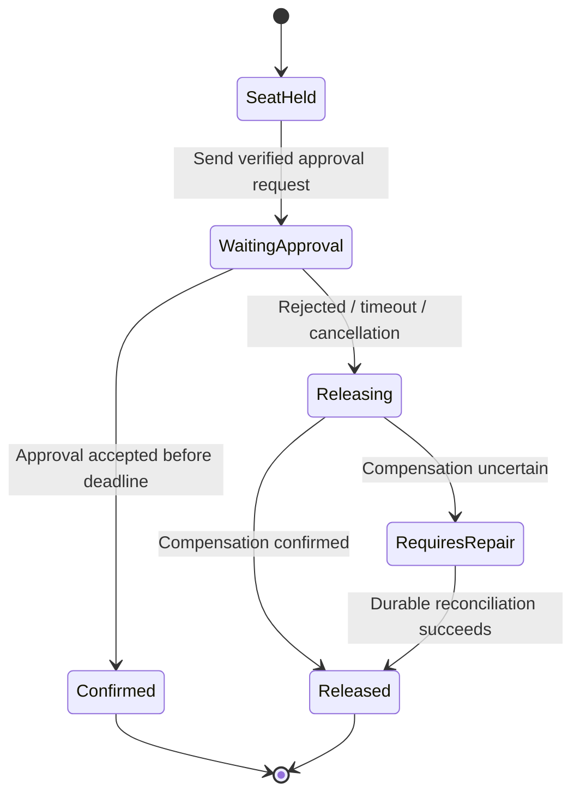

# Workflow state and messaging failure gates

**Owning question:** When does a queue need an additional durable business-state protocol?

This page belongs to [V04/C06 — Messaging families and delivery contracts](README.md). Use the integrated walkthrough for the surrounding decision; the sections below own this narrower mechanism and its limits.

<!-- tycho-question-source:tycho.page.98616bdc3c514ea997b2cfe30ad7c070:3 -->
## 3. A durable workflow is more than a queue

Suppose a fictional registration process must: hold a seat, request external approval, wait up to 24 hours for a human review, then either confirm or release capacity. A message queue can deliver each step, but does not by itself persist **the entire multi-step business state machine, timers, cancellation policy and compensation outcome**.

A durable workflow engine is an architectural **candidate** if it persistently records process progress, timer deadlines, retry identities, versions, transitions and compensation logic under an explicit recovery contract. However, no named workflow engine is recommended or behavior guaranteed by this page: version-specific product analysis and failure experiments must be performed before selecting one.

Text alternative: a long-running process holds a seat and waits for approval. It either confirms or initiates release. Failed or ambiguous compensation moves into a repair state, not an invented success. This original state machine is **not** executed by a workflow engine or broker.

Use the [saga/isolation research](../c03-consistency-and-distributed-transactions/transaction-isolation-and-sagas.md) for compensation and concurrency. Choosing a workflow product does not make its external SQL transactions automatically atomic.

<!-- /tycho-question-source -->
<!-- tycho-question-source:tycho.page.98616bdc3c514ea997b2cfe30ad7c070:4 -->
## 4. Failure and applicability gates

| Workload/failure property | What to measure or test before recommending |
|---|---|
| One hot queue/stream subject | Arrival mix, key skew, consumer concurrency and fair scheduling |
| Producer acknowledgement loss | Broker's accepted/durable state, retry identity and duplicate risk |
| Offline consumer for days | Retention, storage growth/backlog catch-up, expiry and resumption semantics |
| Rebalanced consumer ownership | In-flight effect, ack/cursor commit and side-effect idempotence |
| Cross-region or storage loss | Quorum location, backup/restore, RPO/RTO and replay tests |
| Poison message or schema mismatch | Quarantine/retry budget, dead-letter policy and source of truth |
| Long-running process | Durable state, timers, compensation and human intervention ownership |

**Insufficient evidence:** "We send 10,000 messages/s. Which broker is fastest and cheapest?" Cannot answer without payload/size distribution, replication/durability, subscriber count, retention, batch/ack mode, failure headroom, security and an apples-to-apples benchmark. User and message counts alone are not enough.

<!-- /tycho-question-source -->

## Scheduled runs, durable timers and poison-work recovery

**Enrichment contract:** keep scheduling, execution attempts and the resulting business effect separately identifiable. A queue acknowledgement or workflow completion flag is not proof that an external effect occurred once.

### Original recurring-job example

A fictional catalogue recalculates a summary for each completed UTC day. The logical job key is the task definition plus the covered interval, not the worker's launch timestamp. Two schedulers launching the same interval must converge on the same durable job identity. Two legitimate backfills for different intervals must remain distinct.

Declare a missed-run policy: skip, execute every missed interval, or coalesce under an explicitly defined equivalent operation. Coalescing is wrong if intermediate results or side effects matter. Declare overlap policy too: reject, queue or allow parallel runs with guarded output. A singleton scheduler does not protect against a former worker completing late; use [destination fencing](../c02-replication-consensus-and-leader-changes/leader-recovery.md#leases-stale-owners-and-fencing-at-the-destination).

The SRE distributed-cron chapter discusses missed versus duplicate launches as a workload-specific decision. Its chosen policy is not a universal promise for all schedulers.

| Durable record | Why it matters |
|---|---|
| Definition/version and scheduled interval | Reconstruct intent independently of retries and clock observation |
| Run ID and effect identity | Separate attempts from the logical outcome |
| Current state and ownership epoch | Recover work without trusting a dead worker's memory |
| Timer deadline and action | Resume waiting after process loss |
| Retry count, age and last classified error | Prevent infinite poison-work loops |
| Operator decision and repair evidence | Make manual intervention attributable and bounded |

### Poison work is a policy state

An invalid schema or permanently rejected target is not repaired by retrying forever. Classify transient, permanent and unknown outcomes; cap attempts and total age; preserve enough evidence in quarantine to diagnose without leaking payloads. A dead-letter queue is a holding mechanism, not successful delivery or an automatically safe replayer.

For a fictional failed publication command K, repair may require correcting input while preserving the same logical effect identity, or creating an explicitly new operation if intent changes. Replaying with a new ID merely to bypass deduplication risks a duplicate external effect. Recheck current authorization before repair.

### Workflow history and upgrades

Temporal's overview describes replay against recorded history; its patching documentation explains explicit branches for compatible changes. That supports a concrete concern: changing code that old histories will replay is an ongoing compatibility obligation. It does not prove arbitrary application effects are exactly once.

An original upgrade plan separates new executions from histories already waiting for approval. Retain a compatible worker route or a supported history-aware change until old executions finish or are deliberately migrated. Record the schema/version of pending input, timer meaning and compensation step. Removing the old branch before its histories expire can make recovery fail only after a later worker restart.

~~~mermaid
stateDiagram-v2
    [*] --> Scheduled
    Scheduled --> Claimed: Stable run identity
    Claimed --> Waiting: Durable timer or external approval
    Waiting --> Running: Recorded event permits progress
    Running --> Completed: Required effect resolved
    Running --> Retryable: Transient failure within budget
    Retryable --> Claimed: Same logical identity
    Running --> Quarantined: Permanent or exhausted failure
    Quarantined --> RepairAuthorized: Reviewed correction
    RepairAuthorized --> Claimed: Explicit repair contract
~~~

Text alternative: durable state, not process memory, explains why a job may run again. Quarantine requires a separate repair decision. This synthetic state machine was not run in a workflow engine.

### Sources and acceptance

Inspected selected passages 2026-10-20: [Distributed Periodic Scheduling with Cron](https://sre.google/sre-book/distributed-periodic-scheduling/) (launch failure policy), [Workflow message passing and versioning](https://docs.temporal.io/workflow-execution) (history/replay), [Patching](https://docs.temporal.io/patching) (compatible changes). SDK-specific APIs and worker-version routing are not prescribed.

Proposed tests: kill scheduler after persisting intent but before dispatch; kill worker after effect but before acknowledgement; replay quarantined work; pause through several scheduled intervals; restore an old workflow history on a new worker version. Require correct interval coverage and effect identity. No scheduler, broker or workflow execution was performed.

## Navigation, prerequisites and source scope

| Route | Destination |
|---|---|
| Parent and source ledger | [Chapter introduction and exact source rows](README.md#chapter-source-ledger) |
| Previous / prerequisite | [Read preceding context](message-selection.md) |
| Next | [Continue the reasoning](README.md) |
| Integrated question | [Original scenario and limits](messaging-families-and-durable-workflows.md) |

The source material keeps its original published/inferred/synthetic/unverified distinctions. Chapter-wide citations are shared reference context, not proof that every cited source supports every sentence on this page. Freshly inspected text is identified explicitly; absent dates and unknowns are retained.
