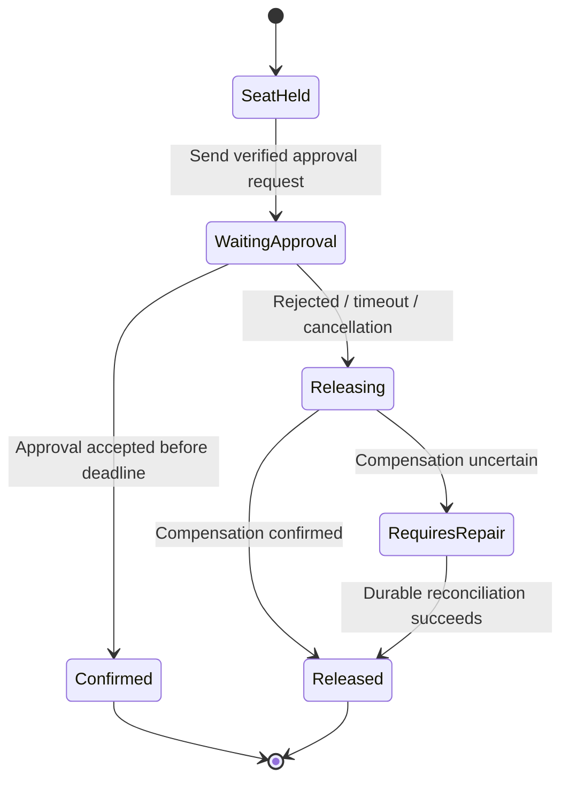

# Workflow state and messaging failure gates

**Owning question:** When does a queue need an additional durable business-state protocol?

This page belongs to [V04/C06 — Messaging families and delivery contracts](README.md). Use the integrated walkthrough for the surrounding decision; the sections below own this narrower mechanism and its limits.

<!-- tycho-question-source:tycho.page.98616bdc3c514ea997b2cfe30ad7c070:3 -->
## 3. A durable workflow is more than a queue

Suppose a fictional registration process must: hold a seat, request external approval, wait up to 24 hours for a human review, then either confirm or release capacity. A message queue can deliver each step, but does not by itself persist **the entire multi-step business state machine, timers, cancellation policy and compensation outcome**.

A durable workflow engine is an architectural **candidate** if it persistently records process progress, timer deadlines, retry identities, versions, transitions and compensation logic under an explicit recovery contract. However, no named workflow engine is recommended or behavior guaranteed by this page: version-specific product analysis and failure experiments must be performed before selecting one.

Text alternative: a long-running process holds a seat and waits for approval. It either confirms or initiates release. Failed or ambiguous compensation moves into a repair state, not an invented success. This original state machine is **not** executed by a workflow engine or broker.

Use the [saga/isolation research](../c03-consistency-and-distributed-transactions/transaction-isolation-and-sagas.md) for compensation and concurrency. Choosing a workflow product does not make its external SQL transactions automatically atomic.

<!-- /tycho-question-source -->

> **Pattern atlas:**
> [Request-Reply Messaging](../../v11-pattern-atlas/c03-messaging-integration/request-reply-messaging.md#request-reply-messaging) — decision conditions and contraindications.
> [Correlation Identifier](../../v11-pattern-atlas/c03-messaging-integration/README.md#correlation-identifier) — decision conditions and contraindications.
> [Claim Check](../../v11-pattern-atlas/c03-messaging-integration/claim-check.md#claim-check) — decision conditions and contraindications.
> [Dead Letter Channel / DLQ](../../v11-pattern-atlas/c03-messaging-integration/README.md#dead-letter-channel--dlq) — decision conditions and contraindications.

<!-- tycho-question-source:tycho.page.98616bdc3c514ea997b2cfe30ad7c070:4 -->
## 4. Failure and applicability gates

| Workload/failure property | What to measure or test before recommending |
|---|---|
| One hot queue/stream subject | Arrival mix, key skew, consumer concurrency and fair scheduling |
| Producer acknowledgement loss | Broker's accepted/durable state, retry identity and duplicate risk |
| Offline consumer for days | Retention, storage growth/backlog catch-up, expiry and resumption semantics |
| Rebalanced consumer ownership | In-flight effect, ack/cursor commit and side-effect idempotence |
| Cross-region or storage loss | Quorum location, backup/restore, RPO/RTO and replay tests |
| Poison message or schema mismatch | Quarantine/retry budget, dead-letter policy and source of truth |
| Long-running process | Durable state, timers, compensation and human intervention ownership |

**Insufficient evidence:** "We send 10,000 messages/s. Which broker is fastest and cheapest?" Cannot answer without payload/size distribution, replication/durability, subscriber count, retention, batch/ack mode, failure headroom, security and an apples-to-apples benchmark. User and message counts alone are not enough.

<!-- /tycho-question-source -->

## Scheduled runs, durable timers and poison-work recovery

**Enrichment contract:** keep scheduling, execution attempts and the resulting business effect separately identifiable. A queue acknowledgement or workflow completion flag is not proof that an external effect occurred once.

Generic scheduling, missed-run, overlap and durable-timer mechanics are owned by the
[V04/C05 periodic-work page](../c05-outbox-inbox-sagas-and-durable-workflows/periodic-work-leases-and-exactly-once.md).
This section keeps only the messaging-specific consequence: a queue acknowledgement or
workflow-completion flag is not proof that the scheduled external effect occurred once.

### Poison work is a policy state

An invalid schema or permanently rejected target is not repaired by retrying forever. Classify transient, permanent and unknown outcomes; cap attempts and total age; preserve enough evidence in quarantine to diagnose without leaking payloads. A dead-letter queue is a holding mechanism, not successful delivery or an automatically safe replayer.

For a fictional failed publication command K, repair may require correcting input while preserving the same logical effect identity, or creating an explicitly new operation if intent changes. Replaying with a new ID merely to bypass deduplication risks a duplicate external effect. Recheck current authorization before repair.

**Dead-letter mechanism.** A dead-letter channel routes a message that exceeds its retry or
age policy to a quarantine queue, preserving payload, headers and failure reason. It is a
holding and triage mechanism, not delivery, repair or an automatically safe replay.

**Alternative.** Retrying with backoff, dropping with an audit record, or parking the work in
a repair table/outbox may be preferable when the failure is deterministic or the broker
cannot retain evidence safely. Reverse the DLQ choice when quarantine retention and manual
repair cost exceed the value of preserving the message.

### Workflow history and upgrades

Temporal's overview describes replay against recorded history; its patching documentation explains explicit branches for compatible changes. That supports a concrete concern: changing code that old histories will replay is an ongoing compatibility obligation. It does not prove arbitrary application effects are exactly once.

An original upgrade plan separates new executions from histories already waiting for approval. Retain a compatible worker route or a supported history-aware change until old executions finish or are deliberately migrated. Record the schema/version of pending input, timer meaning and compensation step. Removing the old branch before its histories expire can make recovery fail only after a later worker restart.

~~~mermaid
stateDiagram-v2
    [*] --> Scheduled
    Scheduled --> Claimed: Stable run identity
    Claimed --> Waiting: Durable timer or external approval
    Waiting --> Running: Recorded event permits progress
    Running --> Completed: Required effect resolved
    Running --> Retryable: Transient failure within budget
    Retryable --> Claimed: Same logical identity
    Running --> Quarantined: Permanent or exhausted failure
    Quarantined --> RepairAuthorized: Reviewed correction
    RepairAuthorized --> Claimed: Explicit repair contract
~~~

Text alternative: durable state, not process memory, explains why a job may run again. Quarantine requires a separate repair decision. This synthetic state machine was not run in a workflow engine.

### Sources and acceptance

Inspected selected passages 2026-10-20: [Distributed Periodic Scheduling with Cron](https://sre.google/sre-book/distributed-periodic-scheduling/) (launch failure policy), [Workflow message passing and versioning](https://docs.temporal.io/workflow-execution) (history/replay), [Patching](https://docs.temporal.io/patching) (compatible changes). SDK-specific APIs and worker-version routing are not prescribed.

Proposed tests: kill scheduler after persisting intent but before dispatch; kill worker after effect but before acknowledgement; replay quarantined work; pause through several scheduled intervals; restore an old workflow history on a new worker version. Require correct interval coverage and effect identity. No scheduler, broker or workflow execution was performed.

## Navigation, prerequisites and source scope

| Route | Destination |
|---|---|
| Parent and source ledger | [Chapter introduction and exact source rows](README.md#chapter-source-ledger) |
| Previous / prerequisite | [Read preceding context](message-selection.md) |
| Next | [Continue the reasoning](README.md) |
| Integrated question | [Original scenario and limits](messaging-families-and-durable-workflows.md) |

The source material keeps its original published/inferred/synthetic/unverified distinctions. Chapter-wide citations are shared reference context, not proof that every cited source supports every sentence on this page. Freshly inspected text is identified explicitly; absent dates and unknowns are retained.

## Bounded pattern ownership notes

These notes define the decision boundary for atlas cards whose mechanism is
not the main subject of this page. They are synthetic design guidance, not
measured evidence, and they do not create a new source claim. Claim Check and
Request-Reply Messaging have moved to dedicated source-bound owner pages.

### Claim Check

See the [dedicated Claim Check owner note](claim-check.md).

### Correlation Identifier

A correlation identifier ties together messages that belong to one request, workflow or
conversation. It needs a generation rule, propagation across asynchronous boundaries, a
retention window and a collision check. Uniqueness is scoped to the operation, not global; a
value reused across operations is a collision, and generation must verify that scope. Use it
when independent messages must be joined for diagnosis, deduplication or reply
routing. Do not use it as an authorization token or when the transport already
provides an equivalent identity.

The failure path is a lost or duplicated identifier; carry it in the message contract and
record it at every boundary. Ambiguous matching or an expired identifier needs a disposition:
quarantine unmatched messages, resolve by a secondary key, or reissue; an expired identifier
maps to a dead-letter or audit record with an owner. A transport-native message
identity is the alternative when the broker guarantees the needed scope and
lifetime.

**Limits.** Correlation is not deduplication: it groups messages but does not prove one effect;
identifier retention and trust boundaries need an owner.

### Request-Reply Messaging

See the [dedicated Request-Reply Messaging owner note](request-reply-messaging.md).

### Dead Letter Channel-DLQ

A quarantine queue receives a message after its retry or age policy is exhausted, retaining
payload, headers and failure context. The DLQ is a policy state, not a second work queue
that silently retries forever.

**Invariant.** A message must leave the retry path when its retry budget is exhausted or its
failure is permanent, and must enter a declared quarantine with enough context to diagnose it.
The Enterprise Integration Patterns Dead Letter Channel page states: "When a messaging system
determines that it cannot or should not deliver a message, it may elect to move the message
to a Dead Letter Channel." Amazon SQS makes the retry bound explicit: "The maxReceiveCount is
the number of times a consumer can receive a message from a source queue before it is moved
to a dead-letter queue." The Azure Service Bus dead-letter queue page states the purpose and
permanent-failure cases: "The purpose of the dead-letter queue is to hold messages that can't
be delivered to any receiver, or messages that couldn't be processed." and "When the delivery
count exceeds the limit, the message is moved to the DLQ." Its application-level section adds:
"Unacceptable messages can include messages that can't be properly processed because of any
sort of system issue, messages that hold malformed payloads, or messages that fail
authentication when some message-level security scheme is used." These sentences support
retry exhaustion and permanent failure as quarantine triggers; classifying each outcome as
transient, permanent or unknown remains Tycho guidance.

Retrying cannot repair an invalid schema or a permanently rejected target. Separate
transient, permanent and unknown outcomes; bound attempts and age; keep diagnostic evidence
without leaking payload. The DLQ needs an owner, an alert threshold, a retention horizon, a
capacity limit, an access policy and a cleanup owner. A replay procedure preserves the
original effect identity, reauthorizes the action and checks whether the effect was already
committed before republishing; a blind replay is a duplicate-effect risk.

**Alternative.** Bounded retry with an audit record, dropping with a recorded disposition, or
parking the work in a repair table/outbox may be preferable when failure is deterministic or
the broker cannot retain evidence safely. Hookdeck's alternatives guide explicitly compares a
DLQ with database persistence, a retry table and a transactional outbox: "Instead of moving
failed events to a separate queue, persist them directly to a database table."; "A variation
of database persistence, the retry table pattern uses a dedicated table specifically for
events that need reprocessing."; "After a maximum number of attempts, events move to a failed
state for manual review."; "The transactional outbox pattern solves the dual-write problem."
The guide also states the reversal: "For high-scale systems with dedicated platform teams,
traditional DLQs remain a solid choice." Those sentences support database persistence,
retry-table and outbox alternatives with a bounded-attempt/record path. The AWS page supports
the retry bound and the Azure page the diagnostic record, but neither compares these
alternatives. The guide is webhook-specific; the drop-with-record variant and the general
transfer beyond webhooks remain Tycho guidance. A DLQ is a fit when the failure is inspectable
and a human or repair job can decide the terminal outcome.

**Source boundary.** EIP page record `read.batch2-dlq.2026-10-21`, revision
`714f6babd327e622695d9be989c93c704d23b034cb2e0fcc1065a0eaa203a278`; publisher-abridged,
and requeue, ownership, retention and alerting are not stated. AWS page read 2026-10-30;
canonical text SHA-256
`c6142288904155bbd99a057145c632195aa76ab86aa939a38a9f0825f3c7e74b`; sections "Using
dead-letter queues in Amazon SQS", "Using policies for dead-letter queues" and
"Understanding message retention periods for dead-letter queues". Azure page read 2026-10-30;
canonical text SHA-256
`200c9ae3c042cab7a8852b33cda0214c14b5eab177a04f2bdcc02ae665005600`; document version
`19d4a83e-55c8-8b9c-38a0-0e9a26ba2cdb`, ms.date 2026-07-16 and updated_at 2026-07-22;
sections "The dead-letter queue", "Moving messages to the DLQ", "Maximum delivery count"
and "Application-level dead-lettering". Hookdeck alternatives guide read 2026-10-30; raw
Markdown alternate SHA-256
`bd4ed76074e2d44f3eaa3e0b8b5f85fed27b00f6867b71e5ba21c439a239d1af`; sections "The
Database Persistence Pattern", "The Retry Table Pattern", "The Transactional Outbox
Pattern" and "Choosing the Right Approach"; webhook-specific vendor guide with no explicit
reuse license, short excerpts only. All four are public documentation or public vendor
guidance, not benchmarks. No replay, retention, redrive or repair behavior was executed.

