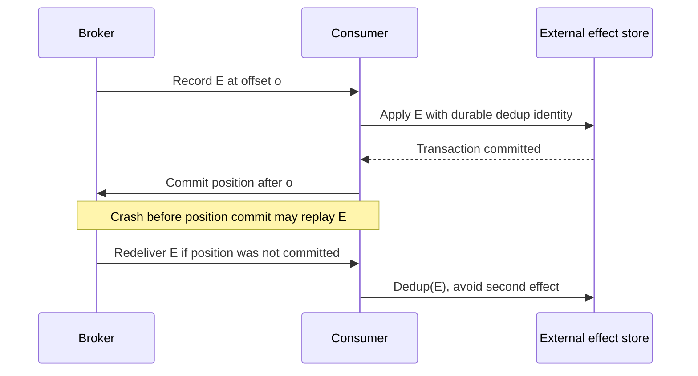

# Offsets, effects and recovery

**Owning question:** Which crash point separates a committed application effect from a consumer offset?

This page belongs to [V04/C07 — Kafka logs, partitions and transactions](README.md). Use the integrated walkthrough for the surrounding decision; the sections below own this narrower mechanism and its limits.

<!-- tycho-question-source:tycho.page.0b493340594c4c4392c5d93940a7f319:4 -->
## 4. Consumer offset, effect and crash points

The consumer must decide when to mark its position consumed, often relative to applying an external business effect.

Text alternative: after applying the external effect, the consumer commits its position. A crash between those actions causes replay; the external store's own deduplication protocol must make the duplicate harmless. The diagram is a proposed consumer contract.

Committing offset *before* the external effect can cause that effect to be silently lost after a crash. Committing it *after* the effect can cause duplicates. No perfect ordering of two independent commits creates an automatic global transaction.

### Producer idempotence and Kafka transactions

Kafka 4.1 documentation **Message Delivery Semantics** and **Using Transactions** discuss idempotent producers and transactions coordinating records/offsets *within Kafka* under supported clients and isolation modes. [E02]

- **Idempotent producer** reduces duplicates caused by eligible retried sends within its producer/broker contract. It is not a unique business operation key across arbitrary application restarts and input sources.
- **Kafka transaction** can coordinate publication to Kafka partitions and (in supported consume-transform-produce workflows) offsets with Kafka output, but it does not automatically enclose an unrelated SQL commit, payment provider or email delivery.
- `read_committed` is an isolation choice for transactional Kafka records; it is not proof that every consumer's external side effect happens once.
- Stream-processing frameworks may offer an **exactly-once processing guarantee within a bounded Kafka state/output topology**; the scope must be explicitly stated alongside connector and external sink behavior.

**Insufficient evidence question:** "Kafka transactions are enabled, therefore our external transfer side effect can never happen twice." False inference. Need source input identity, sink transaction/idempotency, replay/failure tests, external provider contract and reconciliation policy.

### A Kafka transaction cannot atomically commit an arbitrary business database

The [Kafka 4.1 design reference](https://kafka.apache.org/41/design/design/) explains a transactional read-process-write pattern: published Kafka records and consumed offsets included in the *Kafka transaction* can be committed atomically. It does **not** describe an atomic transaction over an independent PostgreSQL row or email effect.

**Original hypothetical:** a consumer reads Kafka source offset 41, changes an authoritative shipment row in PostgreSQL, emits a new Kafka event and commits its position. Two durability authorities now coexist.

| Crash window | Durable observation | Recovery rule |
|---|---|---|
| Before PostgreSQL commit | No business-row change | Reprocess with the original operation identity |
| After PostgreSQL commit, before Kafka output/offset commit | Row changed; Kafka side can still retry the input | Durable idempotency/effect key must suppress the duplicate row transition |
| After Kafka output/offset commit, before client acknowledgment | Kafka effects may be durable, response may be missing | Resolve the logical business outcome from its authority; do not infer from reply loss |
| Kafka output delivered, external email fails | Kafka record exists; mail outcome ambiguous | Separate consumer dedup/retry and reconciliation contract |

Even with transactional producers, the business application must decide how it atomically persists its **own** state and publication intent, for example by a [transactional outbox and consumer inbox](../c05-outbox-inbox-sagas-and-durable-workflows/outbox-inbox-sagas-and-durable-workflows.md). The outbox itself has repeated-delivery windows and cannot guarantee arbitrary external exactly-once effects. A consumer group offset is a replay position, not proof that every user-visible effect succeeded.

**Decision gate:** if a use case is a simple transient task queue with bounded retries and no retained event history, Kafka's partition/replay operations may be unnecessary. If durable partition history and replay are requirements, test producer fencing, rebalance, source replay, crash-after-database-commit and expired dedup keys. These are **proposed tests, not executed Kafka/PostgreSQL experiments**. Preserve exact Kafka broker/client version and configuration in any eventual results.

<!-- /tycho-question-source -->
<!-- tycho-question-source:tycho.page.0b493340594c4c4392c5d93940a7f319:5 -->
## 5. Failure and recovery matrix

| Condition | Boundary affected | What to check |
|---|---|---|
| Producer acknowledgement lost | Producer cannot tell if append occurred | Idempotence configuration, stable business/event IDs, retry policy |
| Leader crash during replication | Partition ownership/ISR may change | Configured min ISR, election, error response, client retry behavior |
| ISR below required threshold | Some acks/writes may reject rather than weaken durability | Broker/producer errors and documented availability gate |
| Consumer group rebalances | Partition assignments and processing pause/change | In-flight work, offset commits and business effect identity |
| Poison record | Partition may stop making progress or skip data | DLQ/quarantine contract, observability, schema handling |
| Source DB commit but relay lags | Kafka downstream sees stale state | Outbox/CDC lag, durable source intent and replay |
| Transaction aborts | Downstream visibility depends on isolation mode | Transactional IDs, abort markers, consumer configuration |
| Retention or compaction removes needed history | Late/rebuilding consumer cannot reconstruct required state | Retention horizon, full snapshots/backfills and event contract |

<!-- /tycho-question-source -->
<!-- tycho-question-source:tycho.page.0b493340594c4c4392c5d93940a7f319:6 -->
## 6. When Kafka is inappropriate

Kafka is a reasonable candidate for retained high-throughput streams, multiple independent readers, replay, stateful stream derivation and partitioned scale *when* operational support, source contracts and durability/retention guarantees are adequate.

It may be excessive for a small request/response integration with no replay needs or a single bounded queue where simpler operational semantics meet the constraints. Conversely, a simple queue is not an adequate substitute if the product explicitly requires multiple rewindable readers and long-lived retained log history.

No architecture can be chosen solely by a claimed RPS threshold, feature list or brand comparison. Compare offered load, key skew, retention/egress costs, consumer failure windows, ordering scope, security, operational support and end-to-end correctness.

<!-- /tycho-question-source -->

## Rebalance, external effects and expired replay positions

**Enrichment contract:** trace one effect across consumer ownership changes without extending a Kafka transaction to an unrelated database. Kafka 4.1 is the specific documentation version.

### Original external-effect trace

A fictional consumer reads partition P offset 70, applies operation K to SQL, then crashes before committing its next consumer position 71. Its successor reads 70 again. A unique durable receipt for K, committed atomically with the SQL effect, can let the successor recognize the existing result and move forward.

| Order | Crash consequence |
|---|---|
| Commit Kafka position before SQL effect | A successor may skip an effect that never committed |
| Commit SQL effect before position, no deduplication | A successor can repeat the effect |
| Commit SQL receipt and effect together, then position | Redelivery can resolve K if receipt scope/retention and SQL isolation are correct |
| Kafka transaction for Kafka input/output and position | Protects that declared Kafka boundary; external SQL still requires cooperation |

The Kafka design documentation explicitly distinguishes transactions on Kafka topics/positions from external output systems. read_committed also has a precise visibility contract; it is not an isolation mode for the application database.

~~~mermaid
sequenceDiagram
    participant A as Consumer A
    participant K as Kafka
    participant D as SQL effect owner
    participant B as Successor B
    K-->>A: Partition P offset 70, effect K
    A->>D: Atomically record K and apply effect
    Note over A: Crash before position commit
    K-->>B: Redeliver offset 70
    B->>D: Resolve duplicate K
    D-->>B: Existing durable result
    B->>K: Commit position 71 after resolution
~~~

Text alternative: source position and external effect can diverge. The synthetic receipt protocol repairs this crash window only under its stated local atomicity and retention assumptions.

### Ownership change does not cancel an in-flight external request

A revoked consumer may still have an outstanding SQL or HTTP operation. Stopping polling or receiving a rebalance callback does not retract that remote request. Guard the external effect with its own identity/ownership contract, drain or classify in-flight work, and commit only positions for resolved effects owned under the selected consumer protocol.

Kafka 4.1's max.poll.interval.ms behavior depends on group management and has static-membership/protocol caveats. Avoid one universal claim that a missed poll immediately moves every partition. Bound processing/poll behavior using the actual client and configuration.

### Retention expiry requires a data decision

If the requested offset no longer exists, auto.offset.reset chooses a configured behavior; it cannot recreate deleted records. latest may skip missing history, while earliest means the earliest retained history, not the beginning of all business events. A silent reset can turn a recovery failure into apparently healthy but incomplete output.

An original rebuild protocol creates a source snapshot with an explicit change boundary, reconstructs a new projection, applies retained subsequent changes with stable identities, compares completeness and then switches the read alias. It requires a source/CDC contract that actually closes the snapshot/change gap. If that boundary is unavailable, record insufficient evidence instead of promising lossless rebuild.

### Evidence and proposed acceptance

Inspected selected passages 2026-10-20: [Kafka delivery semantics](https://kafka.apache.org/41/design/design/#message-delivery-semantics) and [consumer offset reset, isolation and poll settings](https://kafka.apache.org/41/configuration/consumer-configs/). The SQL receipt and rebuild protocols are original unexecuted designs.

Proposed cases: crash after SQL commit, delayed external response across revocation, partial batch completion, aborted Kafka transaction under both isolation settings, offset older than retention and source rebuild while updates continue. Require user-level effect completeness and duplicates resolved, not merely zero consumer lag.

## Navigation, prerequisites and source scope

| Route | Destination |
|---|---|
| Parent and source ledger | [Chapter introduction and exact source rows](README.md#chapter-source-ledger) |
| Previous / prerequisite | [Read preceding context](replication-acks.md) |
| Next | [Continue the reasoning](README.md) |
| Integrated question | [Original scenario and limits](kafka-partitions-replication-and-contracts.md) |

The source material keeps its original published/inferred/synthetic/unverified distinctions. Chapter-wide citations are shared reference context, not proof that every cited source supports every sentence on this page. Freshly inspected text is identified explicitly; absent dates and unknowns are retained.
