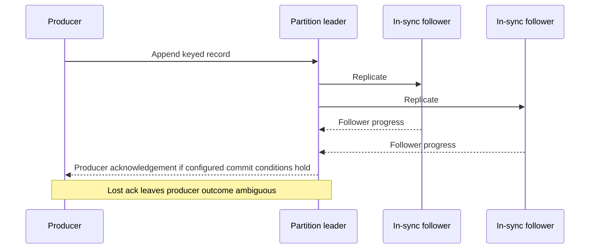

# Replication, ISR and acknowledgment

**Owning question:** Which replica and acknowledgment conditions bound durability and availability?

This page belongs to [V04/C07 — Kafka logs, partitions and transactions](README.md). Use the integrated walkthrough for the surrounding decision; the sections below own this narrower mechanism and its limits.

<!-- tycho-question-source:tycho.page.0b493340594c4c4392c5d93940a7f319:3 -->
## 3. Replicas, ISR and acknowledgement scope

A Kafka partition has a leader and replicas. The **in-sync replica set (ISR)** tracks follower status with respect to the leader; `acks=all` and `min.insync.replicas` are relevant to the expected durability/availability trade-off. A failed leader or insufficient ISR can interrupt accepted production rather than silently grant the same guarantee with fewer replicas. The exact 4.1 behavior includes newer **Eligible Leader Replicas** rules, so older Kafka folklore should not be substituted for the selected release's design and operations text. [E02, E03]

Text alternative: a leader appends and replicates a record. The broker's acknowledgement depends on producer/topic configuration and replica progress; if the producer never receives that acknowledgement it must not assume the record was absent. This diagram is a conceptual, simplified model, not a traced Kafka 4.1 cluster.

**Do not equate "replication factor 3" with "every record always survives any one failure."** The actual durability guarantee depends on producer acks, ISR/min ISR, leader election configuration, storage health, producer retry and how a commit is acknowledged. Loss/corruption and unclean elections have explicit trade-offs. Kafka 4.1's [Eligible Leader Replicas operations guide](https://kafka.apache.org/41/operations/eligible-leader-replicas/) is version-specific and must be consulted before relying on post-4.0 failover behavior. [E03]

### Eligible Leader Replicas are version- and upgrade-configuration scoped

Kafka's official [4.1 Eligible Leader Replicas operations reference](https://kafka.apache.org/41/operations/eligible-leader-replicas/) specifies that ELR was introduced in Kafka **4.0** and is **enabled by default for new clusters starting with 4.1**. That is not equivalent to saying it is active in every existing cluster merely because its brokers were upgraded to 4.1. Explicitly inspect the cluster's ELR protocol/configuration and partition state before using its leader-election behavior as a durability assumption.

The documented ELR logic relies on **strict minimum ISR/high-watermark constraints**, and under eligible conditions can elect a non-ISR replica that is safe according to that protocol. It does not mean an arbitrary stale replica may safely take leadership, nor does it let a client infer whether its lost producer acknowledgment represents an appended record. The actual failover contract still depends on broker release, feature/upgrade status, replication, ISR, producer `acks`, client retries, storage integrity and whether unclean election is permitted.

**Proposed negative test (not run):** compare a freshly created 4.1 cluster with an upgraded cluster for ELR enablement, reduce in-sync replicas below configured limits, lose the producer reply immediately before leader replacement, then inspect eligible leader metadata, acknowledged offsets and consumer-visible records. Reject an unconditional `RF=3 ⇒ no loss` claim. This source check is **about broker-record durability**, not application DB/payment exactly-once effects.

<!-- /tycho-question-source -->

## Navigation, prerequisites and source scope

| Route | Destination |
|---|---|
| Parent and source ledger | [Chapter introduction and exact source rows](README.md#chapter-source-ledger) |
| Previous / prerequisite | [Read preceding context](partitions-producers.md) |
| Next | [Continue the reasoning](offsets-effects.md) |
| Integrated question | [Original scenario and limits](kafka-partitions-replication-and-contracts.md) |

The source material keeps its original published/inferred/synthetic/unverified distinctions. Chapter-wide citations are shared reference context, not proof that every cited source supports every sentence on this page. Freshly inspected text is identified explicitly; absent dates and unknowns are retained.
