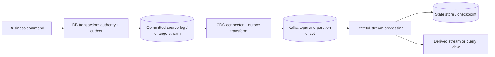
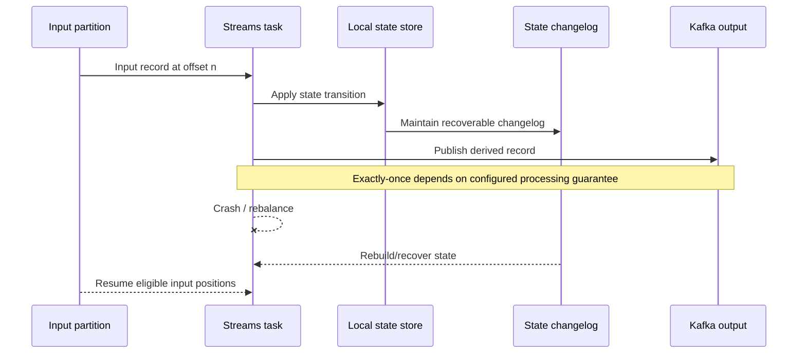

# CDC, task state and changelog replay

**Owning question:** Which records make an input and local processor state recoverable?

This page belongs to [V04/C08 — Stateful/event-time stream processing](README.md). Use the integrated walkthrough for the surrounding decision; the sections below own this narrower mechanism and its limits.

<!-- tycho-question-source:tycho.page.a2c47a0850154eaa95e1eb97e23f9c71:1 -->
## 1. From a database change to a replayable input

A relational database may already own an authoritative business state. A CDC pipeline
observes changes after a commit and publishes records to consumers. PostgreSQL 18
defines logical decoding as "extracting all persistent changes to a database's tables
into a coherent, easy to understand format," and a logical replication slot as "a
stream of changes that can be replayed to a client in the order they were made on the
origin server." Debezium 3.7's architecture page says its PostgreSQL connector "reads
from a logical replication stream"; the connector page says it "produces a change event
for every row-level insert, update, and delete operation that was captured" and writes
each table to a separate Kafka topic. The exact units and limits are bound in
[section 3](#change-data-capture-cdc).

Text alternative: authoritative business state and outbox intent are committed locally. A connector observes committed changes and publishes a versioned integration event into a partitioned stream. A stream task consumes it with managed state; derived outputs have their own correctness and recovery boundaries.

**Important distinctions:** database WAL position, Kafka partition offset, application state-store checkpoint and external sink commit are **not the same cursor**. An implementation must document where their alignment is guaranteed and where duplicates or gaps may be replayed.

**Failure and recovery.** Connector lag, WAL/slot retention, schema changes and
snapshot-to-stream gaps are common. Monitor lag and slot health, take a consistent snapshot,
handle schema evolution, and make downstream apply idempotent. A missing or expired slot can
require resnapshotting the source; that recovery point must be explicit. The bound conditions
and source limits are in [section 3](#change-data-capture-cdc).

**Alternative.** A transactional outbox plus relay or scheduled batch extraction may be
preferable when database log access is unavailable, when the source cannot retain a slot,
or when the team cannot operate a connector. Reverse the CDC choice when connector and
schema-coupling cost exceed the replay benefit. Dual-write with reconciliation remains an
unbound heuristic; section 3 gives the bound comparisons.

<!-- /tycho-question-source -->

> **Pattern atlas:**
> [Change Data Capture (CDC)](../../v11-pattern-atlas/c04-consistency-events/README.md#change-data-capture-cdc) — decision conditions and contraindications.

<!-- tycho-question-source:tycho.page.a2c47a0850154eaa95e1eb97e23f9c71:2 -->
## 2. Kafka Streams: tasks, state stores and changelogs

Kafka **4.1** Streams Architecture and 4.1 Processor API describe stateful tasks tied to stream partitions, local state stores, and fault-tolerant changelog topics that can restore processing state when tasks migrate or restart. They describe processing/parallelism under partition assignment and state restoration under rebalancing. [E03, E04]

Text alternative: a task reads from an input partition and updates a local store backed by a changelog. On crash or reassignment, a replacement task reconstructs state before continuing. Input/output/state consistency depends on Kafka Streams configuration and transactional processing scope, not on this conceptual diagram.

Kafka Streams `processing.guarantee` is documented with choices `at_least_once` and `exactly_once_v2` in the **4.1** configuration reference. This scoped guarantee does **not** by itself encompass an unrelated SQL transaction, remote payment or email provider. [E05]

### State restoration is a measurable operational cost

A persistent local store may need to replay a large changelog after task migration. The amount of state, disk/IO bandwidth, changelog compaction, standby replicas and the workload's live arrivals affect catch-up time. It is incorrect to say "state is fault tolerant, therefore recovery is instant." Monitor restoration duration, unprocessed input lag, output freshness and correctness during rebalances.

<!-- /tycho-question-source -->

## Navigation, prerequisites and source scope

| Route | Destination |
|---|---|
| Parent and source ledger | [Chapter introduction and exact source rows](README.md#chapter-source-ledger) |
| Previous / prerequisite | [Read preceding context](stateful-stream-processing-and-cdc.md) |
| Next | [Continue the reasoning](checkpoints-time.md) |
| Integrated question | [Original scenario and limits](stateful-stream-processing-and-cdc.md) |

The source material keeps its original published/inferred/synthetic/unverified distinctions. Chapter-wide citations are shared reference context, not proof that every cited source supports every sentence on this page. Freshly inspected text is identified explicitly; absent dates and unknowns are retained.

## Bounded pattern ownership notes

### Change Data Capture (CDC)

Change data capture reads the database's own change log and turns committed row changes
into a replayable stream. The log position, not the connector's wall clock, is the
cursor; a snapshot taken at a defined log position establishes the starting boundary.

Debezium's architecture page describes Kafka Connect source connectors that "send
records into Kafka" and says "The PostgreSQL connector reads from a logical replication
stream." The Debezium PostgreSQL connector "produces a change event for every row-level
insert, update, and delete operation that was captured" and writes each table to a
separate Kafka topic by default. PostgreSQL 18 defines "Logical decoding" as
"extracting all persistent changes to a database's tables into a coherent, easy to
understand format." These units describe a log-reading connector, not an exactly-once
transaction that spans the database and the consumer.

**Invariant.** The stream must preserve per-key order and transaction grouping. A
logical replication slot "represents a stream of changes that can be replayed to a
client in the order they were made on the origin server." Debezium uses the table's
primary key as the change-event key, so events for one row share a key, and Kafka
Connect writes "the change event records in the same order in which they were generated
to the appropriate Kafka topic." Transaction boundaries are available only when the
connector emits them: for every transaction BEGIN and END Debezium generates an event,
and each change event can carry `total_order` ("absolute position of the event among
all events generated by the transaction") and `data_collection_order`.

Two limits narrow the claim. Kafka orders records within a partition, not across a
topic; Debezium warns that "Ordering is guaranteed only for topics that use a single
partition" for truncate events, which have no key. And logical decoding has no DDL
stream: "Logical decoding does not support DDL changes. This means that the connector
is unable to report DDL change events back to consumers."

**Tycho rule:** require a row-identifying key, a partition scheme that keeps that key
on one partition, transaction metadata enabled when grouping is required, and an
idempotent apply identity built from the key and log position. A stream that satisfies
none of these is a change feed, not an ordered replayable input.

**Failure and recovery.** Connector lag, slot retention, schema changes and a
snapshot-to-stream gap are common. Debezium defines `MilliSecondsBehindSource` as the
gap "between the last change event's timestamp and the connector processing it", with
minimum, maximum, average and percentile variants. A replication slot "will prevent
removal of required resources even when there is no connection using them"; PostgreSQL
warns that this "consumes storage" and can, in extreme cases, shut the database down.
A slot can also be invalidated by retention settings. `restart_lsn` is "the LSN of the
oldest WAL that the connector might require," and PostgreSQL can remove required WAL
when it falls behind `max_slot_wal_keep_size`.

The initial snapshot reads the current log position before scanning and then streams
from that position, so a successful run does not miss updates made during the scan. If
the connector fails before recording completion, "upon restart the connector begins a
new snapshot." On restart it resumes from the recorded LSN while the slot remains
intact; dropping the slot means "you will lose data" because the removed WAL cannot be
reconstructed. Debezium can emit duplicate change events during recovery and provides
at-least-once delivery; its incremental snapshot path also does not support schema
changes while it is running.

A primary-key change has a window in which the JDBC key and the change event disagree.

**Tycho runbook:** monitor lag and slot health, alert before the retention limit, test a
schema change across the snapshot and streaming paths, and rebuild from a consistent
snapshot rather than assuming the stream is complete. A tombstone or delete event
needs an explicit downstream interpretation.

**Alternative.** A transactional outbox plus relay or scheduled extraction may be
preferable when log access is unavailable or the team cannot operate a connector.
Dual-write with reconciliation remains an unbound Tycho heuristic. Debezium's Outbox
Event Router says an outbox implementation "avoids inconsistencies between a service's
internal state ... and state in events consumed by services that need the same data";
its event ID can "remove duplicate messages," and its event key is "important for
maintaining correct order in Kafka partitions." Kafka Connect documents a source
connector that "would import a relational database into Kafka" and a mapping that
"uses a timestamp column to generate queries incrementally returning new data, and the
last queried timestamp can be used as the offset." That is a scheduled extraction
shape, not a log tail. No selected unit evaluates dual-write with reconciliation.

**Tycho choice rule:** reverse the CDC choice when log access is unavailable, the
source cannot retain a slot, schema changes cannot be governed, or connector operations
exceed the replay benefit. CDC is a fit when the log is accessible, the key and
transaction boundaries are explicit, and the consumer can tolerate derived,
at-least-once delivery.

**Bound source limits.** Six public units were inspected on 2026-10-31, plus
the retained Debezium Outbox Event Router unit: Debezium
*Architecture* (<https://debezium.io/documentation/reference/stable/architecture.html>);
*Debezium connector for PostgreSQL*
(<https://debezium.io/documentation/reference/stable/connectors/postgresql.html>);
PostgreSQL 18, *47.2. Logical Decoding Concepts*
(<https://www.postgresql.org/docs/current/logicaldecoding-explanation.html>);
PostgreSQL 18, *19.6. Replication* settings
(<https://www.postgresql.org/docs/current/runtime-config-replication.html>);
Kafka Connect 4.1, *Connector Development Guide*
(<https://kafka.apache.org/41/kafka-connect/connector-development-guide/>); and Kafka
Connect 4.1, *Overview* (<https://kafka.apache.org/41/kafka-connect/overview/>).
Records: `read.debezium-architecture.2026-10-31`,
`read.debezium-postgresql.2026-10-31`,
`read.postgres-logical-decoding.2026-10-31`,
`read.postgres-slot-retention.2026-10-31`, `read.kafka-connect-offsets.2026-10-31`
and `read.kafka-connect-overview.2026-10-31`; the outbox comparison retains
`read.debezium-outbox-binding.2026-10-31`. The units are documentation, not
benchmarks or production observations. Representation hashes and read scopes are in
the B62 lane note. Coverage is self-checked, not independently reviewed.
