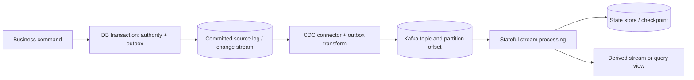
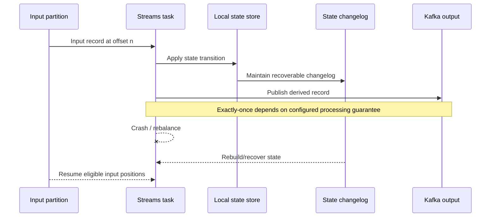

# CDC, task state and changelog replay

**Owning question:** Which records make an input and local processor state recoverable?

This page belongs to [V04/C08 — Stateful/event-time stream processing](README.md). Use the integrated walkthrough for the surrounding decision; the sections below own this narrower mechanism and its limits.

<!-- tycho-question-source:tycho.page.a2c47a0850154eaa95e1eb97e23f9c71:1 -->
## 1. From a database change to a replayable input

A relational database may already own an authoritative business state. A CDC pipeline observes changes after a commit and publishes records to consumers. PostgreSQL 17's logical-replication documentation describes publication/subscription and the logical change stream under PostgreSQL's configured replication mechanisms. Debezium **3.6** Outbox Event Router documents a concrete transform for outbox-table change events, including default event ID/header and aggregate key handling. [E01, E02]

Text alternative: authoritative business state and outbox intent are committed locally. A connector observes committed changes and publishes a versioned integration event into a partitioned stream. A stream task consumes it with managed state; derived outputs have their own correctness and recovery boundaries.

**Important distinctions:** database WAL position, Kafka partition offset, application state-store checkpoint and external sink commit are **not the same cursor**. An implementation must document where their alignment is guaranteed and where duplicates or gaps may be replayed.

<!-- /tycho-question-source -->

> **Pattern atlas:**
> [Change Data Capture (CDC)](../../v11-pattern-atlas/c04-consistency-events/README.md#change-data-capture-cdc) — decision conditions and contraindications.

<!-- tycho-question-source:tycho.page.a2c47a0850154eaa95e1eb97e23f9c71:2 -->
## 2. Kafka Streams: tasks, state stores and changelogs

Kafka **4.1** Streams Architecture and 4.1 Processor API describe stateful tasks tied to stream partitions, local state stores, and fault-tolerant changelog topics that can restore processing state when tasks migrate or restart. They describe processing/parallelism under partition assignment and state restoration under rebalancing. [E03, E04]

Text alternative: a task reads from an input partition and updates a local store backed by a changelog. On crash or reassignment, a replacement task reconstructs state before continuing. Input/output/state consistency depends on Kafka Streams configuration and transactional processing scope, not on this conceptual diagram.

Kafka Streams `processing.guarantee` is documented with choices `at_least_once` and `exactly_once_v2` in the **4.1** configuration reference. This scoped guarantee does **not** by itself encompass an unrelated SQL transaction, remote payment or email provider. [E05]

### State restoration is a measurable operational cost

A persistent local store may need to replay a large changelog after task migration. The amount of state, disk/IO bandwidth, changelog compaction, standby replicas and the workload's live arrivals affect catch-up time. It is incorrect to say "state is fault tolerant, therefore recovery is instant." Monitor restoration duration, unprocessed input lag, output freshness and correctness during rebalances.

<!-- /tycho-question-source -->

## Navigation, prerequisites and source scope

| Route | Destination |
|---|---|
| Parent and source ledger | [Chapter introduction and exact source rows](README.md#chapter-source-ledger) |
| Previous / prerequisite | [Read preceding context](stateful-stream-processing-and-cdc.md) |
| Next | [Continue the reasoning](checkpoints-time.md) |
| Integrated question | [Original scenario and limits](stateful-stream-processing-and-cdc.md) |

The source material keeps its original published/inferred/synthetic/unverified distinctions. Chapter-wide citations are shared reference context, not proof that every cited source supports every sentence on this page. Freshly inspected text is identified explicitly; absent dates and unknowns are retained.
