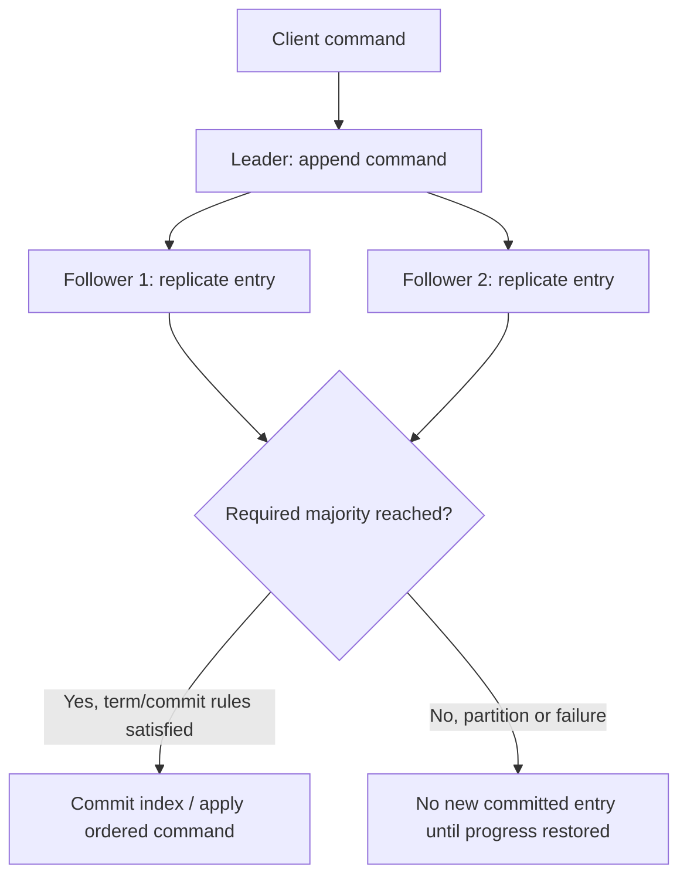

# Agreement, availability and uncertain observations

**Owning question:** Which fault assumption separates an ordering claim from an agreement guarantee?

This page belongs to [V04/C01 — Time, causality and ordering](README.md). Use the integrated walkthrough for the surrounding decision; the sections below own this narrower mechanism and its limits.

<!-- tycho-question-source:tycho.page.d4822cc1e71c4f73896b7f6509f6daae:2 -->
## 2. Agreement, linearizability and availability solve different problems

Agreement means replicas reach a consistent decision within a specified model. **Replicated state-machine consensus** usually sequences commands in an agreed log so deterministic replicas can apply compatible histories. **Linearizability** is a stronger client-visible condition about the apparent atomic placement of operations between invocation and response. Sequential ordering within a log does not automatically make every client-facing read linearizable unless the read path and leader/term checks enforce the required behavior.

The official 2014 extended Raft report (Ongaro and Ousterhout), §§2 and 5, explains replicated state machines and decomposes Raft into **leader election, log replication and safety**. Its published fault model assumes non-Byzantine failures, and write availability depends on a communicating majority. [E02]

Text alternative: the elected leader sequences a command and sends it to followers. A majority and the protocol's term/commit rules are required to regard an entry as committed. Without sufficient communication, progress can stop rather than allow contradictory committed logs. This is a simplified **synthetic three-replica sketch** of ideas described in Raft; not an executable trace.

For a five-member fixed voter configuration, majority is three. If only two members can communicate, that partition cannot form a majority to commit new log entries. This **does not prove the whole application becomes unavailable**: cached/possibly stale reads, local work and independent subsystems may behave differently. Nor does a majority imply all old readers see the same state immediately.

### What Raft safety requires beyond electing a leader

The 2014 Raft report §5.4 explains that a candidate must meet a log up-to-date restriction, preventing a newly elected leader from discarding committed information. Its leader-completeness and log-matching properties need persistent term/vote/log state, not merely a label that says "leader". The paper distinguishes a current-term majority commit rule from blindly declaring older-term entries committed on majority presence alone. [E02]

```mermaid
stateDiagram-v2
    [*] --> Follower
    Follower --> Candidate: Election timeout
    Candidate --> Leader: Wins votes from a majority
    Candidate --> Follower: Recognizes established higher-term leader
    Candidate --> Candidate: Split election; new term
    Leader --> Follower: Observes higher term
    Leader --> Follower: Recovery / restart as follower
```

Text alternative: a node usually follows; loss of leader communication can trigger an election. A candidate that receives the required votes becomes leader, and a node seeing a higher term steps down. The model omits many message, storage and membership details and does not prove liveness under arbitrary timing.

### Safety versus progress under partitions

Consensus designs distinguish **safety** (no incompatible committed histories under the assumed failure model) from **liveness** (operations continue to make progress when required communication, timing and availability conditions hold). In a network partition, choosing safety may intentionally refuse writes from a minority. This is not the same as a generic claim that every read in the application must be unavailable or that every type of database offers the same guarantee.

Do **not** assume:
- all algorithms with leader election provide consensus;
- a replication factor of three means any one machine loss has no impact on latency;
- "eventually replicated" means linearizable reads;
- a consensus log protects arbitrary external database effects, HTTP retries or side effects outside its replicated state machine.

<!-- /tycho-question-source -->
<!-- tycho-question-source:tycho.page.d4822cc1e71c4f73896b7f6509f6daae:4 -->
## 4. Failure and recovery questions

| Disturbance | Potential consequence | Required evidence |
|---|---|---|
| Leader crash before a write commits | Client may see timeout; entry may or may not survive depending on state | Durable log position, majority/term state, client's retry/idempotency outcome |
| Leader crash after a write commits, before reply | Caller cannot infer commit from response absence | Query/retry protocol and committed command identity |
| Minority network partition | No new majority-committed writes in that partition | Quorum membership, routing and read-consistency mode |
| Election storm or clock delay | Availability/latency may degrade while safety should remain intact under model | Election logs, message delays, election configuration and deterministic test |
| Membership reconfiguration | Wrong quorum transition may compromise safety | Version-specific joint/reconfiguration protocol and adversarial tests |
| Application database side effect outside consensus | Replicated log order cannot undo a downstream double effect | Explicit transaction and external effect contract |

<!-- /tycho-question-source -->
<!-- tycho-question-source:tycho.page.d4822cc1e71c4f73896b7f6509f6daae:5 -->
## 5. Applicability, alternatives and insufficient evidence

Use replicated consensus when several fault-prone nodes must agree on an ordered configuration, leader lease/epoch, log, or authoritative state with explicit failure assumptions. Avoid introducing an application-level consensus cluster simply to publish a best-effort notification or to generate globally increasing business IDs if a simpler authoritative database transaction or single-writer contract meets the requirement.

A legitimate alternative can be one durable local database with a single authoritative writer, eventual replicated read models, per-aggregate ordered streams or conflict reconciliation. The decision is driven by invariants and failure objectives, not by "many users" as an unexplained proxy.

**Insufficient-evidence case:** "Our system has five replicas. Can we promise always-available strongly consistent writes during any data-center failure?" **No.** Need explicit voter placement, quorum reachability, regional failure domains, read/write semantics, client routing, persistence/recovery rules and failure tests. The number five alone proves no such service-level guarantee.

<!-- /tycho-question-source -->

## Navigation, prerequisites and source scope

| Route | Destination |
|---|---|
| Parent and source ledger | [Chapter introduction and exact source rows](README.md#chapter-source-ledger) |
| Previous / prerequisite | [Read preceding context](causal-order.md) |
| Next | [Continue the reasoning](README.md) |
| Integrated question | [Original scenario and limits](causality-ordering-and-consensus.md) |

The source material keeps its original published/inferred/synthetic/unverified distinctions. Chapter-wide citations are shared reference context, not proof that every cited source supports every sentence on this page. Freshly inspected text is identified explicitly; absent dates and unknowns are retained.
