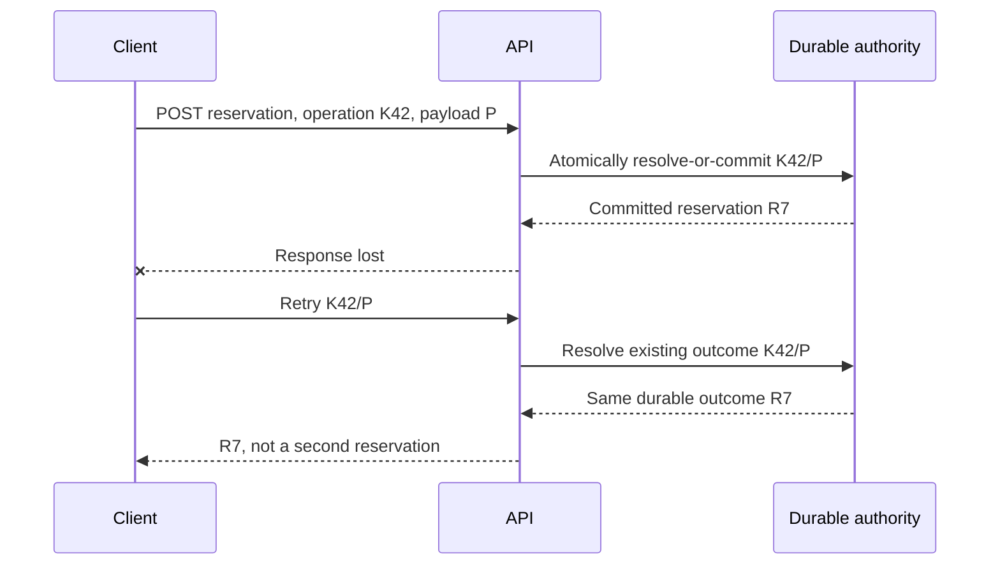

# Logical intent and duplicate submission

**Owning question:** How are retry attempts bound to one payload and business intent?

This page belongs to [V04/C04 — Retries, idempotency and duplicate effects](README.md). Use the integrated walkthrough for the surrounding decision; the sections below own this narrower mechanism and its limits.

<!-- tycho-question-source:tycho.page.8d28a6e14a1c49d6b67bf9cb5bfb242f:1 -->
## 1. Distinguish five identities

| Identifier | Names | Dangerous confusion |
|---|---|---|
| Logical operation ID | One authorized user intent with defined parameters and scope | New ID created for every retry |
| Transport attempt ID | One transmitted HTTP/RPC/message attempt | Counting attempts as distinct successful effects |
| Resource/business ID | Durable object the operation acts on or creates | Assuming resource ID equals request identity |
| Event ID | One persisted notification of a committed domain fact | Assuming two deliveries are two distinct events |
| Consumer-effect key | One externally observable effect applied by a particular consumer | Deduplicating only a transport packet |

A retry identity must be scoped to the relevant owner/tenant/principal and operation semantics. Its retention must be long enough for accepted retry/reconciliation behavior, but a finite key window cannot prevent arbitrary delayed replay forever. When a key is reused with **different intent or parameters**, a safe API detects the conflict rather than silently returning an unrelated prior result.

<!-- /tycho-question-source -->
<!-- tycho-question-source:tycho.page.8d28a6e14a1c49d6b67bf9cb5bfb242f:2 -->
## 2. HTTP method idempotence has a precise scope

RFC 9110 defines PUT and DELETE as idempotent and safe methods as idempotent under **intended request effect** semantics. It explicitly allows non-identical logging or revision history on repeated requests. The method's abstract semantics do not prove a particular handler is correctly implemented, nor that any non-idempotent POST is safe to repeat automatically.

A **POST with an explicit idempotency identity** can be designed so repeated valid equivalent commands resolve to one durable logical outcome. But that is an *application contract* requiring correct storage, parameter checking, concurrency control and retention; simply accepting a request header does not enforce it.

| Client observation | Safe inference | Unsafe inference |
|---|---|---|
| Explicit authenticated validation rejection before admission | Command was not accepted if boundary is guaranteed | Every 4xx is always pre-commit |
| Response with completed resource identity | Client has an observed result for this attempt | All downstream side effects happened |
| Network timeout or lost reply | Outcome may be unknown | Server did nothing |
| Retried request returns same result | Application may have reconciled a prior effect | Every attempt was never executed |
| Broker redelivery | One event can be delivered more than once | Domain state changed again |

<!-- /tycho-question-source -->
<!-- tycho-question-source:tycho.page.8d28a6e14a1c49d6b67bf9cb5bfb242f:3 -->
## 3. Original synthetic sequence: double-submit on equipment booking

A fictional application accepts a request to reserve one physical unit for a specific interval. The server commits reservation **R7** for logical operation key **K42**, but the response is lost. The client repeats K42 with equivalent parameters.

**Text alternative:** a server may commit the effect before losing its response. With stable scoped intent and an atomic deduplication contract, a repeat returns the same committed outcome. This depicts a proposed invariant, not a system tested or deployed.

If the client submits **K42 with different dates/units**, the service must reject or explicitly handle this conflict. It must not pretend that an old result confirms the changed request. If the original transaction is still executing, the server needs a concurrency-safe “in progress / wait / conflict / result lookup” protocol. Two simultaneous first attempts cannot both pass a naive read-then-insert check unless the state authority makes their identity decision atomic.

<!-- /tycho-question-source -->

## Navigation, prerequisites and source scope

| Route | Destination |
|---|---|
| Parent and source ledger | [Chapter introduction and exact source rows](README.md#chapter-source-ledger) |
| Previous / prerequisite | [Read preceding context](retries-idempotency-and-ambiguous-effects.md) |
| Next | [Continue the reasoning](dedup-authority.md) |
| Integrated question | [Original scenario and limits](retries-idempotency-and-ambiguous-effects.md) |

The source material keeps its original published/inferred/synthetic/unverified distinctions. Chapter-wide citations are shared reference context, not proof that every cited source supports every sentence on this page. Freshly inspected text is identified explicitly; absent dates and unknowns are retained.
