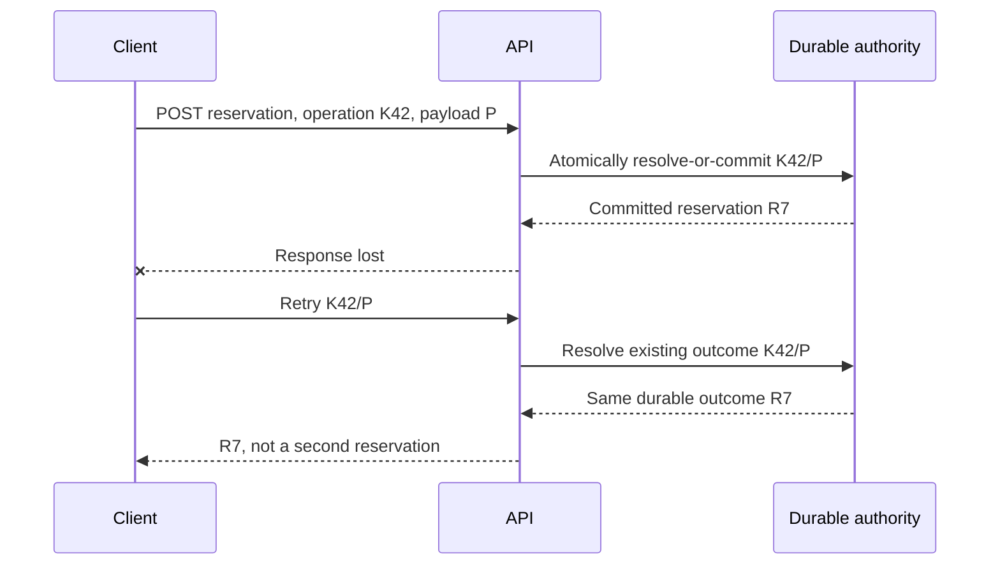

# Retries, idempotency and ambiguous side effects

> **Tycho book manuscript — proposed V04/C04**, 2026-10-19. Original synthetic command and failure sequences. Independently inspected RFC 9110 §9.2.2 and public idempotent-consumer pattern references. No service, transaction, replay, production trace or independently reviewed contract test was executed. Previous combined [outbox/idempotency research](../../../distributed/transactional-outbox-and-idempotency.md) remains preserved for detailed source-claim reconciliation.

## Purpose and mission

In distributed systems, a client can lose the response to a command **after** the server commits its effect. The client observes “no answer,” not necessarily “no commit.” Repeating a state-changing operation without identifying it as the same business intent can violate critical invariants.

**Idempotence is a property of the intended effect**, not a promise that HTTP status codes, logs or network attempts will look identical. The [RFC 9110, §9.2.2](https://www.rfc-editor.org/rfc/rfc9110.html#section-9.2.2) defines idempotent method semantics; this is different from application-level idempotency keys for non-idempotent workflows. This chapter owns *request/effect identity and retry safety*. [Outbox, inbox, sagas and durable workflows](../c05/outbox-inbox-sagas-and-durable-workflows.md) owns durable publication and multi-step state coordination.

## 1. Distinguish five identities

| Identifier | Names | Dangerous confusion |
|---|---|---|
| Logical operation ID | One authorized user intent with defined parameters and scope | New ID created for every retry |
| Transport attempt ID | One transmitted HTTP/RPC/message attempt | Counting attempts as distinct successful effects |
| Resource/business ID | Durable object the operation acts on or creates | Assuming resource ID equals request identity |
| Event ID | One persisted notification of a committed domain fact | Assuming two deliveries are two distinct events |
| Consumer-effect key | One externally observable effect applied by a particular consumer | Deduplicating only a transport packet |

A retry identity must be scoped to the relevant owner/tenant/principal and operation semantics. Its retention must be long enough for accepted retry/reconciliation behavior, but a finite key window cannot prevent arbitrary delayed replay forever. When a key is reused with **different intent or parameters**, a safe API detects the conflict rather than silently returning an unrelated prior result.

## 2. HTTP method idempotence has a precise scope

RFC 9110 defines PUT and DELETE as idempotent and safe methods as idempotent under **intended request effect** semantics. It explicitly allows non-identical logging or revision history on repeated requests. The method's abstract semantics do not prove a particular handler is correctly implemented, nor that any non-idempotent POST is safe to repeat automatically.

A **POST with an explicit idempotency identity** can be designed so repeated valid equivalent commands resolve to one durable logical outcome. But that is an *application contract* requiring correct storage, parameter checking, concurrency control and retention; simply accepting a request header does not enforce it.

| Client observation | Safe inference | Unsafe inference |
|---|---|---|
| Explicit authenticated validation rejection before admission | Command was not accepted if boundary is guaranteed | Every 4xx is always pre-commit |
| Response with completed resource identity | Client has an observed result for this attempt | All downstream side effects happened |
| Network timeout or lost reply | Outcome may be unknown | Server did nothing |
| Retried request returns same result | Application may have reconciled a prior effect | Every attempt was never executed |
| Broker redelivery | One event can be delivered more than once | Domain state changed again |

## 3. Original synthetic sequence: double-submit on equipment booking

A fictional application accepts a request to reserve one physical unit for a specific interval. The server commits reservation **R7** for logical operation key **K42**, but the response is lost. The client repeats K42 with equivalent parameters.

**Text alternative:** a server may commit the effect before losing its response. With stable scoped intent and an atomic deduplication contract, a repeat returns the same committed outcome. This depicts a proposed invariant, not a system tested or deployed.

If the client submits **K42 with different dates/units**, the service must reject or explicitly handle this conflict. It must not pretend that an old result confirms the changed request. If the original transaction is still executing, the server needs a concurrency-safe “in progress / wait / conflict / result lookup” protocol. Two simultaneous first attempts cannot both pass a naive read-then-insert check unless the state authority makes their identity decision atomic.

## 4. Deduplication is only as strong as its authority boundary

An in-memory set can deduplicate within one live process but fails across replicas, restarts and retained events. A durable database uniqueness constraint or state-machine conditional write can enforce one logical-effect record when scoped to the correct business domain.

A minimal conceptual contract is:
1. Authenticate and authorize each request.
2. Derive the normalized identity/semantic parameters and check them against any retained prior operation.
3. In one suitable durable authority boundary, decide **new, in-progress, committed, rejected, or incompatible duplicate**.
4. Commit the business effect and durable outcome correspondence with required atomicity.
5. Reply with an observation consistent with persisted truth.
6. Expose status lookup/reconciliation where an acknowledgment may be lost.
7. Define retention and what happens after keys expire.

If a downstream system can commit independently without supporting a stable effect key or readback, the caller may be unable to give an exactly-once **business** guarantee. Say **unknown** and design recovery rather than promising idempotence through an interface wrapper.

## 5. Message redelivery and consumer effects

[Microservices.io's Idempotent Consumer pattern](https://microservices.io/patterns/communication-style/idempotent-consumer.html) describes recording processed message IDs under a consumer identity in the same database transaction as the business update, so redelivery cannot apply it twice under that local model.

However, marking an event processed **before** making a separate external effect can lose the effect if the process crashes; marking it processed **after** can duplicate that external effect. The consumer must reason about the external capability's own idempotency/reconciliation boundary.

| Failure | Required evidence of safety |
|---|---|
| Duplicate message delivered concurrently to two workers | Atomic (consumer, event/effect ID) uniqueness with business update |
| Crash after DB commit, before ack | Redelivery resolves previously recorded outcome |
| Crash before DB commit | Retry may safely make first valid commit |
| Crash between DB and external delivery | External idempotency or durable reconciliation; local DB cannot make remote effect atomic |
| Event older than current entity state | Version/order/retention policy protects from stale effect |
| Wrong tenant/owner scope | Deduplication must not bypass authorization or cross tenant state |

The event ID is not necessarily the business command ID, nor the notification-delivery effect ID. Choosing all three to be equal can be legitimate only if their intended semantic scopes really coincide.

## 6. Retry policy must protect overload and deadlines

Retry only when an error class and the business contract permit it. Backoff/jitter, per-operation attempt budgets, total absolute deadline and cancellation are architectural controls, but no combination makes non-idempotent effects safe by itself.

Nested retries can multiply calls; a bounded outer retry policy may still overload a downstream service with its own retry layer. Degraded conditions need explicit rejection and **unknown outcome** states rather than suppressed failures. [Overload/admission](../../v07/c05/overload-admission-control-and-graceful-degradation.md) owns broader capacity policy.

A successful API response is not a guarantee that unrelated optional notification is completed. Use a durable accepted/pending contract when the business effect truly spans time.

### Worked race: two simultaneous first requests

**Original fictional scenario:** two requests A and B for the same tenant-scoped operation key K42 arrive concurrently. Both look up K42 before either commits. An implementation that checks for absence and then creates a booking without an atomic uniqueness/conditional-write rule can commit two different bookings despite sending the same key.

| Failure stage | Necessary authority rule |
|---|---|
| Concurrent first attempts | One atomic key-and-payload decision across all replicas; no local-only mutex |
| A commits R7 but its reply is lost | Retrying K42 resolves to R7, never creates R8 |
| B reuses K42 with changed booking parameters | Detect a parameter conflict; returning R7 would affirm the wrong intent |
| Old request replays after key expiry | A finite retention window cannot promise deduplication forever; reconcile by durable business identity |
| Downstream consumer repeats a side effect | Consumer-effect identity must be enforced at that effect's actual durability boundary |

**Alternative designs:** use a transactionally unique operation record, a queryable pending command or serialized per-key processing, provided their own failover/retention semantics are demonstrable. [RFC 9110 §9.2.2](https://www.rfc-editor.org/rfc/rfc9110.html#section-9.2.2) describes HTTP idempotent method meaning, not a POST key contract. The [Idempotent Consumer pattern](https://microservices.io/patterns/communication-style/idempotent-consumer.html) describes duplicate-message protection, not universal external exactly-once effects.

**Proposed, not executed:** start A and B at a synchronization barrier, lose A's response after commit, restart the server, change K42's payload and replay it beyond the declared horizon. Count logical intents, durable outcomes and unresolved effects separately. Publication after commit belongs to the [outbox/workflow owner](../c05/outbox-inbox-sagas-and-durable-workflows.md).

## 7. Negative and acceptance tests

An independent fixture would test two simultaneous requests with the same K/P, K reused with different payload, lost acknowledgment after commit, crash before/after the atomic outcome record, redelivered message to two consumers, delayed replay after key expiry and a downstream side effect without readback.

For each case count logical intents, transmitted attempts, accepted effects, duplicate observable side effects and unresolved outcomes **separately**. No such tests have been executed for this chapter.

## 8. Public source ledger and nonclaims

| Inspected independently published material | Supported point | Not established |
|---|---|---|
| [RFC 9110, §9.2.2 Idempotent Methods](https://www.rfc-editor.org/rfc/rfc9110.html#section-9.2.2) | Intended HTTP method effect, response-loss retries and allowed secondary logs | Any app-specific POST idempotency-key behavior |
| [Microservices.io — Idempotent Consumer](https://microservices.io/patterns/communication-style/idempotent-consumer.html) | Durable processed-message identity and local consumer transaction discipline | Exactly-once external side effects |
| [Original Tycho combined outbox/idempotency page](../../../distributed/transactional-outbox-and-idempotency.md) | Previously researched failure/identity boundaries and source ledger | Executed application or independently verified contract |

Everything in the sequence, fault table and decision criteria is original synthetic teaching prose. No actual client, transaction, concurrency experiment or source-by-claim independent review was performed.

## Navigation

Proposed owner **V04/C04** in [the 69-question outline](../../../PROPOSED-STRUCTURE.md). Related [Distributed coordination landing](../../../distributed/README.md), [outbox/inbox/sagas/workflows](../c05/outbox-inbox-sagas-and-durable-workflows.md), [HTTP/RPC semantics](../../v02/c05/http-rpc-contracts-and-compatibility.md), [transaction isolation](../c03/transaction-isolation-and-sagas.md).

<!-- tycho-edition-navigation -->

## Edition navigation and evidence scope

| Route | Destination |
|---|---|
| Parent chapter | [Question, conclusions and reading route](README.md) |
| Parent volume | [Volume synthesis](../README.md) |
| Book | [Authoritative contents](../../../README.md) |
| Source versions and access scope | [Registered sources](../../../../sources/README.md) and the exact page-local citation ledger above |

The original manuscript was accepted under #213 at the recorded baseline. Earlier draft/review labels describe historical authoring events. Source access, versions, unexecuted experiments and nonclaims retain their original scope; assembly does not assert a new source read or benchmark. The chapter landing adds editorial synthesis and navigation.
