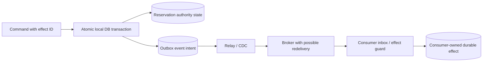

# Outbox publication and ordering

**Owning question:** Which local atomic record closes a dual-write loss window?

This page belongs to [V04/C05 — Outbox, inbox, sagas and durable workflows](README.md). Use the integrated walkthrough for the surrounding decision; the sections below own this narrower mechanism and its limits.

<!-- tycho-question-source:tycho.page.aa810dd152884b35a84f0f4cbe4369e9:1 -->
## 1. Two unsafe dual-write orders

Consider an original invented device-reservation system: it records an accepted reservation and notifies another component. Naive sequence **DB then broker** can commit the reservation and crash before publishing. Naive sequence **broker then DB** can publish a purported acceptance and later roll back the reservation.

[Richardson's Transactional Outbox pattern](https://microservices.io/patterns/data/transactional-outbox) records publication intent together with the business state in a **single local** transaction, then uses a relay. It explicitly notes that a relay may send a message more than once.

**Text alternative:** one local transaction commits both reservation truth and a publication-intent record. A relay sends from that record. Downstream consumers must handle duplicates and record their effects under their own transactional authority. There is **no atomic transaction spanning all illustrated components**.

### Publication truth table

| Failure point | What can be durable | Recovery requirement |
|---|---|---|
| Before local commit | Neither business state nor outbox intent | Retry command with stable business identity |
| After local commit, before relay | Business state and outbox intent | Relay resumes from durable source |
| Broker receives event, relay loses acknowledgment | Broker may store event; relay still sees unsent | Duplicate publication must be tolerated |
| Consumer commits, then loses broker acknowledgment | Consumer-owned effect may already exist | Inbox or effect identity prevents duplicate state |
| Consumer must call another external system | Local DB cannot atomically cover that call | External effect identity or reconciliation |
| Event arrives after newer entity state | Stale event may be replayed | Defined version/order conflict and quarantine |

The source's event-intent guarantee is conditional on **actual atomic insertion**. Writing a so-called outbox record after a completed business transaction still leaves a failure window.

<!-- /tycho-question-source -->
<!-- tycho-question-source:tycho.page.aa810dd152884b35a84f0f4cbe4369e9:2 -->
## 2. Publication schema and ordering boundaries

[Debezium Outbox Event Router 3.6](https://debezium.io/documentation/reference/3.6/transformations/outbox-event-router.html) documents an example event ID, aggregate type, aggregate ID, event type and payload. The aggregate ID can become the Kafka message key and help preserve per-partition order. These are *product configuration semantics*, not a guarantee of global ordering or arbitrary exactly-once effects.

Distinguish:
- transaction commit order;
- an aggregate's version or domain sequence;
- connector capture and relay time;
- broker partition offset;
- consumer application time;
- business effect completion.

If event E6 reaches a consumer after newer version E7, a blind last-writer-wins projection may revert correct state. Require a version rule, permissible out-of-order merge, replay repair or rejection that corresponds to the actual domain invariant. An event timestamp alone does not grant a total order across independent producers.

<!-- /tycho-question-source -->

## Navigation, prerequisites and source scope

| Route | Destination |
|---|---|
| Parent and source ledger | [Chapter introduction and exact source rows](README.md#chapter-source-ledger) |
| Previous / prerequisite | [Read preceding context](outbox-inbox-sagas-and-durable-workflows.md) |
| Next | [Continue the reasoning](inbox-atomicity.md) |
| Integrated question | [Original scenario and limits](outbox-inbox-sagas-and-durable-workflows.md) |

The source material keeps its original published/inferred/synthetic/unverified distinctions. Chapter-wide citations are shared reference context, not proof that every cited source supports every sentence on this page. Freshly inspected text is identified explicitly; absent dates and unknowns are retained.
