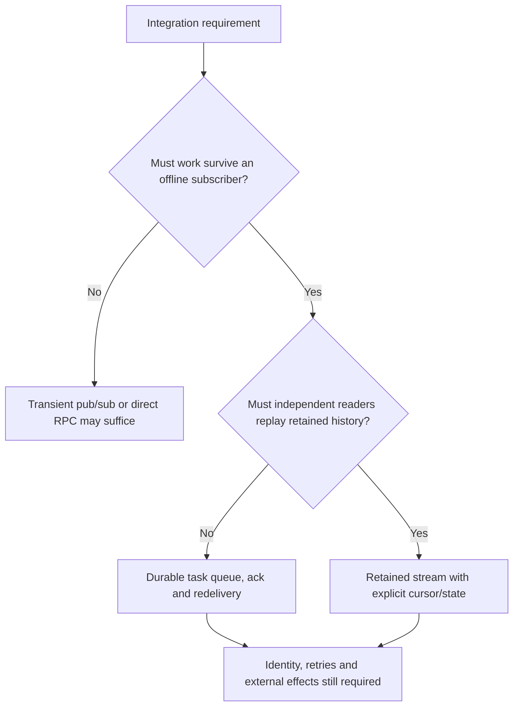
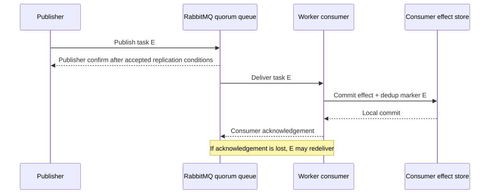
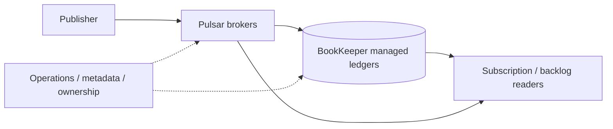

# Consumer requirements and messaging families

**Owning question:** Which ownership, retention and replay contract selects a messaging family?

This page belongs to [V04/C06 — Messaging families and delivery contracts](README.md). Use the integrated walkthrough for the surrounding decision; the sections below own this narrower mechanism and its limits.

<!-- tycho-question-source:tycho.page.98616bdc3c514ea997b2cfe30ad7c070:1 -->
## 1. First identify what a consumer must own

Text alternative: decide whether a publication must survive absent subscribers, then whether multiple independent consumers must replay history. The answer changes the required persistence and cursor model; every option still needs business-level identity and failure handling. This is an original question route, not a product-selection algorithm.

### RabbitMQ quorum queues and publisher confirms

Official RabbitMQ **4.3** *Reliability Guide* and *Consumer Acknowledgements and Publisher Confirms* distinguish two acknowledgements: the broker's confirmation to the publisher (acceptance/persistence responsibility according to queue mode) and the consumer's acknowledgement of processing to the broker. These are independent; publisher confirm does **not** mean the consumer performed a business transaction. Quorum queues maintain replicated queue state and rely on the publisher/consumer protocols for data safety. [E01, E02]

Text alternative: RabbitMQ can confirm taking responsibility for a task separately from a consumer acknowledging its effect. If the worker crashes after local effect but before acknowledgement, task redelivery may occur. Consumer-side deduplication is necessary for nonrepeatable effects.

Quorum queues are not automatically ideal for very short-lived temporary queues, the lowest latency or arbitrarily large replay backlogs; RabbitMQ's [quorum-queue guide](https://www.rabbitmq.com/docs/quorum-queues) explicitly discusses these choices. It also describes replicated queue members and the costs of data safety; the existence of replication does not prove a specific application's recovery SLO.

### NATS Core and JetStream

The current public [NATS JetStream concept documentation](https://docs.nats.io/concepts/jetstream) distinguishes **Core NATS** pub/sub delivery to online subscribers from **JetStream** persistent streams with server-side consumer cursors and acknowledgements. The page describes Core as at-most-once and JetStream's ordinary redelivery as at-least-once, under their respective configurations. [E03]

A fictional notification can use ephemeral pub/sub if losing a signal when no subscriber is listening is acceptable. A durable business task should not casually use Core alone if clients require recoverable delivery; a JetStream durable consumer or another persisted queue may better match that requirement.

JetStream stream retention and consumer policies still need version/configuration-specific testing, especially around publisher deduplication windows, consumer ack timeouts, replicas and restart behavior. No NATS server was installed or exercised for this page.

### Apache Pulsar broker and storage split

The publicly versioned [Apache Pulsar 4.1 Architecture Overview](https://pulsar.apache.org/docs/4.1.x/concepts-architecture-overview/) describes brokers and a **BookKeeper-backed persistent storage layer** with ledger/segment ownership. A broker endpoint is not automatically the sole durable copy of retained messages. Partitioning, subscription type, backlog and BookKeeper quorum/ledger mechanics must be examined for the actual workload. [E04]

This is a different operational decomposition from RabbitMQ queues or Kafka log replication, but the difference alone does **not** prove superior throughput or disaster recovery. It changes the components a team must scale, observe, secure, back up and restore.

Text alternative: Pulsar brokers serve publishers/subscribers while separate managed-ledger storage persists messages; a subscription's backlog and broker/ledger availability must be considered together. This simplified architecture is based on documented roles and does not represent an actual cluster's topology.

<!-- /tycho-question-source -->
<!-- tycho-question-source:tycho.page.98616bdc3c514ea997b2cfe30ad7c070:2 -->
## 2. Requirement-driven comparison, not a ranking

| Question | RabbitMQ quorum queue | NATS Core / JetStream | Pulsar 4.1 | Kafka 4.1 (related chapter) |
|---|---|---|---|---|
| Primary reader model | Consumer acks durable queue deliveries | Core transient pub/sub; JetStream persistent streams and stateful consumers | Topic, subscription and persistent ledger/backlog | Ordered per-partition log, consumer offset/group |
| Retry after worker failure | Manual ack and broker redelivery semantics | JetStream ack timeout/redelivery; Core has no durable replay | Subscription ack/redelivery under configuration | Consumer re-read after uncommitted offset |
| Historical replay | Queue is not equivalent to retained independent log; RabbitMQ Streams separate option | JetStream stream supports replay modes | Subscription retention/backlog according to mode | Position-based replay inside retention |
| Replication/recovery | Quorum queue replication, leader/ISR-like safety policy specific to RabbitMQ | Stream replicas plus consumer state when configured | Broker + managed ledger/BookKeeper durability | Partition leaders/ISR/min ISR and group rebalance |
| Operational burden | Rabbit broker/queue policy, disk, connection, consumer flow | Core simple topology; JetStream adds durable stream/consumer management | Brokers, storage cluster and metadata/ledger operations | Broker/controller, partitions, ISR and producer/consumer clients |
| Typical disqualifier | Need many independent rewindable readers of same very large history | Core insufficient for offline durable work | Cost/operations of broker+BookKeeper unacceptable | Retained partition log and Kafka operations unnecessary for a simple work queue |

Rows describe **documented conceptual capabilities** of selected versions, not measured latency, pricing, throughput or operational superiority. Message ordering is typically scoped to queue/subscription/stream/partition and concrete producer/consumer behavior; no column implies global total order.

<!-- /tycho-question-source -->

## Navigation, prerequisites and source scope

| Route | Destination |
|---|---|
| Parent and source ledger | [Chapter introduction and exact source rows](README.md#chapter-source-ledger) |
| Previous / prerequisite | [Read preceding context](messaging-families-and-durable-workflows.md) |
| Next | [Continue the reasoning](workflow-failure.md) |
| Integrated question | [Original scenario and limits](messaging-families-and-durable-workflows.md) |

The source material keeps its original published/inferred/synthetic/unverified distinctions. Chapter-wide citations are shared reference context, not proof that every cited source supports every sentence on this page. Freshly inspected text is identified explicitly; absent dates and unknowns are retained.
