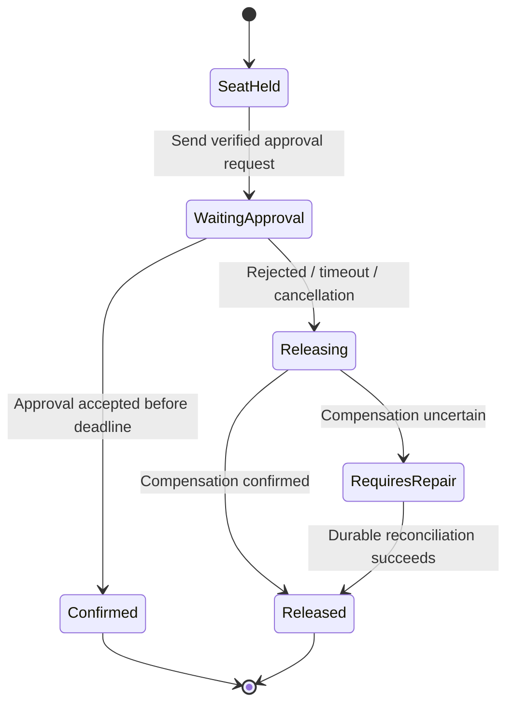

# Workflow state and messaging failure gates

**Owning question:** When does a queue need an additional durable business-state protocol?

This page belongs to [V04/C06 — Messaging families and delivery contracts](README.md). Use the integrated walkthrough for the surrounding decision; the sections below own this narrower mechanism and its limits.

<!-- tycho-question-source:tycho.page.98616bdc3c514ea997b2cfe30ad7c070:3 -->
## 3. A durable workflow is more than a queue

Suppose a fictional registration process must: hold a seat, request external approval, wait up to 24 hours for a human review, then either confirm or release capacity. A message queue can deliver each step, but does not by itself persist **the entire multi-step business state machine, timers, cancellation policy and compensation outcome**.

A durable workflow engine is an architectural **candidate** if it persistently records process progress, timer deadlines, retry identities, versions, transitions and compensation logic under an explicit recovery contract. However, no named workflow engine is recommended or behavior guaranteed by this page: version-specific product analysis and failure experiments must be performed before selecting one.

Text alternative: a long-running process holds a seat and waits for approval. It either confirms or initiates release. Failed or ambiguous compensation moves into a repair state, not an invented success. This original state machine is **not** executed by a workflow engine or broker.

Use the [saga/isolation research](../c03/transaction-isolation-and-sagas.md) for compensation and concurrency. Choosing a workflow product does not make its external SQL transactions automatically atomic.

<!-- /tycho-question-source -->
<!-- tycho-question-source:tycho.page.98616bdc3c514ea997b2cfe30ad7c070:4 -->
## 4. Failure and applicability gates

| Workload/failure property | What to measure or test before recommending |
|---|---|
| One hot queue/stream subject | Arrival mix, key skew, consumer concurrency and fair scheduling |
| Producer acknowledgement loss | Broker's accepted/durable state, retry identity and duplicate risk |
| Offline consumer for days | Retention, storage growth/backlog catch-up, expiry and resumption semantics |
| Rebalanced consumer ownership | In-flight effect, ack/cursor commit and side-effect idempotence |
| Cross-region or storage loss | Quorum location, backup/restore, RPO/RTO and replay tests |
| Poison message or schema mismatch | Quarantine/retry budget, dead-letter policy and source of truth |
| Long-running process | Durable state, timers, compensation and human intervention ownership |

**Insufficient evidence:** "We send 10,000 messages/s. Which broker is fastest and cheapest?" Cannot answer without payload/size distribution, replication/durability, subscriber count, retention, batch/ack mode, failure headroom, security and an apples-to-apples benchmark. User and message counts alone are not enough.

<!-- /tycho-question-source -->

## Navigation, prerequisites and source scope

| Route | Destination |
|---|---|
| Parent and source ledger | [Chapter introduction and exact source rows](README.md#chapter-source-ledger) |
| Previous / prerequisite | [Read preceding context](message-selection.md) |
| Next | [Continue the reasoning](README.md) |
| Integrated question | [Original scenario and limits](messaging-families-and-durable-workflows.md) |

The source material keeps its original published/inferred/synthetic/unverified distinctions. Chapter-wide citations are shared reference context, not proof that every cited source supports every sentence on this page. Freshly inspected text is identified explicitly; absent dates and unknowns are retained.
