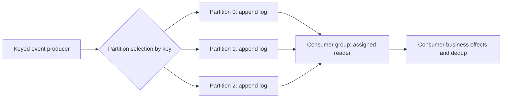

# Kafka interaction contracts and partitioning

**Owning question:** What is ordered within a partition and how does its key constrain load?

This page belongs to [V04/C07 — Kafka logs, partitions and transactions](README.md). Use the integrated walkthrough for the surrounding decision; the sections below own this narrower mechanism and its limits.

<!-- tycho-question-source:tycho.page.0b493340594c4c4392c5d93940a7f319:1 -->
## 1. Command, query, notification and durable event are distinct contracts

| Interface | Initiator expects | Typical failure ambiguity | Required contract |
|---|---|---|---|
| Synchronous RPC/HTTP command | A result or explicit pending/error state | Server may have committed but reply was lost | Deadline, idempotency identity, error classification and retry safety |
| Synchronous query | Named consistency/freshness/read authorization | Old snapshot, timeout, partial result | Eligible response, version/freshness, pagination and cache |
| Event notification | Something happened; subscribers may react | Missed, duplicate or reordered notification | Durable publication if required, consumer offset and schema version |
| Durable work queue | A task is processed by some eligible worker | Ack loss or worker crash yields redelivery | Visibility/ack deadline, dedup, work ownership and poison-message handling |
| Retained partitioned log | Multiple readers can consume retained ordered records | Offset may commit before/after external effect | Key/partition semantics, retention, consumer position and replay |

The official [gRPC core-concepts documentation](https://grpc.io/docs/what-is-grpc/core-concepts/) distinguishes unary, server/client-streaming and bidirectional-streaming RPCs, metadata and deadlines. Streaming does not automatically imply an authoritative event log or durable replay; a live RPC stream is a protocol/channel contract, not a substitute for persisted events. [E01]

<!-- /tycho-question-source -->
<!-- tycho-question-source:tycho.page.0b493340594c4c4392c5d93940a7f319:2 -->
## 2. Kafka's partition is an ordering and load unit

Apache Kafka 4.1 Design sections **The Producer — Load balancing**, **The Consumer — Consumer Position**, **Message Delivery Semantics** and **Replication** describe how a topic is partitioned, records have positions in a partition, and consumer state tracks positions. Partition ordering does **not** establish total ordering across the whole topic. [E02]

Text alternative: producer records are routed to one of several partition logs. A consumer group assigns partition consumption to members; application effects require their own idempotency/commit strategy. No single order spanning all three partitions is shown.

**Partition key choices are correctness and scaling choices**, not a transparent optimization:

- Events for one aggregate may require a stable key to land in one partition and maintain that partition's append sequence.
- A single hot key can concentrate traffic and limit parallel processing; blindly increasing partition count may not split that key.
- Changing key encoding or partition count can change the partition assignment of later records. An application requiring continuity across that change needs a transition/ordering contract.
- A group with more instances than assignable partitions cannot increase per-partition concurrent ownership without changing the consumer architecture; actual group protocol/version matters.
- At-least-once replay and idempotent consumers are still relevant even if producer retries are deduplicated by the broker.

### A source-of-truth boundary

A Kafka record is a durable log entry under a declared retention/replication policy, **not necessarily the authoritative business transaction**. A relational registration store might remain the authority while a transactional outbox relays a committed change into Kafka. The [outbox/idempotency page](../../../distributed/transactional-outbox-and-idempotency.md) explains why a local database commit, Kafka publication, and consumer external side effect remain separate atomic boundaries.

<!-- /tycho-question-source -->

## Navigation, prerequisites and source scope

| Route | Destination |
|---|---|
| Parent and source ledger | [Chapter introduction and exact source rows](README.md#chapter-source-ledger) |
| Previous / prerequisite | [Read preceding context](kafka-partitions-replication-and-contracts.md) |
| Next | [Continue the reasoning](replication-acks.md) |
| Integrated question | [Original scenario and limits](kafka-partitions-replication-and-contracts.md) |

The source material keeps its original published/inferred/synthetic/unverified distinctions. Chapter-wide citations are shared reference context, not proof that every cited source supports every sentence on this page. Freshly inspected text is identified explicitly; absent dates and unknowns are retained.
