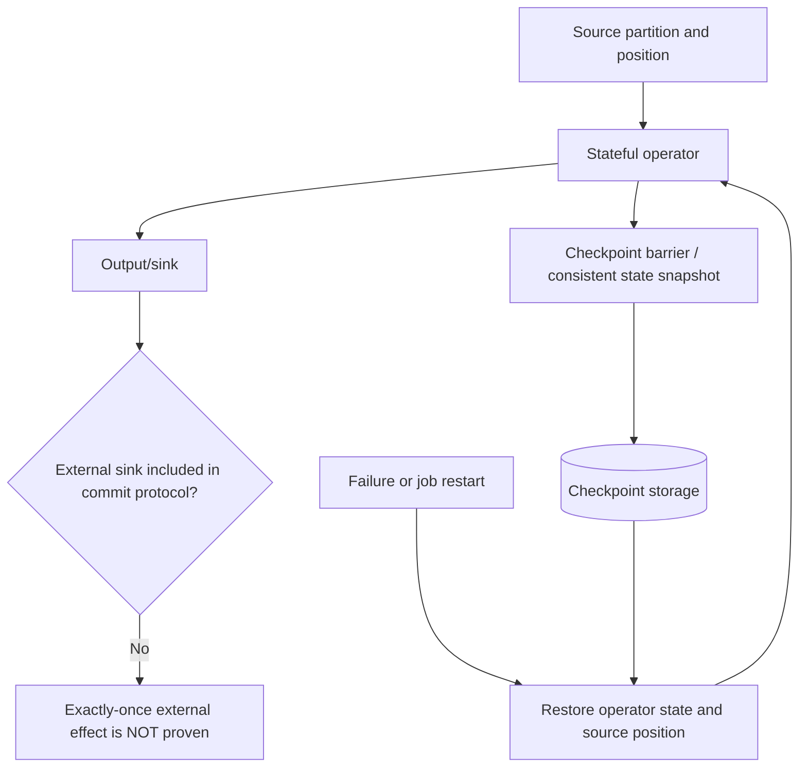

# Checkpoints, watermarks and late data

**Owning question:** Which state boundary and late-data policy define a corrected result?

This page belongs to [V04/C08 — Stateful/event-time stream processing](README.md). Use the integrated walkthrough for the surrounding decision; the sections below own this narrower mechanism and its limits.

<!-- tycho-question-source:tycho.page.a2c47a0850154eaa95e1eb97e23f9c71:3 -->
## 3. Flink: checkpoints versus deployment savepoints

The **archived Apache Flink 2.1** checkpoint documentation explains consistent snapshots of operator state and stream positions for recovery; its **Checkpoints vs. Savepoints** page distinguishes automatically managed failure-recovery checkpoints from more deliberate application state snapshots for controlled operations. This version is **not latest** and must not be assumed to describe newer installed releases. [E06, E07]

Text alternative: Flink periodically stores recoverable state associated with source progress. After failure, the operator and input position are restored consistently under its source/checkpoint model. A write to an arbitrary external sink remains outside that guarantee unless a compatible sink protocol and recovery semantics are demonstrated.

A checkpoint is not automatically a complete application migration artifact. A version upgrade can change state serialization, operator identity, topology and restore compatibility. For those decisions, use the *documented release's* savepoint/upgrade matrix plus a tested recovery plan, rather than applying outdated advice to a different installed version.

<!-- /tycho-question-source -->
<!-- tycho-question-source:tycho.page.a2c47a0850154eaa95e1eb97e23f9c71:4 -->
## 4. Event time, watermarks and late data are business policies

Streaming data can be observed at a different time from when the event occurred. A **watermark** or event-time windowing policy tells operators how much lateness they expect and when to finalize a result. This topic requires exact installed release and API evidence before implementation; the present section provides only a **conceptual synthetic model**, not an asserted Flink 2.1 watermark algorithm.

Consider a fictional count of booking events for a 10-minute window. One client submits an event with timestamp 09:55, but network delay causes it to arrive at 10:12. If the application's window was finalized earlier, the operator must follow a declared late-event policy: drop with an explicit metric, update/retract a prior result, send to a side output, or defer finalization. None is universally correct.

| Dimension | Required explicit choice |
|---|---|
| Event-time source | Trusted producer clock, database commit timestamp or business timestamp? |
| Window boundary | Tumbling/sliding/session, exact start/end and time zone |
| Watermark/lateness | How are delayed or idle input partitions handled? |
| Correction | Updates, retractions or immutable result with compensating event? |
| State size | Number of keys/windows retained, TTL, hot keys and replay |
| External output | Supports corrections, idempotency and checkpoint coordination? |

**Insufficient evidence:** "Flink has exactly-once checkpoints; can our external email be sent exactly once after replay?" No. Email send has its own irreversible acknowledgment and idempotency contract; snapshotting state cannot retroactively cancel an external effect.

<!-- /tycho-question-source -->

## Navigation, prerequisites and source scope

| Route | Destination |
|---|---|
| Parent and source ledger | [Chapter introduction and exact source rows](README.md#chapter-source-ledger) |
| Previous / prerequisite | [Read preceding context](cdc-state.md) |
| Next | [Continue the reasoning](processor-recovery.md) |
| Integrated question | [Original scenario and limits](stateful-stream-processing-and-cdc.md) |

The source material keeps its original published/inferred/synthetic/unverified distinctions. Chapter-wide citations are shared reference context, not proof that every cited source supports every sentence on this page. Freshly inspected text is identified explicitly; absent dates and unknowns are retained.
