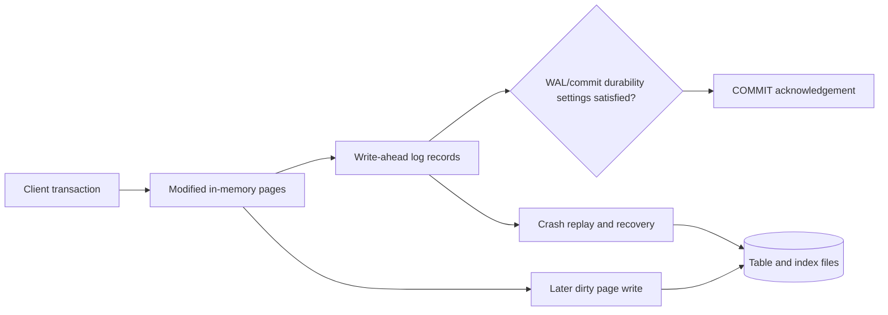
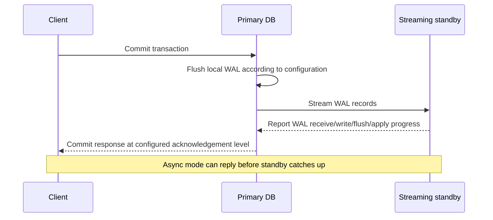

# WAL ordering and acknowledgment

**Owning question:** What must be durable when a primary acknowledges a transaction?

This page belongs to [V05/C02 — PostgreSQL MVCC, WAL and recovery](README.md). Use the integrated walkthrough for the surrounding decision; the sections below own this narrower mechanism and its limits.

<!-- tycho-question-source:tycho.page.ddeff7f1556f44f18c67659b73e6e15f:1 -->
## 1. Why write-ahead logging exists

PostgreSQL 17 §28.3 **Write-Ahead Logging (WAL)** explains the durability approach: record modifications into a log before the affected data pages must be written to their permanent table/index files. WAL records and commit policies permit recovery after a crash without forcing every changed page to disk at transaction commit. WAL is both a recovery mechanism and a foundation for replication approaches. [E01]

Text alternative: transaction changes affect in-memory pages, and corresponding WAL records must meet the configured commit durability policy before acknowledgement. Table/index pages can be flushed later. Following a crash, recovery uses durable WAL to restore a consistent state. This is a conceptual flow; the exact flush ordering is controlled by PostgreSQL internals and configuration.

### Durability has configuration boundaries

`synchronous_commit`, `fsync`, `full_page_writes`, replica availability and storage-level guarantees change what an acknowledged write can survive. A diagram with WAL arrows does **not** guarantee resistance to disk firmware corruption, total-site loss or an incorrectly operated restore.

Avoid saying "transactions use WAL, therefore RPO=0" without specifying the failure (process crash, disk loss, node loss, network partition, region outage) and durable/replicated positions. Under async replication, a primary can acknowledge writes that a standby has not yet received; failing over to that standby may lose the not-yet-replayed or not-yet-received portion. PostgreSQL's §26.2 describes this delay and its implications. [E02]

<!-- /tycho-question-source -->
<!-- tycho-question-source:tycho.page.ddeff7f1556f44f18c67659b73e6e15f:3 -->
## 3. Acknowledgments and replication are not one binary switch

PostgreSQL §26.2.8 **Synchronous Replication** documents configurable commit waiting for standby acknowledgment, with trade-offs in lag and availability. It distinguishes the stage at which a standby has written/flushed/applied changes under configured policies. In a topology whose primary waits for one synchronous standby, an unreachable standby may prevent timely commit progress until configuration or availability changes. [E02]

Text alternative: primary sends WAL and receives progress from a standby. Whether the client waits for any standby progress depends on the synchronous replication configuration. This is not proof of a measured replication delay, cross-region RPO or external event commit.

**A replica count is not a durability SLA.** Deployment must account for quorum/ack configuration, data-center placement, network tail, replication slots/retention, failover fencing, split-brain prevention, old primary reintegration and application retry semantics.

<!-- /tycho-question-source -->

## Navigation, prerequisites and source scope

| Route | Destination |
|---|---|
| Parent and source ledger | [Chapter introduction and exact source rows](README.md#chapter-source-ledger) |
| Previous / prerequisite | [Read preceding context](mvcc-snapshots-and-vacuum.md) |
| Next | [Continue the reasoning](replica-recovery.md) |
| Integrated question | [Original scenario and limits](postgresql-wal-replication-and-recovery.md) |

The source material keeps its original published/inferred/synthetic/unverified distinctions. Chapter-wide citations are shared reference context, not proof that every cited source supports every sentence on this page. Freshly inspected text is identified explicitly; absent dates and unknowns are retained.
