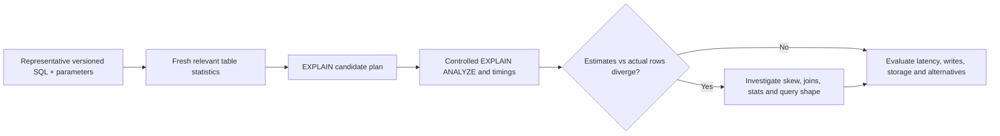

# Plan evidence and index lifecycle

**Owning question:** What does EXPLAIN omit and what operational work does an index change create?

This page belongs to [V05/C03 — Query planning, indexes and access paths](README.md). Use the integrated walkthrough for the surrounding decision; the sections below own this narrower mechanism and its limits.

<!-- tycho-question-source:tycho.page.7a136445bbfe4a8194c2c4db8a8818ee:4 -->
## 4. EXPLAIN is not a user latency report

An estimated plan may show a sequential scan, index scan, bitmap heap scan, nested loop, merge join or hash join, depending on the query and cardinality. The estimated cost is in planner units; it should not be read as elapsed milliseconds.

EXPLAIN ANALYZE **executes the query** and records actual timings and row counts, with instrumentation overhead and the side effects of commands that are not read-only. Do not run EXPLAIN ANALYZE on an unsafe data-changing statement against uncontrolled state. Observe actual run context, caching, concurrent load, locks, network and client serialization separately.

**Text alternative:** reproducible query parameters and appropriate statistics shape the planner choice. Controlled execution compares actual row counts and times, then investigates misestimates and checks the end-to-end system cost. No plan was run for this page.

<!-- /tycho-question-source -->

> **Pattern atlas:**
> [Index Table](../../v11-pattern-atlas/c06-database-storage/README.md#index-table) — decision conditions and contraindications.

<!-- tycho-question-source:tycho.page.7a136445bbfe4a8194c2c4db8a8818ee:5 -->
## 5. An index is a data-lifecycle change

Adding an index may change:
- write/update latency and WAL volume;
- storage and backup/restore size;
- vacuum/maintenance, cache pressure and bloat management;
- schema rollout constraints and lock exposure during index creation;
- planning time and scan choice;
- resource cost when multiple replicas or tenants repeat the same index.

[PostgreSQL 17 CREATE INDEX](https://www.postgresql.org/docs/17/sql-createindex.html) documents creation and concurrent build choices, including limitations and failure recovery. The choice to create an index concurrently reduces some write-blocking behavior but has **its own** constraints, phases and resource costs; it is not a free online operation.

For high write demand, an index improving one query by a few milliseconds can be a net loss if it increases every update or checkpoint cost. Keep the unit of value as correct completed user operations across the whole workload.

**Native secondary-index mechanism.** A native secondary index maps a search key to a row
locator and is maintained on base-table writes; the planner chooses it when estimated
selectivity and cost favor it. It is the competing native mechanism, not the application-owned
lookup table defined below.

**Invariant and failure.** Every index entry must remain consistent with the base row, and
its write/backup/maintenance cost belongs to the workload budget. Bloat, failed concurrent
builds, stale statistics and write amplification are common; rebuild or repair explicitly
and compare end-to-end cost. A sequential scan, covering index, partition pruning or
materialized view may be preferable when the index would cost more writes than it saves.

<!-- /tycho-question-source -->

## Bounded pattern ownership notes

### Index Table

**Synthetic design guidance, not measured evidence.** An index table is an
application-owned lookup table that maps a query key to a primary key or row
locator. The application maintains it on the write path, separately from any
native database index, because the query shape, sort order or cross-store join
is not served by the primary store.

**Mechanism.** A secondary index is a separate structure keyed for one access
path. PostgreSQL states that its indexes are "stored separately from the table's
main data area" and that index-only scans "can answer queries from an index
alone without any heap access". Use The Index Luke describes the covering
variant: it "avoids accessing the table completely if the database can find the
selected columns in the index itself". SQL Server calls the non-key form a
covering index: "By including nonkey columns, you can create nonclustered
indexes that cover more queries." **Tycho reading:** the index table is the
application-owned variant of that secondary access path; the base row stays
authoritative and the lookup row is derived state that the write path maintains.

**Invariant.** The lookup key alone defines what a row locates and what a
duplicate means. SQL Server states that nonkey columns "aren't considered by the
Database Engine when calculating the number of index key columns or index key
size", and that their order "doesn't affect the performance of queries that use
the index". PostgreSQL states that for a unique index with included columns
"the uniqueness condition applies to just column x, not to the combination of x
and y". Luke notes that non-key columns are "only stored in the leaf nodes and
can thus not be used for access predicates". **Tycho rule:** keep exactly one
lookup key; payload columns must never become a second key or a second source
of truth. Every lookup row must resolve to the current base row; the mapping and
the base write commit in one local transaction, or the write path publishes a
durable repair intent.

**Failure and recovery.** A covering access path fails quietly when its shape
changes. Luke shows that adding a filter column "can cause “illogical”
performance behavior"; "The table access increases the response time although
the query selects fewer rows", and "The relevant factor is not how many rows the
query delivers but how many rows the database must inspect to find them".
PostgreSQL adds that when the visibility-map bit is not set, "the heap entry
must be visited to find out whether it's visible, so no performance advantage is
gained over a standard index scan". SQL Server warns that very wide included
columns add update cost, and that "Nonkey columns can't be dropped from a table
unless that table's index is dropped first". **Tycho runbook:** dual-write
ambiguity, partial backfill, duplicate lookup keys and stale rows are
design-time failure modes; reconcile with a repair job, keep the lookup key
immutable, bound rebuild time and re-check the execution plan after every
query-shape change; remove payload columns that no longer earn their write cost.

**Alternative.** A native covering index, a materialized view or an overloaded
managed secondary index may serve the access path without an application-owned
table. DynamoDB documents overloaded global secondary indexes: beyond the
default quota of 20 GSIs, one index can serve "a variety of different queries
using that single global secondary index". Luke calls index-only scans "an
aggressive indexing strategy" and recommends indexing without the select clause
first, then extending only when needed. PostgreSQL and SQL Server both show
payload columns declared as non-key rather than key columns. **Tycho choice
rule:** use a native covering index, materialized view, query-time join or
overloaded managed secondary index when the primary store already serves the
access path; keep an application-owned index table when the write path can own
its repair and the added write/repair cost is lower than the scan or drift cost
it removes. Reverse the choice when key drift or maintenance cost exceeds the
lookup benefit.

**Bound source limits.** The four 2026-10-31 units are public documentation
pages, not benchmarks or production observations. PostgreSQL 17 documents
index-only scans and INCLUDE columns; SQL Server documents included (nonkey)
columns; *Use The Index, Luke* is a practitioner book site; DynamoDB documents
GSI overloading. None tests an application-owned lookup table, and none
supplies a measured drift or repair cost. Tycho-labelled sentences are this
book's synthesis, not source quotations.

**Source units.** Each binding revision is the canonical-text SHA-256 of the
2026-10-31 representation:

- PostgreSQL 17, *11.9. Index-Only Scans and Covering Indexes*;
  770597607e655863d637486b44c7169fb547dba3cd3c40acd1320866a754e3c4;
  record read.pg17-index-only-scans.2026-10-31 under src.postgresql.
- Microsoft Learn, *Create indexes with included columns* (SQL Server);
  90861625c10dd5cf1892aeb32f98619b65ffcd0a43b2d1c9183f1d63da4da394;
  record read.microsoft-included-columns.2026-10-31 under
  src.microsoft-sql-server.
- Markus Winand, *Index-Only Scan: Avoiding Table Access*;
  5e1204b9cdd0f25a712894869d80126abbbd39132706c80357908693dc24a95b;
  record read.luke-index-only-scan.2026-10-31 under src.use-the-index-luke.
- Amazon DynamoDB Developer Guide, *Overloading Global Secondary Indexes in
  DynamoDB*;
  1d1a982b843ee7d8cca03b06eecb19efc0c67a135acd020fb91a8d35da32fc1a;
  record read.aws-dynamodb-gsi-overloading.2026-10-31 under
  src.aws-dynamodb-gsi.

## Navigation, prerequisites and source scope

| Route | Destination |
|---|---|
| Parent and source ledger | [Chapter introduction and exact source rows](README.md#chapter-source-ledger) |
| Previous / prerequisite | [Read preceding context](access-selectivity.md) |
| Next | [Continue the reasoning](query-counterexamples.md) |
| Integrated question | [Original scenario and limits](postgresql-indexes-statistics-and-query-plans.md) |

The source material keeps its original published/inferred/synthetic/unverified distinctions. Chapter-wide citations are shared reference context, not proof that every cited source supports every sentence on this page. Freshly inspected text is identified explicitly; absent dates and unknowns are retained.
