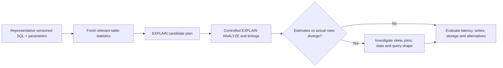

# Plan evidence and index lifecycle

**Owning question:** What does EXPLAIN omit and what operational work does an index change create?

This page belongs to [V05/C03 — Query planning, indexes and access paths](README.md). Use the integrated walkthrough for the surrounding decision; the sections below own this narrower mechanism and its limits.

<!-- tycho-question-source:tycho.page.7a136445bbfe4a8194c2c4db8a8818ee:4 -->
## 4. EXPLAIN is not a user latency report

An estimated plan may show a sequential scan, index scan, bitmap heap scan, nested loop, merge join or hash join, depending on the query and cardinality. The estimated cost is in planner units; it should not be read as elapsed milliseconds.

EXPLAIN ANALYZE **executes the query** and records actual timings and row counts, with instrumentation overhead and the side effects of commands that are not read-only. Do not run EXPLAIN ANALYZE on an unsafe data-changing statement against uncontrolled state. Observe actual run context, caching, concurrent load, locks, network and client serialization separately.

**Text alternative:** reproducible query parameters and appropriate statistics shape the planner choice. Controlled execution compares actual row counts and times, then investigates misestimates and checks the end-to-end system cost. No plan was run for this page.

<!-- /tycho-question-source -->

> **Pattern atlas:**
> [Index Table](../../v11-pattern-atlas/c06-database-storage/README.md#index-table) — decision conditions and contraindications.

<!-- tycho-question-source:tycho.page.7a136445bbfe4a8194c2c4db8a8818ee:5 -->
## 5. An index is a data-lifecycle change

Adding an index may change:
- write/update latency and WAL volume;
- storage and backup/restore size;
- vacuum/maintenance, cache pressure and bloat management;
- schema rollout constraints and lock exposure during index creation;
- planning time and scan choice;
- resource cost when multiple replicas or tenants repeat the same index.

[PostgreSQL 17 CREATE INDEX](https://www.postgresql.org/docs/17/sql-createindex.html) documents creation and concurrent build choices, including limitations and failure recovery. The choice to create an index concurrently reduces some write-blocking behavior but has **its own** constraints, phases and resource costs; it is not a free online operation.

For high write demand, an index improving one query by a few milliseconds can be a net loss if it increases every update or checkpoint cost. Keep the unit of value as correct completed user operations across the whole workload.

**Native secondary-index mechanism.** A native secondary index maps a search key to a row
locator and is maintained on base-table writes; the planner chooses it when estimated
selectivity and cost favor it. It is the competing native mechanism, not the application-owned
lookup table defined below.

**Invariant and failure.** Every index entry must remain consistent with the base row, and
its write/backup/maintenance cost belongs to the workload budget. Bloat, failed concurrent
builds, stale statistics and write amplification are common; rebuild or repair explicitly
and compare end-to-end cost. A sequential scan, covering index, partition pruning or
materialized view may be preferable when the index would cost more writes than it saves.

<!-- /tycho-question-source -->

## Bounded pattern ownership notes

### Index Table

**Synthetic design guidance, not measured evidence.** An index table is an application-owned
lookup table that maps a query key to a primary key or row locator. The application
maintains it on the write path, separately from any native database index,
because the query shape, sort order or cross-store join is not served by the primary store.

Every lookup row must resolve to the current base row; the mapping and the base write should
commit in one local transaction, or the write path must publish a durable repair
intent. Dual-write ambiguity, partial backfill, duplicate lookup keys and stale rows
are common design-time failure modes; the cited PostgreSQL page covers native indexes,
not this application-owned table. Reconcile with a repair job, keep the lookup key
immutable and bound rebuild time.

A native secondary index, a materialized view or a query-time join may be preferable when the
primary store already serves the access path. An index table is a fit when the primary
store cannot serve a stable, frequently used lookup, the write path can own its repair and
the added write/repair cost is lower than the scan or drift cost it removes.

## Navigation, prerequisites and source scope

| Route | Destination |
|---|---|
| Parent and source ledger | [Chapter introduction and exact source rows](README.md#chapter-source-ledger) |
| Previous / prerequisite | [Read preceding context](access-selectivity.md) |
| Next | [Continue the reasoning](query-counterexamples.md) |
| Integrated question | [Original scenario and limits](postgresql-indexes-statistics-and-query-plans.md) |

The source material keeps its original published/inferred/synthetic/unverified distinctions. Chapter-wide citations are shared reference context, not proof that every cited source supports every sentence on this page. Freshly inspected text is identified explicitly; absent dates and unknowns are retained.
