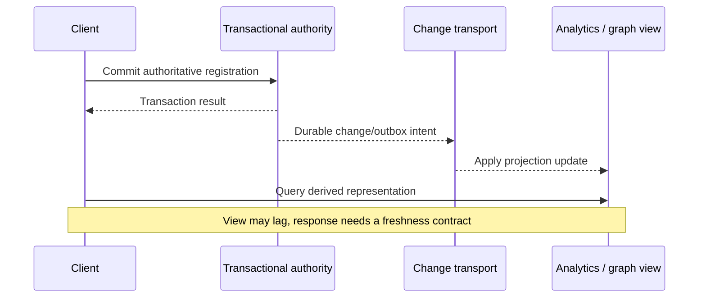

# Cross-model comparison and synchronization

**Owning question:** Which extra authority and recovery obligations appear when stores are combined?

This page belongs to [V05/C04 — Alternative data models and stores](README.md). Use the integrated walkthrough for the surrounding decision; the sections below own this narrower mechanism and its limits.

<!-- tycho-question-source:tycho.page.c75a11f9786442a5b5456f11c2412df4:6 -->
## 6. Cross-model trade-off matrix

| Model / representative engine | Strong workload fit | Central boundary and failure cost | Measure before adopting | Ledger support |
|---|---|---|---|---|
| Embedded SQL — SQLite | Local/offline transactional storage with bounded process integration | Local file/device availability; networking/sync must be built separately | Concurrent writer behavior, backup and local I/O | E01 |
| Server relational — PostgreSQL | Relational invariants, joins and mixed transactional queries | Connection/lock/index/WAL bottlenecks; replica lag and failover | Actual query plans, transactions, write/read mix, recovery | Tycho synthesis; no separate source row |
| Distributed SQL — CockroachDB | SQL with distributed placement and transactions | Distributed commit/conflict/network costs and operational topology | Hot ranges, geographic latency, failover and dialect fit | E02 |
| Transactional KV — FoundationDB | Ordered key-value transactions and flexible higher-level layers | Key design/layer implementation, conflict rate, cluster operation | Range shape, transaction size, conflicts and API translation | E03 |
| Document — MongoDB | Variable-shape bounded aggregates and common co-read data | Cross-document links, growing arrays, index/consistency semantics | Embedding vs referencing, payload growth and update pattern | E04 |
| Wide-column — Cassandra | Predefined partition-based access over large distributed datasets | Hot partitions, query rigidity and replication/consistency policy | Partition sizes/skew, repairs, consistency and failure behavior | E05 |
| Columnar OLAP — ClickHouse | Aggregate scans over append-oriented high-volume data | Background merges, freshness/ingest architecture and separate authority | Query selectivity, merge cost, lag, retention and correctness | E06 |
| Graph — Neo4j | Typed multi-hop relationship queries | Graph maintenance/index/constraint and cross-store sync | Actual traversal depth/fan-out vs SQL alternatives | E07 |
| Time series — workload category | Time range/retention/downsampling and metric-oriented queries | Out-of-order input, cardinality, rollup and cold retention | Series cardinality, ingestion, query/window/retention | Tycho synthesis; no vendor claim |

Rows citing E01–E07 are bounded by the chapter's public-source ledger. The PostgreSQL and time-series rows are Tycho synthesis without a product-specific source row and must not be read as vendor capability claims. This is **architecture reasoning**, not a numerical product comparison; no benchmark scores, release prices or generic "winner" are asserted.

<!-- /tycho-question-source -->
<!-- tycho-question-source:tycho.page.c75a11f9786442a5b5456f11c2412df4:7 -->
## 7. Multiple databases create a new synchronization problem

A single authoritative registration database plus a graph/search/OLAP projection is a valid possible design—but then there are *two data representations*, not two automatically consistent sources of truth.

Text alternative: a user commits to an authoritative store. A change pipeline later updates derived views, which may temporarily return stale results. Define freshness, rebuild, deduplication, schema migration and failure recovery explicitly. See the canonical [outbox page](../../../distributed/transactional-outbox-and-idempotency.md) and [CQRS projections](../../../distributed/cqrs-event-sourcing-and-projections.md).

<!-- /tycho-question-source -->
<!-- tycho-question-source:tycho.page.c75a11f9786442a5b5456f11c2412df4:8 -->
## 8. Safe selection process and insufficient evidence

A credible selection compares:

1. Invariants, transaction scope, security/compliance and authorized deletion/retention.
2. Canonical queries and write patterns with actual request volume/distribution and peak/failure changes.
3. Data size and growth by cardinality, key, index and partition rather than total rows alone.
4. Read consistency, freshness, cross-system coordination, conflict/retry and migration obligations.
5. Operational cost: staffing, backup/restoration, topology, upgrades, support and license constraints.
6. Measured performance on comparable representative datasets, with cache/warmup, concurrent writes and failure drills.
7. A simpler single-database alternative and the evidence that could reverse the decision.

**Insufficient evidence — unanswered architecture choice:** "Our product has 5 million users and wants a fast dashboard, so should we migrate everything from PostgreSQL to Cassandra, MongoDB and ClickHouse?" **No determination is possible.** User count and the word "fast" do not establish the authority, query mix, dataset, costs, latency window, migration compatibility or consistency requirements. Start by profiling actual PostgreSQL query plans and workload; consider a single purpose-built projection only if the evidence supports it.

<!-- /tycho-question-source -->

## Navigation, prerequisites and source scope

| Route | Destination |
|---|---|
| Parent and source ledger | [Chapter introduction and exact source rows](README.md#chapter-source-ledger) |
| Previous / prerequisite | [Read preceding context](specialized-models.md) |
| Next | [Continue the reasoning](README.md) |
| Integrated question | [Original scenario and limits](storage-model-alternatives-and-workload-fit.md) |

The source material keeps its original published/inferred/synthetic/unverified distinctions. Chapter-wide citations are shared reference context, not proof that every cited source supports every sentence on this page. Freshly inspected text is identified explicitly; absent dates and unknowns are retained.
