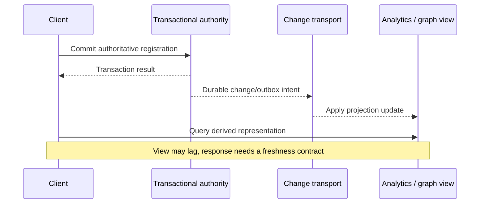

# Cross-model comparison and synchronization

**Owning question:** Which extra authority and recovery obligations appear when stores are combined?

This page belongs to [V05/C04 — Alternative data models and stores](README.md). Use the integrated walkthrough for the surrounding decision; the sections below own this narrower mechanism and its limits.

<!-- tycho-question-source:tycho.page.c75a11f9786442a5b5456f11c2412df4:6 -->
## 6. Cross-model trade-off matrix

| Model / representative engine | Strong workload fit | Central boundary and failure cost | Measure before adopting | Ledger support |
|---|---|---|---|---|
| Embedded SQL — SQLite | Local/offline transactional storage with bounded process integration | Local file/device availability; networking/sync must be built separately | Concurrent writer behavior, backup and local I/O | E01 |
| Server relational — PostgreSQL | Relational invariants, joins and mixed transactional queries | Connection/lock/index/WAL bottlenecks; replica lag and failover | Actual query plans, transactions, write/read mix, recovery | Tycho synthesis; no separate source row |
| Distributed SQL — CockroachDB | SQL with distributed placement and transactions | Distributed commit/conflict/network costs and operational topology | Hot ranges, geographic latency, failover and dialect fit | E02 |
| Transactional KV — FoundationDB | Ordered key-value transactions and flexible higher-level layers | Key design/layer implementation, conflict rate, cluster operation | Range shape, transaction size, conflicts and API translation | E03 |
| Document — MongoDB | Variable-shape bounded aggregates and common co-read data | Cross-document links, growing arrays, index/consistency semantics | Embedding vs referencing, payload growth and update pattern | E04 |
| Wide-column — Cassandra | Predefined partition-based access over large distributed datasets | Hot partitions, query rigidity and replication/consistency policy | Partition sizes/skew, repairs, consistency and failure behavior | E05 |
| Columnar OLAP — ClickHouse | Aggregate scans over append-oriented high-volume data | Background merges, freshness/ingest architecture and separate authority | Query selectivity, merge cost, lag, retention and correctness | E06 |
| Graph — Neo4j | Typed multi-hop relationship queries | Graph maintenance/index/constraint and cross-store sync | Actual traversal depth/fan-out vs SQL alternatives | E07 |
| Time series — workload category | Time range/retention/downsampling and metric-oriented queries | Out-of-order input, cardinality, rollup and cold retention | Series cardinality, ingestion, query/window/retention | Tycho synthesis; no vendor claim |

Rows citing E01–E07 are bounded by the chapter's public-source ledger. The PostgreSQL and time-series rows are Tycho synthesis without a product-specific source row and must not be read as vendor capability claims. This is **architecture reasoning**, not a numerical product comparison; no benchmark scores, release prices or generic "winner" are asserted.

<!-- /tycho-question-source -->
<!-- tycho-question-source:tycho.page.c75a11f9786442a5b5456f11c2412df4:7 -->
## 7. Multiple databases create a new synchronization problem

A single authoritative registration database plus a graph/search/OLAP projection is a valid possible design—but then there are *two data representations*, not two automatically consistent sources of truth.

Text alternative: a user commits to an authoritative store. A change pipeline later updates derived views, which may temporarily return stale results. Define freshness, rebuild, deduplication, schema migration and failure recovery explicitly. See the canonical [outbox page](../../../distributed/transactional-outbox-and-idempotency.md) and [CQRS projections](../../../distributed/cqrs-event-sourcing-and-projections.md).

<!-- /tycho-question-source -->
<!-- tycho-question-source:tycho.page.c75a11f9786442a5b5456f11c2412df4:8 -->
## 8. Safe selection process and insufficient evidence

A credible selection compares:

1. Invariants, transaction scope, security/compliance and authorized deletion/retention.
2. Canonical queries and write patterns with actual request volume/distribution and peak/failure changes.
3. Data size and growth by cardinality, key, index and partition rather than total rows alone.
4. Read consistency, freshness, cross-system coordination, conflict/retry and migration obligations.
5. Operational cost: staffing, backup/restoration, topology, upgrades, support and license constraints.
6. Measured performance on comparable representative datasets, with cache/warmup, concurrent writes and failure drills.
7. A simpler single-database alternative and the evidence that could reverse the decision.

**Insufficient evidence — unanswered architecture choice:** "Our product has 5 million users and wants a fast dashboard, so should we migrate everything from PostgreSQL to Cassandra, MongoDB and ClickHouse?" **No determination is possible.** User count and the word "fast" do not establish the authority, query mix, dataset, costs, latency window, migration compatibility or consistency requirements. Start by profiling actual PostgreSQL query plans and workload; consider a single purpose-built projection only if the evidence supports it.

Pattern atlas: [Polyglot Persistence](../../v11-pattern-atlas/c06-database-storage/README.md#polyglot-persistence)
— decision conditions and contraindications.

<!-- /tycho-question-source -->

## Bounded pattern ownership notes

### Polyglot Persistence

A single authoritative registration database plus a graph/search/OLAP projection is a valid
possible design—but then there are *two data representations*, not two automatically consistent
sources of truth. Each store has its own schema, failure mode and rebuild cost. A projection view
may lag; the response needs a freshness contract, and the write owner must be named.

**Tycho's four-part invariant, not a vendor claim.** Define freshness, rebuild, deduplication,
schema migration and failure recovery explicitly. Write the serving rule down before the
projection serves traffic. The public pages support separate parts of that rule, not the whole
rule:

- **Freshness.** AWS says "The CQRS pattern typically results in eventual consistency between the
  data stores." Microsoft says that with separate stores "the read data might not show the most
  recent changes immediately. This delay results in stale data" and that "The read model is
  eventually consistent with the write model." Tycho's rule: the owner publishes a freshness
  bound and the caller-visible meaning of a stale read; "eventual" alone is not a bound.
- **Rebuild.** PostgreSQL says "When logical replication of a table typically starts, PostgreSQL
  takes a snapshot of the table's data on the publisher database and copies it to the subscriber.
  Once complete, changes on the publisher since the initial copy are sent continually to the
  subscriber." Microsoft says that with an event store as the authority "you can easily
  regenerate materialized views or adapt to changes in the read model by replaying historical
  events." Tycho's rule: rebuild reads the authority, not the projection, and records the
  position it applied.
- **Deduplication.** Debezium's outbox table exposes an event id: "You can use this ID, for
  example, to remove duplicate messages." Microsoft says to "make the read-model consumer
  idempotent to tolerate duplicate delivery." Tycho's rule: the deduplication key survives
  redelivery, and the marker and the derived write commit together.
- **Schema migration.** PostgreSQL warns "The database schema and DDL commands are not
  replicated" and "Subsequent schema changes would need to be kept in sync manually." Tycho's
  rule: projection, event and authority schemas each have a compatibility window, and an unknown
  version is rejected rather than silently coerced.

**Failure and recovery.** Tycho's rule, not a source claim. Dual-write ambiguity and partial
migration need an explicit reconciliation owner; a half-migrated projection is not a valid
serving state. The sources expose the failure mechanics:

- A database write and a broker publish do not share one transaction. Microsoft says "Because
  you usually can't enlist message brokers and databases into a single distributed transaction,
  consistency problems can occur when you update the database and publish events." It recommends
  "Use the Transactional Outbox pattern to persist the state change and event atomically".
- A logical replication conflict that raises an error stops the pipeline. PostgreSQL says "A
  conflict that produces an error will stop the replication; it must be resolved manually by the
  user." It says "The resolution can be done either by changing data or permissions on the
  subscriber so that it does not conflict with the incoming change or by skipping the
  transaction that conflicts with the existing data."
- Tycho's recovery sequence: stop serving the affected projection as current, record the last
  applied position, reconcile conflicting or missing rows against the authority, rebuild when
  the position cannot be trusted, and only then re-enable reads. A projection that is half
  migrated fails the freshness contract and is unavailable, not merely stale.

A single store with derived projections or query-time joins may be preferable when one engine
can meet the query shapes and the team cannot operate a second consistency contract. Polyglot
persistence is a fit when a specialized query engine buys measured value and the synchronization
contract is owned.

**Source boundary.** Public documentation accessed 2026-10-31; living pages, not a benchmark or
an executed multi-store test. Quotes are short excerpts. Tycho-labelled sentences are synthesis,
not source claims.

- AWS, "CQRS pattern", section "CQRS pattern": canonical text revision
  `d3bcb473e011c43db8df0e09f568a0ba7c6c05a9014c1c7ef06fdf7bf60b8258`, raw HTML
  `4e6f93053f75665a2efce9079b551847db05c6b375075c53a0be5127bd5382e9`; retained record
  `read.aws-cqrs.2026-10-30`.
- Microsoft, "CQRS pattern", sections "Separate models in different data stores", "Problems and
  considerations" and "Benefits of combining the Event Sourcing and CQRS patterns": canonical
  text revision
  `469253bc1c554fc0697cff4f1bbdbcbf851bb40840d39579850c92e03d7f591f`; retained record
  `read.microsoft-cqrs.2026-10-30`.
- Debezium, "Outbox Event Router", section "Basic outbox table": canonical text revision
  `26c1b278b6e7bd2a85787fa38064b0e9651836ca1bf1e7830df46781d9b6872e`, raw HTML
  `382f0bd0cd99f5c8206f9ba0381f3ec71f12ffe373154d351baa8823fd11ad53`; proposed record
  `read.debezium-outbox.2026-10-31`.
- PostgreSQL, "Logical Replication", chapter 29: canonical text revision
  `2f803799559f1397ed6f6af2aa2fb3d04b678418e3ef5c7b901438d2062c4c1d`, raw HTML
  `588d7a5bfa50fafada6e3bda0cfb39e979e924af84fee4bdcf40944a47ebc42f`; proposed record
  `read.postgresql-logical-replication.2026-10-31`.
- PostgreSQL, "29.7. Conflicts": canonical text revision
  `14702e9d7f4291babb23509b3193a7e3720618e2c1de01f674f858e60478c4d3`, raw HTML
  `03928cc562272d536f3067a145e2e668f123a0ccb28ff205bf799315223c4a59`; proposed record
  `read.postgresql-logical-replication-conflicts.2026-10-31`.
- PostgreSQL, "29.8. Restrictions": canonical text revision
  `85de74cc6d352a20becc5282482c542367c143d18d66cb9612db2287244a179a`, raw HTML
  `ebcbea9f2af8d99e9df1c0a981fe031177fb90a522b92745b1d1549d8687243c`; proposed record
  `read.postgresql-logical-replication-restrictions.2026-10-31`.

Tycho's rule: the projection is not authority. A stale read is a derived read with a published
bound; a missing, conflicting or half-applied row is a failure state with an owner.

## Navigation, prerequisites and source scope

| Route | Destination |
|---|---|
| Parent and source ledger | [Chapter introduction and exact source rows](README.md#chapter-source-ledger) |
| Previous / prerequisite | [Read preceding context](specialized-models.md) |
| Next | [Continue the reasoning](README.md) |
| Integrated question | [Original scenario and limits](storage-model-alternatives-and-workload-fit.md) |

The source material keeps its original published/inferred/synthetic/unverified distinctions. Chapter-wide citations are shared reference context, not proof that every cited source supports every sentence on this page. Freshly inspected text is identified explicitly; absent dates and unknowns are retained.
