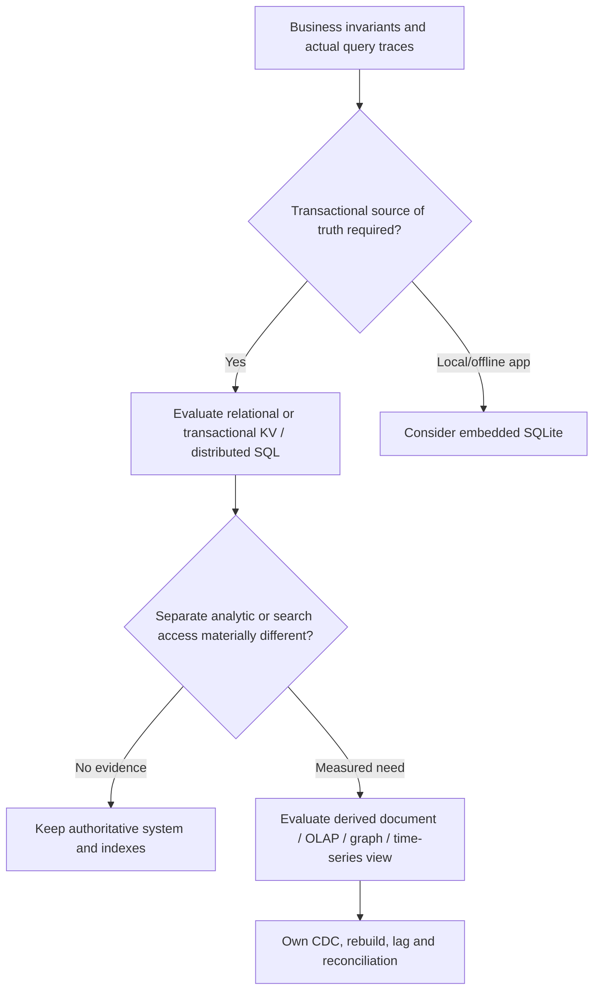
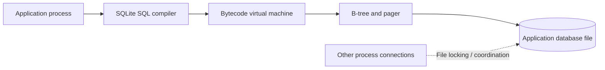
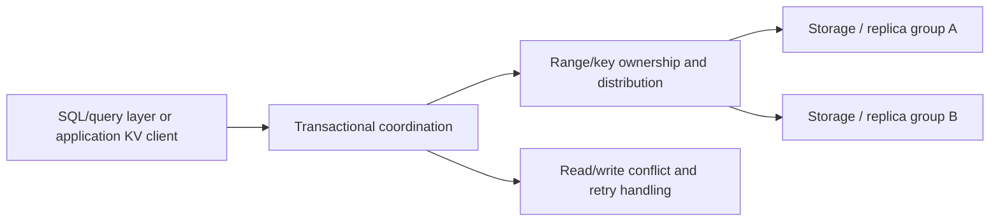

# Relational, embedded and transactional key-value models

**Owning question:** Which transaction and locality requirements distinguish these storage choices?

This page belongs to [V05/C04 — Alternative data models and stores](README.md). Use the integrated walkthrough for the surrounding decision; the sections below own this narrower mechanism and its limits.

<!-- tycho-question-source:tycho.page.c75a11f9786442a5b5456f11c2412df4:1 -->
## 1. Start from the workload and invariant, not a database brand

Imagine a fictional workshop service with three distinct needs:

- **Authoritative registration:** concurrency-safe confirmed seat allocation and recoverable request identity.
- **Event/usage analytics:** summarize attendance and request metrics over periods, perhaps over billions of mostly append-only observations.
- **Explore relationships:** traverse instructors, topics, workshops and prerequisites to find multi-hop recommendations.

These are three **query/invariant shapes**, not proof that three different databases are necessary. A single relational store may initially handle all of them. Before adding specialized engines measure data volume, retention, selectivity, ingest rate, aggregation and traversal costs, write/update mix and operational cost.

Text alternative: start from business constraints. Preserve authoritative transaction semantics and choose simple storage first; if real query demand warrants specialized projections, explicitly budget synchronization and recovery rather than silently treating another database as the same authority.

<!-- /tycho-question-source -->
<!-- tycho-question-source:tycho.page.c75a11f9786442a5b5456f11c2412df4:2 -->
## 2. Transactional relational and embedded storage

**PostgreSQL 17** provides a server-managed relational engine with versioned concurrency, SQL planner, diverse indexes, WAL and logical/physical replication. These mechanisms are explained separately in [MVCC/query planning](../../../data/postgresql-mvcc-indexes-and-query-plans.md) and [WAL/replication](../c02-postgresql-mvcc-wal-and-recovery/postgresql-wal-replication-and-recovery.md).

**SQLite** is a library embedded in the hosting process rather than an independent client/server database service. Its official *Architecture of SQLite* document describes SQL text compiled to bytecode and executed in a virtual machine; B-tree storage, page cache/pager, file locking and optional WAL are core subsystems. [E01]

Text alternative: an application's local SQLite library compiles a query into VM instructions that access on-disk B-trees via a pager. Concurrent file access must obey SQLite's locking/journaling model. This is a **conceptual** design, not a benchmark.

SQLite can be appropriate for mobile/edge/offline apps, local configuration or single-node embedded transactional storage. It is not by itself a networked multi-region service with independently scalable write nodes; adding such a system would require a **separate synchronization/conflict protocol**. It is also incorrect to say embedded means "not ACID": actual guarantees depend on filesystem, transaction and journaling settings.

<!-- /tycho-question-source -->
<!-- tycho-question-source:tycho.page.c75a11f9786442a5b5456f11c2412df4:3 -->
## 3. Distributed SQL and transactional key-value

**CockroachDB v24.3**, official architecture overview, describes SQL, transaction, distribution, replication and storage layers. This decomposition is intended to run transactional SQL workloads across distributed key ranges and replicas, at the cost of distributed coordination and more complex placement/recovery than a single server. [E02]

**FoundationDB 8.0**, official architecture, describes an ordered **transactional key-value** model with separately assigned cluster roles and optional application layers that implement higher-level data models. Its core API is not simply "any SQL query" without a layer. [E03]

Text alternative: applications interact with an SQL translation layer or transactional KV API, while coordination places data across storage owners. Network/quorum/conflict behavior becomes part of transaction latency and recovery. This is a **generic synthetic architecture**, not an assertion that CockroachDB and FoundationDB share identical internal protocols.

Do not assume SQL dialect equivalence, single-region latency, unbounded horizontal scaling or zero-conflict writes. Compare serializability/isolation at the declared API, hot-range distribution, network round trips, failover and cost under a representative transaction mix.

<!-- /tycho-question-source -->

## Navigation, prerequisites and source scope

| Route | Destination |
|---|---|
| Parent and source ledger | [Chapter introduction and exact source rows](README.md#chapter-source-ledger) |
| Previous / prerequisite | [Read preceding context](storage-model-alternatives-and-workload-fit.md) |
| Next | [Continue the reasoning](specialized-models.md) |
| Integrated question | [Original scenario and limits](storage-model-alternatives-and-workload-fit.md) |

The source material keeps its original published/inferred/synthetic/unverified distinctions. Chapter-wide citations are shared reference context, not proof that every cited source supports every sentence on this page. Freshly inspected text is identified explicitly; absent dates and unknowns are retained.
